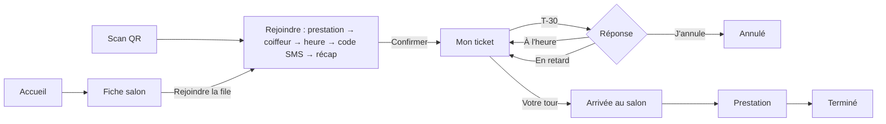
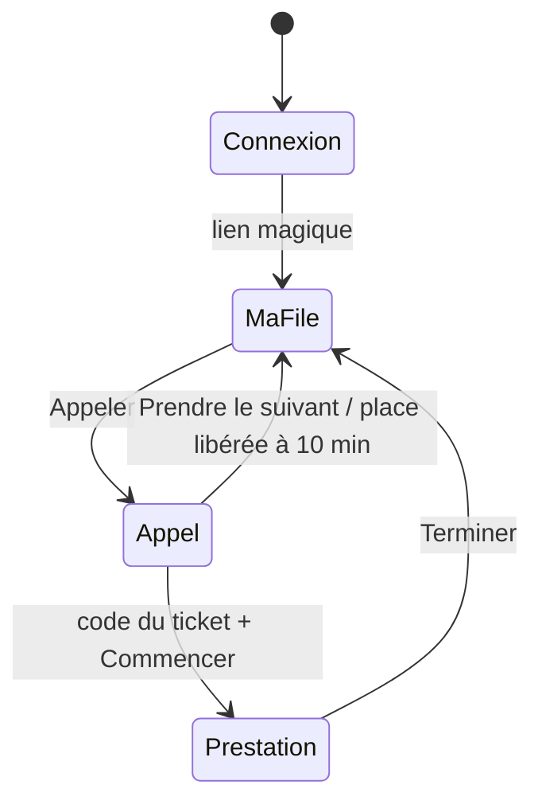

# APP FLOW — Zelaté

> version 0.2 · 16/10/2026 · statut : mis à jour avec les décisions de l'atelier du 16/10 (PRD §11)
> Documents liés : [PRD](./PRD.md) · [TRD](./TRD.md) · [DESIGN_SYSTEM](./DESIGN_SYSTEM.md) · [BACKEND_SCHEMA](./BACKEND_SCHEMA.md) · [IMPLEMENTATION_PLAN](./IMPLEMENTATION_PLAN.md)

Ce document décrit **chaque écran, chaque route et l'effet de chaque clic**, rôle par rôle. Un écran ou un bouton absent d'ici n'existe pas au MVP. Les commandes citées (`join_queue`, `call_ticket`…) sont celles de [TRD §6.2](./TRD.md#62-commandes-de-queue-command) ; les textes affichés viennent du dictionnaire, les libellés ci-dessous sont indicatifs.

**Conventions des tableaux** : *Élément* = ce que l'utilisateur touche ; *Action* = ce qui se passe ; *Ensuite* = écran ou état obtenu. Toute commande serveur affiche un état de chargement sur le bouton, désactive le bouton pendant l'envoi (anti double clic) et gère l'erreur par un message du dictionnaire `errors`.

---

## 1. Espaces, applications et accès

| App | URL (hypothèse) | Espace | Qui | Connexion |
| --- | --- | --- | --- | --- |
| Zelaté | `zelate.fr` | Client | Tout le monde | Aucune pour consulter ; code SMS pour rejoindre une file |
| Zelaté Pro | `pro.zelate.fr` | `/dashboard` | Gérant | E-mail + mot de passe ou lien magique |
| Zelaté Pro | `pro.zelate.fr` | `/stylist` | Coiffeurs, sur leur propre téléphone (lot 1) | Compte personnel, lien magique par e-mail ; tablette partagée + PIN au lot 2 |
| Zelaté Pro | `pro.zelate.fr` | `/admin` | Équipe plateforme | E-mail + mot de passe + MFA |

Les chemins d'URL sont en anglais (ce sont des noms de code) ; les titres de page sont en français.

---

## 2. Plan des routes

### 2.1 App client

| Route | Écran | Accès | Arrive depuis |
| --- | --- | --- | --- |
| `/` | Accueil : recherche, liste + carte | Public | Ouverture de l'app |
| `/salons/:slug` | Fiche salon (panneau sur mobile, page sur ordinateur) | Public | Carte ou liste, lien partagé |
| `/salons/:slug/join` | Rejoindre la file (étapes) | Public, code SMS à l'étape 4 | Fiche salon, QR |
| `/q/:qrToken` | Entrée par QR (redirection) | Public | Scan du QR du salon |
| `/signin` | Identification par code SMS | Public | Étape 4 de la file, menu |
| `/ticket` | Mon ticket actif et suivi | Client connecté | Après création, notification, menu |
| `/t/:trackingToken` | Suivi par lien SMS | Détenteur du lien | SMS |
| `/install` | Guide d'installation et notifications | Public | Proposition après le premier ticket |
| `/account` | Compte : prénom, consentements, export, suppression, déconnexion | Client connecté | Menu |
| `/legal/:page` | CGU, confidentialité, mentions | Public | Pied de page |

### 2.2 App Pro

| Route | Écran | Accès |
| --- | --- | --- |
| `/signin` | Connexion gérant ou admin | Public |
| `/signup` | Inscription du salon (étapes) | Public |
| `/signup/pending` | Dossier en cours de validation | Gérant |
| `/invite/:token` | Activation du compte d'un coiffeur | Détenteur du lien |
| `/dashboard` | Vue temps réel de la file et de l'équipe | Gérant (salon validé) |
| `/dashboard/setup` | Wizard de configuration (horaires, équipe, prestations, QR de l'affiche, test) | Gérant |
| `/dashboard/team` | Équipe et invitations | Gérant |
| `/dashboard/services` | Prestations | Gérant |
| `/dashboard/hours` | Horaires et fermetures | Gérant |
| `/dashboard/salon` | Infos du salon, photos, QR de l'affiche, délais | Gérant |
| `/dashboard/audit` | Journal du salon | Gérant |
| `/dashboard/summary` | Récapitulatif du jour | Gérant |
| `/stylist/queue` | Ma file, appel en cours et prestation en cours | Coiffeur connecté (et gérant qui coiffe) |
| `/stylist/summary` | Mon bilan du jour | Coiffeur connecté |
| `/admin/salons` | Dossiers de validation | Admin |
| `/admin/salons/:id` | Détail d'un dossier | Admin |
| `/admin/audit` | Journal global | Admin |

### 2.3 Gardes de navigation

| Situation | Redirection |
| --- | --- |
| Client non connecté sur `/ticket` | `/signin?next=/ticket` |
| Client avec un ticket actif sur `/salons/:slug/join` | `/ticket` avec message « Vous avez déjà une place » |
| Gérant dont le salon est en brouillon | `/signup` à l'étape enregistrée |
| Gérant dont le salon attend la validation | `/signup/pending` (le wizard reste accessible) |
| Gérant dont le salon est validé mais non publié | `/dashboard/setup` |
| Coiffeur non connecté sur `/stylist` | `/signin?next=/stylist/queue` |
| Coiffeur désactivé | `/signin` avec le message « Votre accès a été retiré, contactez votre gérant » |
| Sessions coupées par le gérant (téléphone perdu ou changé) | `/signin` avec le message « Vous avez été déconnecté, reconnectez-vous avec votre e-mail » |
| Utilisateur sans droit admin sur `/admin` | `/signin` |

---

## 3. Parcours client

### F-C1 · Découvrir les salons (`/`) — U-01

| Élément | Action | Ensuite |
| --- | --- | --- |
| Ouverture de l'écran | Demande la géolocalisation (une fois, avec explication avant la demande système) ; appelle `search_salons` sur 5 km | Liste triée par distance |
| Géolocalisation refusée | Affiche le champ « Adresse ou ville » | Recherche par adresse |
| Champ « Adresse ou ville » | Autocomplétion par la Géoplateforme après 3 caractères | Choix d'une suggestion → nouvelle recherche |
| Onglet « Liste » / « Carte » | Bascule l'affichage ; la carte se charge à la première ouverture | Même résultats |
| Filtre « Ouvert maintenant » (activé par défaut) | Masque les files fermées ou en pause | Liste filtrée |
| Carte de salon (liste) ou repère (carte) | Ouvre la fiche | F-C2 |
| Badge d'attente | Affiche « ~25 min » et « mis à jour il y a 2 min » ; « à vérifier » au-delà de 5 min | — |
| Bouton « Me localiser » (carte) | Recentre la carte | — |
| Aucun résultat | Message et bouton « Élargir à 10 km » | Nouvelle recherche |
| Bandeau « Ma place » (si ticket actif) | Ouvre le ticket | F-C5 |

### F-C2 · Fiche salon (`/salons/:slug`) — U-02

| Élément | Action | Ensuite |
| --- | --- | --- |
| Photos | Galerie défilante, plein écran au clic, fermeture par Échap ou « Fermer » | — |
| Attente actuelle | Personnes avant vous, heure de passage estimée, fraîcheur | — |
| Horaires | Déplie la semaine | — |
| Prestations | Liste nom, durée, prix | — |
| Coiffeurs | Prénom, photo, spécialités, « disponible » ou « en prestation » | — |
| Bouton « Itinéraire » | Ouvre l'app de cartes de l'appareil (lien `geo:` ou Apple Plans) | App externe |
| Bouton « Rejoindre la file » | Ouvre l'étape 1 | F-C3 |
| File fermée | Bouton désactivé « Fermé · ouvre demain à 9h00 » | — |
| File en pause | Bouton désactivé « File en pause, réessayez dans quelques minutes » | — |
| File complète | Bouton désactivé « Complet pour aujourd'hui » et lien « Salons proches » | F-C1 |
| Fermer le panneau (mobile) | Glisser vers le bas ou bouton « Fermer » | F-C1 |

### F-C3 · Rejoindre la file (`/salons/:slug/join`) — U-03, U-04

Étapes avec indicateur de progression (1/5…). Retour arrière possible à chaque étape sans perte des choix.

| Étape | Élément | Action | Ensuite |
| --- | --- | --- | --- |
| 1 · Prestation | Une prestation dans la liste | Sélectionne ; « Suivant » s'active | Étape 2 |
| | « Je ne sais pas encore » | Sélectionne (durée de calcul : 30 min) | Étape 2 |
| 2 · Coiffeur | « Premier disponible » (présélectionné) | Sélectionne | Étape 3 |
| | Un coiffeur | Sélectionne ; si absent ce jour-là : message et retour au « premier disponible » | Étape 3 |
| | Chaque option | Affiche l'heure de passage estimée correspondante | — |
| 3 · Heure d'arrivée | « Dès que possible » (présélectionné) | Sélectionne | Étape 4 |
| | « J'arrive vers… » + sélecteur par pas de 5 min | Choisit une heure dans la journée d'ouverture | Étape 4 |
| 4 · Identification (si non connecté) | Champ téléphone (+33 fixé) | Valide le format à la saisie | — |
| | « Recevoir le code » | Envoie le code (`signInWithOtp`) ; minuteur de renvoi 30 s | Champ code |
| | Champ code (6 cases, collage accepté, remplissage auto SMS) | Valide à la 6e saisie | Étape 5 |
| | « Renvoyer le code » (après 30 s) | Renvoie ; au 3e échec : attendre 5 min | — |
| | Champ prénom (si premier passage) | Obligatoire, 30 caractères max | — |
| 5 · Récapitulatif | Résumé : salon, prestation, coiffeur, heure estimée, règle d'appel (« une fois appelé, vous avez 10 min pour arriver ; rappel à 5 min ») | — | — |
| | Case « Me prévenir quand mon tour approche » (cochée, explication) | Consentement aux notifications de suivi | — |
| | « Confirmer ma place » | `join_queue` | F-C5 + proposition d'installation (F-C9) |
| Erreurs | `already_has_active_ticket` | Message + bouton « Voir ma place » | F-C5 |
| | `queue_closed` ou `queue_full` | Message + « Salons proches » | F-C1 |

### F-C4 · Entrée par QR (`/q/:qrToken`) — U-05

| Élément | Action | Ensuite |
| --- | --- | --- |
| Scan du QR affiché au salon | Ouvre le navigateur ; résout le jeton vers le salon ; canal `qr` | F-C3 étape 1, en-tête « Vous êtes chez *Salon* » |
| Jeton régénéré ou inconnu | Message « Ce QR code n'est plus valide, demandez à l'accueil » | — |

Le parcours est identique à F-C3, dans le navigateur, sans installation. Le SMS de création contient le lien de suivi.

### F-C5 · Suivre mon ticket (`/ticket`) — U-06, U-10

| Élément | Action | Ensuite |
| --- | --- | --- |
| Carte ticket | Code (#AF2K9) en grand, à donner au coiffeur ; position, heure de passage, coiffeur demandé ou « premier disponible », « mis à jour à 14h32 » | — |
| Mise à jour | Temps réel page ouverte ; sinon toutes les 30 s et au retour sur l'app | — |
| Message de changement | Si l'heure bouge de 10 min ou plus ou si la position recule : bandeau avec la raison | — |
| « Itinéraire » | Ouvre l'app de cartes | App externe |
| « Je serai en retard » | Ouvre le choix 5 à 30 min (même effet que F-C6 « En retard ») | F-C6 |
| « Annuler ma place » | F-C8 | — |
| Bandeau « Votre coiffeur n'est plus disponible » (coiffeur demandé absent ou en retard) | Deux boutons : « Attendre *Prénom* » (nouvelle heure affichée) ou « Premier disponible » (heure affichée) → `resolve_stylist_change` | F-C5 avec la nouvelle heure |
| Bandeau « Risque de fin de journée » (U-11) | « Vous risquez de ne pas être pris avant la fermeture » ; « Je reste » ou « J'annule » → `respond_end_of_day` | F-C5, ou écran de fin |
| Statut « Appelé » | Écran plein « C'est votre tour ! » avec prénom du coiffeur, adresse, code du ticket en grand et compteur de 10 min | F-C7 |
| Statut « Terminé », « Annulé », « Absent » | Écran de fin avec la raison et « Rejoindre une autre file » | F-C1 |
| Bandeau hors ligne | « Connexion perdue, dernière mise à jour à … » | — |

### F-C6 · Répondre à « votre tour approche » — U-07

Déclenché à T-30 min par notification push (trois actions) ou à l'ouverture du ticket (bandeau).

| Élément | Action | Ensuite |
| --- | --- | --- |
| « Je serai à l'heure » | `respond_eta` (`on_time`) ; visible dans l'espace coiffeur | F-C5 |
| « En retard de… » (5, 10, 15, 20, 30 min) | `respond_eta` (`late`, délai) ; recul de 2 places au plus si nécessaire, raison affichée | F-C5 avec nouvelle heure |
| « J'annule » | Confirmation puis `respond_eta` (`cancel`) | Fin |
| Sans réponse | Aucun effet ; le ticket reste en place | — |

### F-C7 · Arrivée au salon

| Élément | Action | Ensuite |
| --- | --- | --- |
| Code du ticket (affiché en grand) | Le client le donne au coiffeur, qui le saisit | Arrivée horodatée, écran « Installez-vous » |
| 5 min après l'appel sans arrivée | Notification « Le salon vous attend, place libérée dans 5 min » | — |
| 10 min après l'appel sans arrivée | Place libérée ; proposition de se réinscrire | Écran de fin |

### F-C8 · Annuler (`/ticket` ou `/t/:token`) — U-08

| Élément | Action | Ensuite |
| --- | --- | --- |
| « Annuler ma place » | Boîte de confirmation « Votre place sera donnée au suivant » | — |
| « Oui, annuler » | `cancel_ticket` | Écran de fin, « Rejoindre une autre file » |
| « Garder ma place » | Ferme la boîte | F-C5 |

### F-C9 · Installer l'app et activer les notifications (`/install`) — U-09

| Élément | Action | Ensuite |
| --- | --- | --- |
| Proposition après le premier ticket | Carte « Installez Zelaté pour être prévenu sans SMS » | — |
| « Installer » (Android, ordinateur) | Déclenche l'invite d'installation du navigateur | App installée |
| « Comment faire » (iPhone) | Guide en 3 images : Partager → Sur l'écran d'accueil → Ouvrir | — |
| « Activer les notifications » (app installée) | Demande système ; si accepté : `push-subscribe` | Push actif, le SMS n'est plus envoyé sauf « votre tour » |
| « Plus tard » | Ferme ; reproposé au ticket suivant au plus tôt | — |

### F-C10 · Suivi par lien SMS (`/t/:trackingToken`)

Même affichage que F-C5, sans session ; rafraîchissement toutes les 30 s. Actions possibles : répondre à T-30, signaler un retard, choisir « attendre » ou « premier disponible », répondre à l'alerte de fin de journée, annuler, activer le push (lié au ticket). Lien « Créer mon compte » qui ouvre `/signin` avec le numéro à confirmer. Jeton inconnu ou ticket de plus de 24 h : « Ce lien a expiré ».

### F-C11 · Compte (`/account`)

| Élément | Action |
| --- | --- |
| Prénom | Modifiable |
| Consentements | Interrupteur « Notifications de suivi » ; date du consentement affichée |
| « Télécharger mes données » | Fichier JSON des tickets et consentements |
| « Supprimer mon compte » | Confirmation en deux temps ; compte supprimé, tickets anonymisés |
| « Se déconnecter » | Fin de session, retour à l'accueil |

---

## 4. Parcours coiffeur (espace coiffeur, sur son téléphone)

Au lot 1, chaque coiffeur utilise Zelaté Pro sur **son propre téléphone**, avec son compte. L'écran est pensé pour un téléphone posé au poste : une colonne, le prochain client en haut, les actions dans une barre en bas, à portée de pouce. Rien du client n'est conservé sur le téléphone ([TRD, ADR-007](./TRD.md#5-décisions-darchitecture-adr)). Les tablettes partagées arrivent au lot 2.

### F-S1 · Activer son compte (`/invite/:token`) — C-01

| Élément | Action | Ensuite |
| --- | --- | --- |
| Lien de l'e-mail d'invitation | Ouvre la page ; lien à usage unique, 72 h | — |
| Lien expiré ou utilisé | Message « Demandez une nouvelle invitation à votre gérant » | — |
| « Activer mon compte » | `activate-invitation` ; e-mail de connexion envoyé | « Ouvrez le lien reçu sur votre téléphone » |
| Lien de connexion ouvert sur le téléphone | Session de 30 jours ; proposition d'installer Zelaté Pro (guide iPhone comme F-C9) | F-S4 |

### F-S2 · Se connecter (`/signin` de l'app Pro)

| Élément | Action | Ensuite |
| --- | --- | --- |
| Champ e-mail + « Recevoir mon lien » | Envoie le lien magique | — |
| Lien ouvert | Session de 30 jours | F-S4 |
| Compte désactivé | « Votre accès a été retiré, contactez votre gérant » | — |
| Sessions coupées par le gérant | « Vous avez été déconnecté, reconnectez-vous avec votre e-mail » | F-S2 |
| « Se déconnecter » (menu) | Fin de session | F-S2 |

### F-S3 · Mon statut — C-02

Barre de statut toujours visible en haut de `/stylist/queue`.

| Élément | Action | Ensuite |
| --- | --- | --- |
| « Je suis prêt » | `set_presence` (`available`) | Reçoit des clients |
| « Pause » | Choix : repas, courte, imprévu + durée (5, 10, 15, 30, 45, 60 min) → `set_presence` (`on_break`) | Compte à rebours ; clients notifiés si leur heure bouge de 10 min ou plus |
| « Reprendre » (en pause) | `set_presence` (`available`) | — |
| « Fin de journée » | Heure de fin (maintenant ou plus tard) → confirmation listant les clients concernés | Clients sans préférence redistribués ; ceux qui le demandaient choisissent (U-12) |

### F-S4 · Ma file (`/stylist/queue`) — C-03

| Élément | Action | Ensuite |
| --- | --- | --- |
| Carte « Prochain client » (en haut) | Premier ticket éligible pour moi (il me demande, ou il est sans préférence et je maîtrise la prestation) : prénom, prestation, durée, statut d'approche (confirmé à T-30, en retard de X min, sans réponse, arrivé), réponse T-30, mention « vous a demandé » | — |
| « Appeler » (barre du bas, actif si je suis disponible et qu'un ticket est éligible) | `call_ticket` : le serveur appelle le premier ticket éligible ; refuse un second appel en cours | F-S5 |
| Liste « Ensuite » | Mes prochains clients estimés, lecture seule (pas de glisser-déposer) | — |
| Bandeau rouge « Connexion perdue » | Toutes les actions désactivées, reconnexion automatique | — |
| Aucun ticket | « Aucun client pour l'instant » | — |

### F-S5 · Appel et arrivée — C-04, C-05

| Élément | Action | Ensuite |
| --- | --- | --- |
| Carte « Appel en cours » | Prénom, compteur de 10 min (« rappel envoyé » à 5 min), retard déclaré éventuel | — |
| « Saisir le code » | Pavé de 5 caractères pour le code que le client donne → `confirm_arrival` | « Arrivé » |
| Code inconnu, d'un autre salon ou d'un ticket clos | Message clair, aucun changement | — |
| « Commencer » (actif quand le client est arrivé) | F-S6 | — |

### F-S6 · Commencer — C-06

| Élément | Action | Ensuite |
| --- | --- | --- |
| Feuille « Commencer la prestation » | Prestation pré-remplie (modifiable), durée prédéfinie de la prestation (modifiable par pas de 5 min) | — |
| « Commencer » | `start_service` | F-S7 |

### F-S7 · Prestation en cours — C-07, C-08

| Élément | Action | Ensuite |
| --- | --- | --- |
| Carte « En cours » | Prénom, prestation, temps écoulé / prévu, fin estimée | — |
| « +5 », « +15 », « +30 », « +45 » | `adjust_duration` | Fin estimée mise à jour ; clients notifiés au-delà de 10 min d'écart |
| « Terminer » (appui long 600 ms, ou appui + confirmation) | `complete_service` | F-S4, prochain client en haut |

Une prestation plus courte que prévu se termine simplement par « Terminer ».

### F-S8 · Client appelé qui n'arrive pas — C-09

| Élément | Action | Ensuite |
| --- | --- | --- |
| Compteur à 5 min | Rappel envoyé au client (notification) | — |
| « Prendre le suivant » (si le client a déclaré un retard) | Confirmation « *Prénom* passera après *n* clients (2 maximum) » → `take_next` | Le suivant est appelé |
| Attendre | Aucune action ; le compteur continue | — |
| Compteur à 10 min sans arrivée | Place libérée automatiquement, bandeau d'information | F-S4 |

### F-S9 · Mon bilan du jour (`/stylist/summary`) — C-10

Clients servis, durée moyenne par prestation, écart prévu / réel. Bouton « Retour à ma file ». Ouvert automatiquement après « Fin de journée ».

### Gérant qui coiffe

Avec « Je coiffe » activé, le gérant utilise le même espace coiffeur (sur son téléphone ou depuis le dashboard). Coupé, il ne reçoit plus de clients ; le dashboard lui propose « Je prends le prochain » (F-M6).

---

## 5. Parcours gérant (dashboard)

### F-M1 · Inscription du salon (`/signup`) — S-01, S-02

Brouillon enregistré à chaque champ ; reprise possible pendant 7 jours via l'e-mail.

| Étape | Élément | Action | Ensuite |
| --- | --- | --- | --- |
| 1 · Compte | E-mail, mot de passe, prénom, nom | Crée le compte gérant ; e-mail de confirmation | Étape 2 |
| 2 · Salon | Nom, téléphone public du salon | — | — |
| | Adresse | Autocomplétion Géoplateforme ; position enregistrée | — |
| | SIRET (14 chiffres) | Vérification à la sortie du champ (`verify-siret`) : ✓ actif et NAF 96.02A/B ; ⚠ « à vérifier » sinon | Étape 3 |
| 3 · Vous et la coiffure | Interrupteur « Je coiffe aussi » (modifiable à tout moment depuis le dashboard) | Enregistre `is_hairdressing` | Étape 4 |
| 4 · Envoi | Récapitulatif + « Envoyer mon dossier » | `salon-signup` | `/signup/pending` |

### F-M2 · Configuration (`/dashboard/setup`) — S-03 à S-06

Accessible dès l'envoi du dossier. Liste de contrôle avec progression.

| Étape | Élément | Action |
| --- | --- | --- |
| Horaires | Plages par jour, « Ajouter une plage », « Copier sur la semaine », fermetures exceptionnelles (du, au, motif) | Enregistre ; refuse ouverture après fermeture ; au moins un jour ouvert |
| Équipe | « Ajouter un coiffeur » : prénom, nom, e-mail, spécialités → `invite-member` | Invitation envoyée ; statut « invité » puis « actif » ; 20 maximum |
| Prestations | Suggestions pré-remplies (cocher, ajuster), « Ajouter » : nom, durée (15-180), prix, spécialité | Au moins une active |
| QR code | « Télécharger le PDF A4 », « Régénérer » (confirmation : l'ancien QR cesse de fonctionner) | PDF téléchargé |
| Téléphones de l'équipe | Rappel : chaque coiffeur active son compte depuis son invitation et installe Zelaté Pro sur son téléphone | — |
| Test | F-M3 | — |

### F-M3 · Tester et publier — S-07

| Élément | Action | Ensuite |
| --- | --- | --- |
| « Lancer un test » | `create_test_ticket` : un client fictif « Test » apparaît sur le dashboard et dans l'espace coiffeur | Le gérant ou un coiffeur appelle, saisit le code, commence, termine |
| Test terminé | Case « Test réussi » cochée automatiquement | — |
| « Publier mon salon » (actif si dossier validé, test réussi, horaires, 1 coiffeur actif, 1 prestation) | Statut `published` | Visible des clients ; `/dashboard` |

### F-M4 · Déconnecter ou désactiver un coiffeur (`/dashboard/team`) — S-16

| Élément | Action | Ensuite |
| --- | --- | --- |
| Menu du coiffeur : « Déconnecter ses appareils » (téléphone perdu ou changé) | Confirmation → `revoke-member-sessions` | Toutes ses sessions coupées ; il se reconnecte par lien magique |
| Menu du coiffeur : « Désactiver » (départ du salon) | Confirmation → statut `deactivated` et sessions coupées | Accès retiré ; les clients qui le demandaient choisissent (U-12) |

Tablettes partagées : au lot 2 (appairage par code et PIN, annexe A du TRD).

### F-M5 · Ouvrir, mettre en pause, fermer — S-08

Commutateur à trois états en haut du dashboard.

| Élément | Action | Ensuite |
| --- | --- | --- |
| « Ouvrir » | `set_queue_status` (`open`) | Visible côté client en < 2 s |
| « Pause » | `set_queue_status` (`paused`) | Aucun nouveau ticket ; les inscrits restent |
| « Fermer » | Confirmation « Les *n* clients en attente seront servis jusqu'à la fin de journée » → `set_queue_status` (`closed`) | Aucun nouveau ticket |

### F-M6 · Vue temps réel (`/dashboard`) — S-09

| Zone | Contenu | Clic |
| --- | --- | --- |
| En-tête | État de la file, nombre en attente, attente moyenne, indicateur « synchronisé » | — |
| Colonnes coiffeurs | Statut, client en cours, fin estimée, tickets assignés (prénom, prestation, heure) | Clic sur un coiffeur : F-M8 |
| Liste globale | Tous les tickets actifs, ordre, coiffeur, statut d'approche | Clic sur un ticket : panneau détail (F-M9, F-M10) |
| « + Client à l'accueil » (bouton principal, raccourci clavier `N`) | F-M7 | — |
| Interrupteur « Je coiffe » (en-tête) | `set_hairdressing` | Le gérant reçoit des clients, ou n'en reçoit plus |
| « Je prends le prochain » (si « Je coiffe » est coupé) | `call_ticket` au nom du gérant | Appel en cours, comme F-S5 |

Jamais de numéro de téléphone affiché.

### F-M7 · Inscrire un client à l'accueil — S-10

| Élément | Action | Ensuite |
| --- | --- | --- |
| Boîte « Client à l'accueil » | Prénom (focus auto), téléphone, prestation (facultatif), coiffeur (facultatif, « premier disponible » par défaut) | — |
| « Inscrire » (Entrée) | `register_walk_in` | Ticket ajouté ; SMS au client avec lien de suivi ; numéro masqué dès l'enregistrement |
| Numéro avec ticket actif | Message `already_has_active_ticket` | — |

### F-M8 · Déclarer l'absence ou le retard d'un coiffeur — S-11

| Élément | Action | Ensuite |
| --- | --- | --- |
| Menu du coiffeur : « Absent », « En retard », « Part plus tôt », « Pause » | Formulaire (heure prévue, heure de fin, motif) | — |
| Aperçu de l'impact | Liste des tickets touchés : réassignés automatiquement (sans préférence) ou à confirmer par le client (avec préférence) | — |
| « Confirmer » | `set_presence` | Clients notifiés ; ceux avec préférence choisissent « attendre » ou « premier disponible » |

### F-M9 · Retirer un ticket — S-12

| Élément | Action | Ensuite |
| --- | --- | --- |
| Panneau ticket : « Retirer de la file » | Motif obligatoire dans une liste + précision facultative | — |
| « Retirer » | `remove_ticket` | Client prévenu avec le motif ; journalisé |

### F-M10 · Réaffecter un ticket — S-13

| Élément | Action | Ensuite |
| --- | --- | --- |
| Panneau ticket : « Changer de coiffeur » | Liste des coiffeurs avec la nouvelle heure estimée | — |
| Choix sans recul | `reassign_ticket` | Client notifié si ±10 min |
| Choix avec recul | Message « L'heure du client reculerait de X min : demandez-lui son accord » + case « Le client est d'accord » | `reassign_ticket` avec `client_agreed` |

### F-M11 · Pages de configuration et journal

`/dashboard/team`, `/dashboard/services`, `/dashboard/hours`, `/dashboard/salon` reprennent les formulaires du wizard. `/dashboard/salon` affiche les délais (rappel à 5 min, libération à 10 min, alerte de fin de journée 2 h avant la fermeture), réglables après le pilote, et le message d'accueil. `/dashboard/audit` liste les actions (qui, quand, quoi, motif) avec filtres par date, coiffeur et type. `/dashboard/summary` (S-14) : clients servis, attente annoncée et réelle, absences, annulations.

### F-M12 · Fin de journée — S-15

| Élément | Action | Ensuite |
| --- | --- | --- |
| Bandeau « Fin de journée » (à partir de 2 h avant la fermeture) | Liste des clients à risque et de leur réponse (reste, annule, sans réponse) | — |
| « Fermer la file maintenant » | `set_queue_status` (`closed`) | Plus de nouveaux clients ; les inscrits restent |
| À l'heure de fermeture : boîte « *n* clients attendent encore » | Pour chacun, ou « Tous » : « Servir » ou « Annuler avec excuses » → `resolve_closing` | Servis : restent dans la file ; annulés : message d'excuse et salons proches |
| Sans action du gérant | Annulation automatique 15 min après la fermeture | Clients prévenus avec excuses |

---

## 6. Parcours admin

### F-A1 · Valider un salon (`/admin/salons`) — P-01

| Élément | Action | Ensuite |
| --- | --- | --- |
| Liste des dossiers (filtre « à traiter ») | Nom, ville, date, résultat SIRET (✓, ⚠, ✗) | Clic : détail |
| Détail | Données saisies, résultat Recherche d'entreprises, carte | — |
| « Valider » | `admin-decide-salon` (`approved`) | E-mail au gérant |
| « Refuser » | Motif obligatoire → `admin-decide-salon` (`rejected`) | E-mail avec motif |

### F-A2 · Journal global (`/admin/audit`) — P-02

Filtres : salon, période, type d'action, acteur. Chaque consultation d'une donnée client par l'admin est elle-même journalisée.

---

## 7. Événements système et notifications

Ce que le système fait sans clic, et ce que chaque écran voit.

| Événement | Déclencheur | Client | Espace coiffeur | Dashboard |
| --- | --- | --- | --- | --- |
| Ticket créé | `join_queue`, `register_walk_in` | Push, ou SMS 1 si pas de push : rang, heure, code, lien | Apparaît dans « Ensuite » du coiffeur demandé ou pressenti | Ticket ajouté |
| Votre tour approche | Heure de passage ≤ 30 min, une seule fois | Push avec 3 réponses ; pas de SMS (la page porte les réponses) | Réponse affichée sur la carte | — |
| Préparez-vous | Heure de passage ≤ 10 min | Push, ou SMS 2 si pas de push : heure, adresse, itinéraire | — | — |
| Votre tour | `call_ticket` | Push haute priorité **et** SMS 3 : prénom du coiffeur, adresse, code ; compteur de 10 min | Carte « Appel en cours » | Statut « appelé » |
| Rappel | 5 min après l'appel sans arrivée | Push « place libérée dans 5 min » | « Rappel envoyé » | — |
| Libération | 10 min sans arrivée | Push avec proposition de se réinscrire | Ticket retiré | Compteur d'absences |
| Changement d'heure | Variation ≥ 10 min | Push avec nouvelle heure et raison | — | — |
| Choix demandé | Coiffeur demandé déclaré absent, en retard ou partant plus tôt | Push (ou SMS si pas de push, dans le plafond) : « attendre » ou « premier disponible » | — | Ticket marqué « en attente de réponse » |
| Recul | `take_next`, retard déclaré | Push avec nouvelle position et raison | — | Journal |
| Risque de fin de journée | Fin estimée après la fermeture, à partir de 2 h avant, une seule fois | Push (ou SMS si pas de push, dans le plafond) : « Je reste » ou « J'annule » | — | Liste des clients à risque et leurs réponses |
| Clients restants à la fermeture | Heure de fermeture atteinte | Servis, ou annulés avec excuses selon le gérant | Les clients servis restent dans la file | Boîte « Servir / Annuler avec excuses » ; annulation automatique 15 min après sans action |
| Annulation par le salon | `remove_ticket`, `resolve_closing` (annuler), absence sans alternative | Push **et** SMS (hors plafond) : motif, excuses, salons proches | Ticket retiré | Journal |

---

## 8. États communs à tous les écrans

| État | Comportement |
| --- | --- |
| Chargement | Squelettes aux dimensions du contenu (pas de saut de mise en page) |
| Vide | Illustration légère, phrase et action suivante |
| Erreur réseau | Message et bouton « Réessayer » ; les commandes ne sont jamais rejouées sans `command_id` identique |
| Hors ligne | Bandeau ; client : dernière donnée affichée avec son heure ; espace coiffeur et dashboard : actions bloquées |
| Session expirée | Client et coiffeur : retour à `/signin` avec retour automatique |
| Mise à jour de l'app disponible | Toast « Nouvelle version » avec « Recharger » (jamais pendant une prestation dans l'espace coiffeur) |
