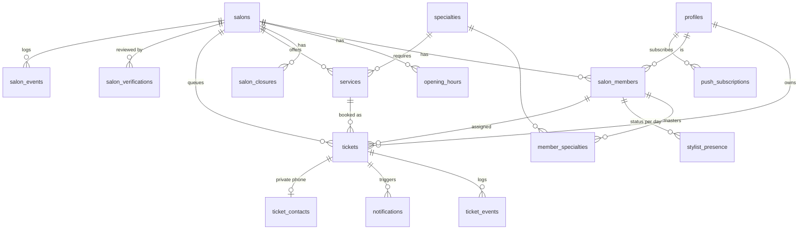

# BACKEND SCHEMA — Zelaté

> version 0.3 · 18/10/2026 · statut : à figer au lot DES-4, avant la première migration
> v0.3 : PRD v1.1 et TRD v0.3 — rendez-vous (`ticket_kind`, `scheduled_at`, statut `pending_confirmation`), demande de réaffectation, libération à l'heure annoncée, dernière heure notifiée, prochain créneau libre, compteur d'absences par numéro, lien court, journal sans texte libre.
> v0.2 : décisions de l'atelier du 16/10 (PRD §11) — coiffeurs avec compte personnel, tablettes au lot 2 (annexe A), interrupteur « Je coiffe », compteur de 10 min, fin de journée, coiffeur pressenti.
> Base : modèle de données de la spec MVP (12 entités), complété des tables techniques nécessaires aux décisions du [TRD](./TRD.md) (ADR-003 à ADR-011).
> Documents liés : [PRD](./PRD.md) · [TRD](./TRD.md) · [APP_FLOW](./APP_FLOW.md) · [DESIGN_SYSTEM](./DESIGN_SYSTEM.md) · [IMPLEMENTATION_PLAN](./IMPLEMENTATION_PLAN.md)

Ce document décrit **chaque table, chaque colonne, chaque contrainte et chaque droit**. La première migration le traduit tel quel ; toute évolution ultérieure modifie ce document et ajoute une migration dans la même pull request.

---

## 1. Conventions

| Sujet | Règle |
| --- | --- |
| Noms | Anglais, `snake_case`, tables au pluriel, colonnes au singulier |
| Clés | `id uuid primary key default gen_random_uuid()` ; `bigint generated always as identity` pour les journaux |
| Temps | `timestamptz` en UTC ; suffixe `_at` ; dates de service en `date` (heure de Paris), suffixe `_on` ou `service_date` |
| Durées | Entiers en minutes, suffixe `_minutes` |
| Montants | Entiers en centimes, suffixe `_cents` |
| Booléens | Préfixe `is_`, `has_` |
| Horodatage | `created_at` et `updated_at` sur chaque table modifiable ; `updated_at` maintenu par le déclencheur `set_updated_at()` |
| Énumérations | Types Postgres `enum` (§3) ; valeurs en `snake_case` |
| Suppression | Pas de suppression logique générale ; les journaux sont en ajout seul |
| Schémas | `public` : exposé par l'API, RLS obligatoire · `private` : jamais exposé, accès par fonctions serveur uniquement |
| Correspondance métier | Voir la table « Noms techniques » de la spec MVP v0.1 et le glossaire du [PRD §10](./PRD.md#10-glossaire) |

---

## 2. Vue d'ensemble

| Schéma | Tables |
| --- | --- |
| `public` | `profiles`, `platform_admins`, `salons`, `salon_members`, `specialties`, `member_specialties`, `opening_hours`, `salon_closures`, `services`, `stylist_presence`, `tickets`, `ticket_events`, `salon_events`, `notifications`, `push_subscriptions`, `salon_verifications` |
| `private` | `ticket_contacts`, `member_invitations`, `processed_commands`, `rate_limits`, `no_show_records` |
| Lot 2 (annexe A) | `salon_devices`, `stylist_sessions`, `private.member_pins`, `private.device_pairing_requests` |

---

## 3. Énumérations

| Type | Valeurs | Remarque |
| --- | --- | --- |
| `salon_status` | `draft`, `pending_review`, `approved`, `published`, `rejected`, `suspended` | Brouillon → à valider → validé → public, ou refusé ; `suspended` pour un abus |
| `queue_status` | `closed`, `open`, `paused` | « Complète » est calculée, pas stockée |
| `member_role` | `manager`, `stylist` | — |
| `member_status` | `invited`, `active`, `deactivated` | — |
| `presence_status` | `offline`, `available`, `in_service`, `on_break`, `late`, `absent`, `off_duty` | `off_duty` = fin de journée |
| `break_type` | `meal`, `short`, `unexpected` | — |
| `ticket_status` | `pending_confirmation`, `waiting`, `called`, `in_service`, `completed`, `cancelled`, `no_show` | Actifs : `pending_confirmation`, `waiting`, `called`, `in_service` ; `pending_confirmation` = rendez-vous signalé par le client, hors calcul |
| `ticket_kind` | `queue`, `appointment` | `appointment` = rendez-vous à heure fixe (H10, ADR-016) |
| `appointment_source` | `salon_entry`, `client_check_in` | Saisi par le salon, ou signalé par le client à son arrivée |
| `ticket_channel` | `app`, `qr`, `front_desk` | Un rendez-vous saisi par le salon a le canal `front_desk` |
| `reassignment_choice` | `accepted`, `refused`, `expired` | Réponse du client à une réaffectation qui recule son heure (E9) |
| `eta_response` | `on_time`, `late` | « J'annule » donne le statut `cancelled` |
| `end_of_day_choice` | `stay`, `cancel` | Réponse à l'alerte de fin de journée ; `cancel` donne le statut `cancelled` |
| `closing_decision` | `serve`, `cancel` | Décision du gérant pour un client resté après la fermeture |
| `cancel_reason` | `client_cancelled`, `removed_by_salon`, `stylist_unavailable`, `end_of_day`, `appointment_rejected` | « Fermer la file » n'annule aucun ticket : seule la fin de journée (H9) le fait |
| `removal_reason` | `emergency`, `client_request`, `duplicate`, `inappropriate_behaviour`, `other` | Motif de retrait par le gérant (S-12) |
| `actor_type` | `client`, `stylist`, `manager`, `system`, `admin` | — |
| `ticket_event_type` | `created`, `assigned`, `reassigned`, `estimate_changed`, `eta_responded`, `postponed`, `stylist_change_requested`, `stylist_change_resolved`, `arrival_confirmed`, `called`, `service_started`, `duration_adjusted`, `completed`, `cancelled`, `no_show`, `end_of_day_warned`, `end_of_day_responded`, `appointment_checked_in`, `appointment_confirmed`, `appointment_rejected`, `appointment_updated`, `appointment_delay_warned`, `reassignment_requested`, `reassignment_resolved` | `completed` par un gérant : `actor_type = 'manager'` (E15) |
| `salon_event_type` | `submitted`, `approved`, `rejected`, `published`, `suspended`, `queue_opened`, `queue_paused`, `queue_closed`, `closing_resolved`, `presence_changed`, `hairdressing_toggled`, `member_invited`, `member_activated`, `member_deactivated`, `member_sessions_revoked`, `qr_regenerated`, `settings_updated`, `admin_viewed_client_data` | — |
| `notification_channel` | `push`, `sms`, `email` | — |
| `notification_template` | `ticket_created`, `turn_approaching`, `get_ready`, `your_turn`, `arrival_reminder`, `released_no_show`, `estimate_changed`, `postponed`, `stylist_change_required`, `end_of_day_risk`, `cancelled_by_salon`, `appointment_confirmed`, `appointment_rejected`, `appointment_delay`, `reassignment_request`, `no_show_warning`, `member_invitation`, `salon_decision`, `daily_summary` | Textes dans `notifications.json` ; indispensables (envoyés sans consentement, K11) : `ticket_created`, `your_turn` |
| `notification_status` | `pending`, `sent`, `failed`, `skipped` | `skipped` : plafond SMS atteint, push actif, consentement absent |
| `verification_decision` | `pending`, `approved`, `rejected` | — |
| `siret_check_result` | `valid`, `naf_mismatch`, `inactive`, `not_found`, `error` | — |

---

## 4. Tables du schéma `public`

Légende : **PK** clé primaire · **FK** clé étrangère · **U** unique · **NN** non nul.

### 4.1 `profiles` — le client ou le gérant (1 ligne par compte Auth humain)

| Colonne | Type | Contraintes | Description |
| --- | --- | --- | --- |
| `id` | uuid | PK, FK → `auth.users(id)` on delete cascade | Même identifiant que le compte Auth |
| `first_name` | text | NN, 1 à 30 caractères | Prénom affiché au salon |
| `last_name` | text | ≤ 50 caractères | Gérants seulement |
| `email` | citext | U | Gérants ; facultatif pour les clients |
| `is_guest` | boolean | NN, défaut `true` | Client qui n'a pas finalisé de compte (ADR-005) |
| `tracking_consent_at` | timestamptz | | Consentement aux notifications de suivi |
| `marketing_consent_at` | timestamptz | | Hors MVP, colonne prévue |
| `created_at`, `updated_at` | timestamptz | NN | |

Le **téléphone** n'est pas ici : il reste dans `auth.users.phone` (ADR-011). Les coiffeurs ont un profil comme les gérants (compte personnel, ADR-007).

### 4.2 `platform_admins`

| Colonne | Type | Contraintes | Description |
| --- | --- | --- | --- |
| `user_id` | uuid | PK, FK → `auth.users(id)` | Membre de l'équipe Zelaté |
| `created_at` | timestamptz | NN | |

### 4.3 `salons`

| Colonne | Type | Contraintes | Description |
| --- | --- | --- | --- |
| `id` | uuid | PK | |
| `slug` | text | U, NN, `^[a-z0-9-]{3,60}$` | Utilisé dans `/salons/:slug` |
| `name` | text | NN, 2 à 80 caractères | |
| `phone` | text | NN, E.164 +33 | Téléphone public du salon |
| `address_line` | text | NN | Numéro et voie |
| `postal_code` | text | NN, `^\d{5}$` | |
| `city` | text | NN | |
| `city_code` | text | | Code INSEE renvoyé par la Géoplateforme |
| `location` | geography(Point, 4326) | NN | Position du salon (PostGIS) |
| `siret` | char(14) | NN, `^\d{14}$` | |
| `naf_code` | text | | Renvoyé par Recherche d'entreprises |
| `status` | `salon_status` | NN, défaut `draft` | |
| `queue_status` | `queue_status` | NN, défaut `closed` | |
| `welcome_message` | text | ≤ 280 caractères | Affiché sur la fiche |
| `photo_paths` | text[] | ≤ 6 éléments | Chemins dans le bucket `salon-photos` |
| `qr_token` | text | U, NN | Jeton du QR (`/q/:qrToken`), régénérable |
| `reminder_after_minutes` | smallint | NN, défaut 5 | Rappel après appel (H4) |
| `auto_release_after_minutes` | smallint | NN, défaut 10 | Libération automatique (H4) ; contrainte `reminder < auto_release` ; fixes au pilote, réglables plus tard |
| `end_of_day_warning_minutes` | smallint | NN, défaut 120, 30 à 240 | Début de la fenêtre d'alerte avant la fermeture (H9) |
| `closing_grace_minutes` | smallint | NN, défaut 15 | Délai après la fermeture avant l'annulation automatique des clients restants |
| `waiting_count` | integer | NN, défaut 0 | Calculé par le moteur |
| `current_wait_minutes` | integer | | Attente pour un nouveau client « premier disponible », calculée par le moteur |
| `estimate_updated_at` | timestamptz | | Fraîcheur affichée |
| `next_free_slots` | jsonb | NN, défaut `[]` | Prochain créneau libre par prestation, calculé par le moteur (ADR-017) : `[{ service_id, starts_at }]`, sans coiffeur ; seules les prestations qui tiennent dans un trou y figurent |
| `queue_version` | bigint | NN, défaut 0 | Incrémentée à chaque commande ; envoyée dans les messages temps réel |
| `setup_test_passed_at` | timestamptz | | Test S-07 réussi |
| `published_at` | timestamptz | | |
| `draft_expires_at` | timestamptz | | Brouillon supprimé après cette date (7 jours) |
| `created_by` | uuid | NN, FK → `profiles(id)` | Gérant créateur |
| `created_at`, `updated_at` | timestamptz | NN | |

Fuseau horaire implicite `Europe/Paris` (marché France uniquement) ; pas de colonne au MVP.

### 4.4 `salon_members` — gérants et coiffeurs

| Colonne | Type | Contraintes | Description |
| --- | --- | --- | --- |
| `id` | uuid | PK | |
| `salon_id` | uuid | NN, FK → `salons(id)` on delete cascade | |
| `profile_id` | uuid | FK → `profiles(id)` | Compte du membre ; rempli à l'activation de l'invitation (obligatoire si `status = 'active'`) |
| `role` | `member_role` | NN | |
| `status` | `member_status` | NN, défaut `invited` | |
| `first_name` | text | NN | |
| `last_name` | text | NN | |
| `email` | citext | NN | Adresse d'invitation |
| `photo_path` | text | | Bucket `member-photos` |
| `is_hairdressing` | boolean | NN, défaut `true` | Interrupteur « Je coiffe » du gérant ; toujours `true` pour un coiffeur |
| `served_today_count` | integer | NN, défaut 0 | Remis à 0 chaque nuit ; critère d'égalité du dispatch |
| `created_at`, `updated_at` | timestamptz | NN | |

Contraintes :
- `unique (salon_id, email)`.
- Un coiffeur actif n'appartient qu'à un salon : index unique partiel sur `email` où `role = 'stylist' and status <> 'deactivated'`.
- Un gérant ne gère qu'un salon au MVP : index unique partiel sur `profile_id` où `role = 'manager'`.
- Au moins un gérant par salon : vérifié par la fonction de désactivation.
- 20 membres actifs maximum par salon : vérifié par `invite-member`.
- Un membre reçoit des clients s'il est actif, `is_hairdressing = true` et présent (statut de présence) ; le gérant qui a coupé « Je coiffe » peut quand même prendre le prochain client.

### 4.5 `specialties` — référentiel

| Colonne | Type | Contraintes | Description |
| --- | --- | --- | --- |
| `code` | text | PK | `women_cut`, `men_cut`, `kids_cut`, `beard`, `color`, `highlights`, `braids`, `curly_hair`, `styling`, `treatment` |
| `sort_order` | smallint | NN | |

Libellés dans le dictionnaire (`common.specialties.<code>`).

### 4.6 `member_specialties`

| Colonne | Type | Contraintes |
| --- | --- | --- |
| `member_id` | uuid | FK → `salon_members(id)` on delete cascade |
| `specialty_code` | text | FK → `specialties(code)` |
| | | PK (`member_id`, `specialty_code`) |

Au moins une spécialité par coiffeur : vérifié à l'invitation.

### 4.7 `opening_hours`

| Colonne | Type | Contraintes | Description |
| --- | --- | --- | --- |
| `id` | uuid | PK | |
| `salon_id` | uuid | NN, FK → `salons(id)` on delete cascade | |
| `weekday` | smallint | NN, 1 à 7 | |
| `opens_at` | time | NN | |
| `closes_at` | time | NN, `> opens_at` | |

Plusieurs plages par jour possibles ; contrainte d'exclusion contre le chevauchement des plages d'un même jour. Au moins un jour ouvert pour publier.

### 4.8 `salon_closures`

| Colonne | Type | Contraintes | Description |
| --- | --- | --- | --- |
| `id` | uuid | PK | |
| `salon_id` | uuid | NN, FK on delete cascade | |
| `starts_on` | date | NN | |
| `ends_on` | date | NN, `>= starts_on` | |
| `reason` | text | ≤ 120 caractères | |

### 4.9 `services` — prestations

| Colonne | Type | Contraintes | Description |
| --- | --- | --- | --- |
| `id` | uuid | PK | |
| `salon_id` | uuid | NN, FK on delete cascade | |
| `name` | text | NN, 2 à 60 caractères | |
| `duration_minutes` | smallint | NN, 15 à 180, multiple de 5 | |
| `price_cents` | integer | NN, ≥ 0 | |
| `required_specialty_code` | text | FK → `specialties(code)` | Filtre les coiffeurs éligibles |
| `is_active` | boolean | NN, défaut `true` | |
| `sort_order` | smallint | NN, défaut 0 | |
| `created_at`, `updated_at` | timestamptz | NN | |

### 4.10 et 4.11 — tablettes partagées : lot 2

Les tables `salon_devices` et `stylist_sessions` ne sont créées qu'au lot 2 (tablettes louées). Au lot 1, chaque coiffeur agit depuis son téléphone avec son propre compte (TRD, ADR-007). Leur description est à l'annexe A.

### 4.12 `stylist_presence` — statut du coiffeur pour la journée

| Colonne | Type | Contraintes | Description |
| --- | --- | --- | --- |
| `id` | uuid | PK | |
| `salon_id` | uuid | NN, FK | Dupliqué pour les politiques RLS et les index |
| `member_id` | uuid | NN, FK → `salon_members(id)` | |
| `service_date` | date | NN | Journée en heure de Paris |
| `status` | `presence_status` | NN, défaut `offline` | |
| `status_since` | timestamptz | NN | |
| `break_type` | `break_type` | | Si `on_break` |
| `expected_back_at` | timestamptz | | Fin de pause ou heure d'arrivée prévue (`late`) |
| `shift_end_at` | timestamptz | | Fin de journée prévue |
| `updated_by_member_id` | uuid | FK → `salon_members(id)` | |
| `updated_at` | timestamptz | NN | |

`unique (member_id, service_date)`. L'historique des changements est dans `salon_events` (`presence_changed`).

### 4.13 `tickets` — l'entité centrale

| Colonne | Type | Contraintes | Description |
| --- | --- | --- | --- |
| `id` | uuid | PK | |
| `salon_id` | uuid | NN, FK → `salons(id)` | |
| `service_date` | date | NN | Journée de service (heure de Paris) |
| `short_code` | text | NN, `^[A-HJ-NP-Z2-9]{5}$` | Code lisible (#AF2K9), sans 0/O ni 1/I |
| `tracking_token` | text | U, NN | 32 octets aléatoires en base64url (ADR-006) |
| `tracking_short_code` | text | U, NN, `^[A-Za-z0-9]{8}$` | Lien court des SMS `zelate.fr/t/xxxxxxxx`, résolu par l'Edge Function `ticket-public` (K5) ; même traitement que le jeton |
| `kind` | `ticket_kind` | NN, défaut `queue` | |
| `scheduled_at` | timestamptz | | Heure du rendez-vous ; obligatoire si `kind = 'appointment'`, vide sinon |
| `appointment_source` | `appointment_source` | | Obligatoire si `kind = 'appointment'` |
| `confirmed_at` | timestamptz | | Rendez-vous signalé confirmé par le salon |
| `confirmed_by_member_id` | uuid | FK → `salon_members(id)` | Gérant ou coiffeur qui confirme |
| `appointment_delay_warned_steps` | smallint | NN, défaut 0 | Nombre d'alertes de retard envoyées (10, 20, 30 min… de retard), dans le plafond SMS (R5) |
| `client_id` | uuid | FK → `profiles(id)` | Vide pour un walk-in |
| `display_name` | text | NN, ≤ 30 caractères | Prénom affiché |
| `channel` | `ticket_channel` | NN | |
| `is_test` | boolean | NN, défaut `false` | Ticket fictif de S-07, exclu des statistiques |
| `service_id` | uuid | FK → `services(id)` | Vide si « je ne sais pas encore » |
| `planned_duration_minutes` | smallint | NN, 5 à 240 | Durée de la prestation, ou 30 si inconnue |
| `requested_member_id` | uuid | FK → `salon_members(id)` | Coiffeur demandé ; vide = premier disponible |
| `estimated_member_id` | uuid | FK → `salon_members(id)` | Coiffeur pressenti par la simulation, pour l'estimation (ADR-015) |
| `assigned_member_id` | uuid | FK → `salon_members(id)` | Coiffeur fixé à l'appel ; vide tant que le ticket attend (sauf coiffeur demandé : rempli dès la création) |
| `status` | `ticket_status` | NN, défaut `waiting` | `pending_confirmation` à la création par `check_in_appointment` |
| `queue_rank` | integer | NN | Ordre d'inscription au salon pour la journée |
| `postpone_count` | smallint | NN, défaut 0 | Places reculées au total (≤ 2, H5) |
| `declared_arrival_at` | timestamptz | | Heure d'arrivée déclarée (H8) |
| `eta_response` | `eta_response` | | Réponse à T-30 |
| `declared_delay_minutes` | smallint | 5 à 30 | Retard déclaré |
| `arrived_at` | timestamptz | | Arrivée validée au salon par le code du ticket |
| `stylist_change_pending_since` | timestamptz | | Coiffeur demandé devenu indisponible, réponse du client attendue (`resolve_stylist_change`) ; sans réponse en 10 min : « premier disponible » si le coiffeur est absent toute la journée ou désactivé (seul choix proposé, E7), sinon attente |
| `reassignment_member_id` | uuid | FK → `salon_members(id)` | Coiffeur proposé par le gérant, en attente de l'accord du client (E9) |
| `reassignment_requested_at` | timestamptz | | Demande envoyée ; sans réponse en 10 min, `queue-tick` l'efface (`expired`) |
| `estimated_start_at` | timestamptz | | Heure de passage courante |
| `last_notified_start_at` | timestamptz | | Dernière heure annoncée au client ; le seuil de 10 min se mesure par rapport à elle, écarts cumulés (E11) |
| `initial_estimated_start_at` | timestamptz | | Heure annoncée à l'inscription (métrique) |
| `t30_estimated_start_at` | timestamptz | | Heure annoncée à T-30 (indicateur principal) |
| `estimate_version` | integer | NN, défaut 0 | Incrémentée quand l'estimation change |
| `turn_approaching_sent_at` | timestamptz | | T-30 envoyé (une seule fois) |
| `get_ready_sent_at` | timestamptz | | T-10 envoyé |
| `called_at` | timestamptz | | |
| `release_due_at` | timestamptz | | Libération automatique : `called_at` + 10 min, ou l'heure d'arrivée annoncée si elle est plus tardive (E2) |
| `reminder_sent_at` | timestamptz | | Rappel à 5 min |
| `end_of_day_warned_at` | timestamptz | | Alerte de fin de journée envoyée (une seule fois) |
| `end_of_day_choice` | `end_of_day_choice` | | Réponse du client |
| `closing_decision` | `closing_decision` | | Décision du gérant après la fermeture |
| `started_at` | timestamptz | | |
| `completed_at` | timestamptz | | |
| `actual_duration_minutes` | smallint | | Calculée à la fin |
| `cancelled_at` | timestamptz | | |
| `cancel_reason` | `cancel_reason` | | |
| `removal_reason` | `removal_reason` | | Si retrait par le gérant |
| `removal_note` | text | ≤ 200 caractères | Précision facultative ; jamais copiée dans le journal ; effacée à l'anonymisation (K10) |
| `no_show_at` | timestamptz | | |
| `created_by_member_id` | uuid | FK → `salon_members(id)` | Walk-in ou rendez-vous saisi : membre qui inscrit |
| `created_at`, `updated_at` | timestamptz | NN | |

Contraintes et index :
- `unique (salon_id, service_date, short_code)`.
- **Un seul ticket actif par client** : index unique partiel sur `client_id` où `status in ('pending_confirmation','waiting','called','in_service') and not is_test`.
- Rendez-vous : `check ((kind = 'appointment') = (scheduled_at is not null and appointment_source is not null))` ; un rendez-vous a toujours `assigned_member_id` rempli, sauf au statut `pending_confirmation` sans coiffeur choisi.
- Pas deux rendez-vous qui se chevauchent chez un même coiffeur : contrôlé par le moteur (`appointment_overlap`), pas par une contrainte, car la durée réelle varie.
- Un seul ticket `called` ou `in_service` par coiffeur : index unique partiel sur `assigned_member_id` où `status in ('called','in_service')`.
- Cohérence des horodatages par statut (contrainte `check`) : `called` ⇒ `called_at` ; `in_service` ⇒ `started_at` ; `completed` ⇒ `completed_at` ; `cancelled` ⇒ `cancelled_at` et `cancel_reason` ; `no_show` ⇒ `no_show_at`.
- `postpone_count between 0 and 2`.
- Index : `(salon_id, service_date, status)`, `(assigned_member_id, status)`, `(client_id, created_at desc)`, `(salon_id, service_date, scheduled_at)` où `kind = 'appointment'`.

Le **statut d'approche** affiché dans l'espace coiffeur (« arrivé », « en retard de X min », « confirmé », « sans réponse ») se calcule à partir de `arrived_at`, `eta_response` et `declared_delay_minutes` ; il n'est pas stocké.

### 4.14 `ticket_events` — journal d'audit des tickets (ajout seul)

| Colonne | Type | Contraintes | Description |
| --- | --- | --- | --- |
| `id` | bigint | PK, identity | |
| `ticket_id` | uuid | NN, FK → `tickets(id)` | |
| `salon_id` | uuid | NN, FK | |
| `type` | `ticket_event_type` | NN | |
| `actor_type` | `actor_type` | NN | |
| `actor_member_id` | uuid | FK → `salon_members(id)` | |
| `actor_profile_id` | uuid | FK → `profiles(id)` | |
| `reason_code` | text | | Motif structuré (valeur d'un enum de motif) ; pas de texte libre dans le journal (K10) |
| `before` | jsonb | | Champs modifiés, avant |
| `after` | jsonb | | Champs modifiés, après |
| `command_id` | uuid | | Commande d'origine |
| `created_at` | timestamptz | NN, défaut `now()` | |

Jamais de téléphone, de jeton, de prénom ni de texte libre dans `before` / `after` (K10). Déclencheur `prevent_update_delete()` : toute mise à jour ou suppression lève une erreur. Index `(salon_id, created_at desc)`, `(ticket_id, id)`.

### 4.15 `salon_events` — journal d'audit du salon (ajout seul)

Mêmes colonnes que `ticket_events`, sans `ticket_id`, avec `type salon_event_type` et `subject_member_id uuid` (membre concerné, par exemple le coiffeur déclaré absent). Même déclencheur d'ajout seul.

### 4.16 `notifications` — outbox (ADR-008)

| Colonne | Type | Contraintes | Description |
| --- | --- | --- | --- |
| `id` | uuid | PK | |
| `ticket_id` | uuid | FK → `tickets(id)` | Vide pour les e-mails gérant |
| `salon_id` | uuid | NN, FK | |
| `recipient_profile_id` | uuid | FK → `profiles(id)` | |
| `recipient_member_id` | uuid | FK → `salon_members(id)` | E-mails d'invitation, récapitulatif |
| `channel` | `notification_channel` | NN | |
| `template` | `notification_template` | NN | |
| `params` | jsonb | NN, défaut `{}` | Variables du modèle (prénom, heure, code…), **sans téléphone** |
| `dedupe_key` | text | NN | Ex. `your_turn:1` (numéro d'appel, pour qu'un second appel après « Prendre le suivant » reparte), `estimate_changed:v7` |
| `status` | `notification_status` | NN, défaut `pending` | |
| `skip_reason` | text | | `sms_cap_reached`, `push_active`, `no_consent`… |
| `provider_message_id` | text | | |
| `cost_cents` | integer | | Coût SMS remonté par le fournisseur |
| `attempts` | smallint | NN, défaut 0 | 3 essais maximum |
| `last_error` | text | | |
| `scheduled_at` | timestamptz | NN, défaut `now()` | |
| `sent_at` | timestamptz | | |
| `created_at` | timestamptz | NN | |

`unique (ticket_id, channel, dedupe_key)` : une même notification n'est jamais doublée. **Plafond SMS** : avant envoi, `send-notifications` compte les SMS `sent` du ticket hors `cancelled_by_salon` et `your_turn` ; à 3, la ligne passe en `skipped` (`sms_cap_reached`) ; `your_turn` et `cancelled_by_salon` partent toujours (E1). **Consentement** : sans `tracking_consent_at`, seuls `ticket_created` et `your_turn` partent, les autres passent en `skipped` (`no_consent`, K11).

### 4.17 `push_subscriptions`

| Colonne | Type | Contraintes | Description |
| --- | --- | --- | --- |
| `id` | uuid | PK | |
| `profile_id` | uuid | FK → `profiles(id)` on delete cascade | Client connecté |
| `ticket_id` | uuid | FK → `tickets(id)` on delete cascade | Abonnement lié à un ticket ouvert par lien SMS |
| `endpoint` | text | U, NN | |
| `p256dh` | text | NN | |
| `auth_secret` | text | NN | |
| `user_agent` | text | | |
| `created_at` | timestamptz | NN | |
| `last_success_at` | timestamptz | | |
| `expired_at` | timestamptz | | Le service de push a répondu 404 ou 410 → ligne supprimée par la tâche quotidienne |

Contrainte : `profile_id` ou `ticket_id` renseigné.

### 4.18 `salon_verifications` — dossiers de validation

| Colonne | Type | Contraintes | Description |
| --- | --- | --- | --- |
| `id` | uuid | PK | |
| `salon_id` | uuid | NN, FK on delete cascade | |
| `siret_check_result` | `siret_check_result` | NN | |
| `siret_check_payload` | jsonb | | Extrait minimal : dénomination, NAF, état, adresse |
| `checked_at` | timestamptz | NN | |
| `decision` | `verification_decision` | NN, défaut `pending` | |
| `decision_reason` | text | Obligatoire si `rejected` | Envoyé au gérant |
| `decided_by` | uuid | FK → `platform_admins(user_id)` | |
| `decided_at` | timestamptz | | |
| `created_at` | timestamptz | NN | |

---

## 5. Tables du schéma `private`

Aucune n'est exposée par l'API ; seules les Edge Functions (rôle service) et les fonctions `security definer` y accèdent.

| Table | Colonnes | Rôle |
| --- | --- | --- |
| `ticket_contacts` | `ticket_id uuid PK FK`, `phone_e164 text NN`, `phone_hash bytea NN` (HMAC-SHA256 avec `PHONE_HASH_SECRET`), `is_active boolean NN`, `closed_at timestamptz` | Numéro du client pour les SMS de ce ticket, y compris walk-in (ADR-011). Index unique partiel sur `phone_hash` où `is_active` : un ticket actif par numéro. Ligne supprimée 24 h après la clôture du ticket |
| `member_invitations` | `member_id uuid PK FK`, `token_hash bytea U NN`, `expires_at timestamptz NN` (72 h), `used_at timestamptz` | Lien d'invitation à usage unique |
| `processed_commands` | `command_id uuid PK`, `command text NN`, `salon_id uuid`, `response jsonb NN`, `created_at timestamptz NN` | Idempotence (ADR-004), purge à 7 jours |
| `rate_limits` | `bucket text`, `key_hash bytea`, `window_start timestamptz`, `count integer NN` ; PK (`bucket`, `key_hash`, `window_start`) | Plafonds : codes SMS par numéro et par IP, PIN, création de tickets |
| `no_show_records` | `phone_hash bytea NN`, `ticket_id uuid NN`, `occurred_at timestamptz NN` ; PK (`phone_hash`, `ticket_id`) | Une ligne par absence, tous salons (K8) ; à la 5e en 30 jours glissants, notification `no_show_warning` ; lignes de plus de 30 jours purgées chaque nuit. Le numéro d'un client connecté est haché avec le même secret que celui des walk-ins |

---

## 6. Vues publiques

| Vue | Contenu | Accès |
| --- | --- | --- |
| `public_salons` | Salons `published` : `id`, `slug`, `name`, `phone`, adresse, `location`, `queue_status`, `welcome_message`, `photo_paths`, `waiting_count`, `current_wait_minutes`, `estimate_updated_at`, `next_free_slots` | `anon`, `authenticated` |
| `public_stylists` | Membres actifs qui coiffent aujourd'hui, des salons publiés : `id`, `salon_id`, `first_name`, `photo_path`, spécialités, statut de présence simplifié (`available`, `busy`, `away`) | `anon`, `authenticated` |

Sans `siret`, `qr_token`, e-mails ni noms de famille. `services`, `opening_hours`, `salon_closures` et `specialties` sont lisibles publiquement pour les salons publiés (politiques RLS).

---

## 7. Droits (RLS)

### 7.1 Fonctions d'aide (schéma `private`, `security definer`, `search_path = ''`)

| Fonction | Renvoie |
| --- | --- |
| `private.is_platform_admin()` | Vrai si `auth.uid()` est dans `platform_admins` |
| `private.managed_salon_id()` | Le salon dont `auth.uid()` est gérant actif (un seul au MVP), sinon `null` |
| `private.member_id()` | Le membre actif correspondant à `auth.uid()` (gérant ou coiffeur), sinon `null` |
| `private.staff_salon_id()` | Le salon de ce membre actif (gérant ou coiffeur), sinon `null` |

### 7.2 Matrice

L = lecture, É = écriture directe (insert, update, delete). « Serveur » = seulement par Edge Function (rôle service).

| Table | Public (`anon`) | Client | Gérant (son salon) | Coiffeur (son salon) | Admin |
| --- | --- | --- | --- | --- | --- |
| `profiles` | — | L/É sa ligne (sauf `is_guest`) | L prénoms des clients de ses tickets via RPC seulement | — | L (journalisé) |
| `salons` | via `public_salons` | via `public_salons` | L ; É champs de configuration (nom, téléphone, adresse, photos, message, délais) ; `status`, `queue_status`, compteurs : serveur | L | L ; `status` : serveur |
| `salon_members` | via `public_stylists` | via `public_stylists` | L ; É champs de profil (nom, photo, spécialités) ; invitation, statut et `is_hairdressing` : serveur | L (prénom, photo, rôle) ; É sa photo | L |
| `member_specialties` | L (salons publiés) | L | L/É | L | L |
| `specialties` | L | L | L | L | L/É |
| `opening_hours`, `salon_closures`, `services` | L (salons publiés) | L | L/É | L | L |
| `stylist_presence` | — | — | L ; serveur | L ; serveur | L |
| `tickets` | — | L ses tickets ; serveur | L (sans `tracking_token` ni `tracking_short_code`, via RPC) ; serveur | L via RPC `get_stylist_queue` (prénom, prestation, statut d'approche, heure du rendez-vous) ; serveur | L |
| `ticket_events`, `salon_events` | — | L événements de ses tickets (types affichables) | L son salon | L ses actions | L |
| `notifications` | — | — | — | — | L |
| `push_subscriptions` | — | L/É les siennes | — | — | — |
| `salon_verifications` | — | — | L son dossier (sans `siret_check_payload` brut) | — | L ; serveur |
| `platform_admins` | — | — | — | — | L |

Règles transverses :
- `tracking_token` et `tracking_short_code` ne sont **jamais** renvoyés par une lecture du gérant ou d'un coiffeur (exclus des RPC et des politiques par colonnes).
- Le téléphone saisi pour un rendez-vous ou un walk-in va directement dans `private.ticket_contacts` et n'est jamais relu par le salon.
- Les tests pgTAP vérifient, pour chaque table, qu'un gérant du salon A ne lit ni n'écrit rien du salon B, qu'un coiffeur désactivé ne lit plus rien, et qu'un client ne lit que ses tickets.

---

## 8. Fonctions SQL et Storage

### 8.1 RPC de lecture

| Fonction | Paramètres | Renvoie | Sécurité |
| --- | --- | --- | --- |
| `search_salons` | `lat`, `lng`, `radius_m` (défaut 5000, max 20000), `query?` | Salons publiés triés par distance, avec attente et `next_free_slots` | `security invoker` sur `public_salons` |
| `get_salon_public` | `slug` | Salon, prestations, horaires, coiffeurs | `security invoker` |
| `resolve_qr_token` | `qr_token` | `slug` du salon publié | `security definer` |
| `my_active_ticket` | — | Ticket actif du client + `salon` + `assigned_stylist_first_name` | `security invoker` |
| `get_stylist_queue` | — | Pour le coiffeur connecté : ticket en cours, ticket appelé et prochains clients éligibles (qui le demandent ou sans préférence), avec statut d'approche | `security definer`, vérifie `member_id()` |
| `get_salon_board` | `salon_id` | Coiffeurs avec présence, tickets actifs (dont rendez-vous à confirmer), indicateurs | `security definer`, vérifie `managed_salon_id()` (gérant seulement, K9) |
| `preview_presence_change` | `member_id`, `status`, `until?` | Clients touchés avec leur heure actuelle et la nouvelle, sans rien écrire (K2) | `security definer`, vérifie `managed_salon_id()` |
| `get_audit_log` | `salon_id?`, `from`, `to`, `type?`, `member_id?` (acteur ou membre concerné), `cursor?` | Événements paginés | Gérant (son salon) ou admin |
| `get_day_summary` | `salon_id`, `service_date`, `member_id?` | Clients servis, attente annoncée et réelle, absences, annulations | Gérant ; coiffeur connecté pour lui-même |

### 8.2 Écritures
Toutes les écritures de file passent par l'Edge Function `queue-command` (TRD §6.2), qui exécute dans **une transaction** : `select pg_advisory_xact_lock(hashtextextended(salon_id::text, 0))` → contrôle d'idempotence (`private.processed_commands`) → lecture de l'état de la file du jour → application du moteur → écritures `tickets`, `stylist_presence`, `salons` (compteurs, `queue_version`), `ticket_events` / `salon_events`, `notifications` → enregistrement de la réponse → validation, puis diffusion temps réel.

### 8.3 Storage

| Bucket | Contenu | Accès |
| --- | --- | --- |
| `salon-photos` | Photos du salon, WebP ≤ 300 Ko, 1600 px max | Lecture publique ; écriture gérant (dossier `salon_id/`) |
| `member-photos` | Photos des coiffeurs, WebP ≤ 150 Ko | Lecture publique ; écriture gérant |
| `qr-posters` | PDF A4 du QR généré | Lecture et écriture gérant |

---

## 9. Temps réel

Publication par **Broadcast** depuis les Edge Functions (ADR-009), sur des canaux privés :

| Canal | Autorisé si (politique sur `realtime.messages`) | Événements |
| --- | --- | --- |
| `salon:{salon_id}` | `private.staff_salon_id() = salon_id` | `queue_updated`, `queue_status_changed`, `presence_changed`, `appointment_pending` — charge : `{ version }` |
| `ticket:{ticket_id}` | Le ticket appartient à `auth.uid()` | `ticket_updated` — charge : `{ version, status }` |
| `salon-public:{salon_id}` | Public (ADR-018) | `salon_updated` — charge : `{ version }` |
| `ticket-token:{token_key}` | Public ; `token_key` = 32 premiers caractères hexadécimaux du SHA-256 du jeton (ADR-018) | `ticket_updated` — charge : `{ version }` |

Aucune table n'est ajoutée à la publication `supabase_realtime` (pas de *Postgres Changes*), pour ne jamais diffuser de ligne complète.

---

## 10. Tâches planifiées (pg_cron, heures en UTC)

| Tâche | Fréquence | Action |
| --- | --- | --- |
| `queue-tick` | Chaque minute | Appelle l'Edge Function : T-30, T-10, rappel à 5 min, libération à `release_due_at`, alertes de retard sur rendez-vous, fin des demandes de réaffectation sans réponse, alertes de fin de journée (fenêtre `end_of_day_warning_minutes` avant la dernière fermeture), ouverture et fermeture selon les horaires, annulation des clients restants après `closing_grace_minutes` sans décision du gérant, recalcul des estimations et de `next_free_slots` |
| `send-notifications` | Chaque minute | Rattrape l'outbox (`pending` dont `scheduled_at` est passé, essais ≤ 3) |
| `salon-daily-summary` | Toutes les 15 min | Envoie le récapitulatif des salons fermés depuis le dernier passage |
| `daily-maintenance` | 01:30 UTC | Remise à zéro de `served_today_count` ; suppression des brouillons expirés, des `processed_commands` de plus de 7 jours, des `rate_limits` de plus de 24 h, des `ticket_contacts` clôturés depuis plus de 24 h, des `no_show_records` de plus de 30 jours, des abonnements push expirés ; anonymisation des tickets de plus de 12 mois (durée à confirmer avec un conseil RGPD) |

L'anonymisation vide `display_name`, `client_id` et `removal_note`, en gardant les horodatages et les durées pour les statistiques. Le journal reste intact : il ne contient ni prénom ni texte libre (K10).

---

## 11. Données de démonstration (`seed.sql`)

- Spécialités du référentiel (§4.5).
- Deux salons fictifs publiés (« Salon Démo Enghien », « Barber Démo Montmorency ») avec horaires, 3 coiffeurs chacun, 6 prestations.
- Un gérant, un admin et trois clients de test (numéros de test du fournisseur SMS, jamais de vrais numéros).
- Une file du jour avec des tickets dans chaque statut, dont des rendez-vous (à l'heure, en retard, à confirmer), pour les captures et les tests.

---

## 12. Ordre des migrations (lot DEV-1)

1. Extensions : `postgis`, `pg_cron`, `pg_net`, `pgcrypto`, `citext`.
2. Schéma `private`, énumérations (§3), fonction `set_updated_at()`, fonction `prevent_update_delete()`.
3. `profiles`, `platform_admins`, déclencheur de création de profil à l'inscription Auth.
4. `salons`, `specialties`, `salon_members`, `member_specialties`, `opening_hours`, `salon_closures`, `services`.
5. `stylist_presence`.
6. `tickets`, `ticket_events`, `salon_events`, `notifications`, `push_subscriptions`, `salon_verifications`.
7. Tables `private` (§5).
8. Fonctions d'aide (§7.1), vues (§6), politiques RLS (§7.2), RPC (§8.1).
9. Buckets Storage et leurs politiques.
10. Politiques Realtime Authorization (§9).
11. Tâches pg_cron (§10).

Chaque étape a ses tests pgTAP dans `supabase/tests/`, écrits dans la même pull request.

---

## Annexe A · Lot 2 : tablettes partagées

À créer au lot 2, avec les Edge Functions de l'annexe A du TRD.

**`salon_devices`** — tablettes appairées

| Colonne | Type | Contraintes | Description |
| --- | --- | --- | --- |
| `id` | uuid | PK | |
| `salon_id` | uuid | NN, FK on delete cascade | |
| `auth_user_id` | uuid | U, NN, FK → `auth.users(id)` | Compte Auth propre à l'appareil (`app_metadata.kind = 'device'`), sans profil |
| `label` | text | NN, ≤ 40 caractères | « Poste 1 » |
| `paired_by` | uuid | NN, FK → `salon_members(id)` | |
| `last_seen_at` | timestamptz | | |
| `revoked_at` | timestamptz | | Révocation : sessions Auth de l'appareil supprimées |
| `created_at` | timestamptz | NN | |

**`stylist_sessions`** — déverrouillage par PIN

| Colonne | Type | Contraintes | Description |
| --- | --- | --- | --- |
| `id` | uuid | PK | Passé dans chaque commande depuis la tablette |
| `device_id` | uuid | NN, FK → `salon_devices(id)` | |
| `member_id` | uuid | NN, FK → `salon_members(id)` | |
| `started_at`, `last_activity_at` | timestamptz | NN | |
| `expires_at` | timestamptz | NN | `last_activity_at + 5 min` |
| `ended_at` | timestamptz | | Verrouillage manuel ou expiration |

Une seule session ouverte par appareil (index unique partiel sur `device_id` où `ended_at is null`).

**Tables privées** : `member_pins` (`member_id`, `pin_hash` Argon2id, `failed_attempts`, `locked_until`) et `device_pairing_requests` (`pairing_code` de 6 caractères, `claim_secret_hash`, `status`, expiration à 10 min).

**Évolutions associées** : colonne `device_id` dans `ticket_events` et `salon_events` ; fonction `private.device_salon_id()` ajoutée à `private.staff_salon_id()` ; colonne « Appareil » dans la matrice des droits ; purge des demandes d'appairage expirées dans `daily-maintenance`.

