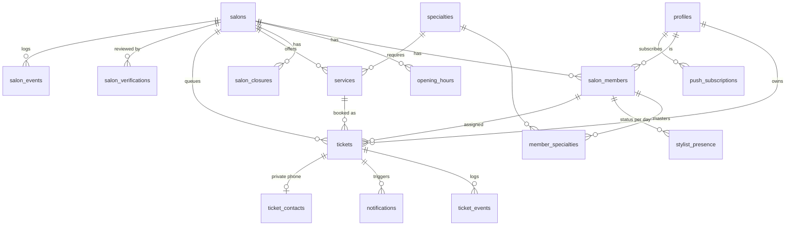

# BACKEND SCHEMA — Zelaté

> version 0.14 · 23/10/2026 · statut : à figer au lot DES-4, avant la première migration
> v0.14 · 23/10/2026 : `search_salons` et `get_salon_public` suivent les horaires (`accepting`, `closes_at`, `next_opening_at` dès la fermeture du jour) ; `private.close_past_days` termine les places d'un jour précédent restées actives (toutes les heures, et pour le client d'une commande).
> v0.13 · 22/10/2026 : fonctions `account_export` et `account_delete`, réservées aux Edge Functions du compte client (DEV-8, U-13).
> v0.12 · 22/10/2026 : `private.client_ticket_view` ajoute `wait_offered` (« Attendre » encore possible, E7, E8) et `last_change` (dernier changement d'heure ou de place et son motif, masqué une fois le changement annulé, E11, K26) ; `ticket_events.before` de `estimate_changed` donne l'heure quittée (DEV-8, U-10, U-12).
> v0.11 · 22/10/2026 : `search_salons` renvoie la position du salon et `next_free_slot` (DEV-8, U-01, U-16).
> v0.10 · 22/10/2026 : lot DEV-8 — RPC `my_ticket()` et vue `private.client_ticket_view`, partagée avec `ticket-public`.
> v0.9 · 21/10/2026 : `get_salon_board` lit la réponse du client à une réaffectation dans `ticket_events.reason_code` (elle lisait `after`, jamais rempli) ; le coiffeur d'une réaffectation est écrit dans `after` et non plus dans `reason_code`, que la contrainte refusait (S-13).
> v0.8 · 21/10/2026 : revue du lot DEV-7 — `get_salon_board` donne la dernière fermeture du jour, les réglages de fin de journée et, pour chaque ticket, l'alerte, la réponse du client et la décision du gérant (F-M12, S-15).
> v0.7 · 21/10/2026 : lot DEV-6 — contrôle de session dans les fonctions d'aide du personnel (ADR-019), RPC `stylist_context()`, colonnes d'appel dans `get_stylist_queue()`, révocation et désactivation (S-16).
> v0.6 · 21/10/2026 : lot DEV-5 — écriture de l'outbox (une ligne push et une ligne SMS par message client, noms ajoutés à l'envoi), messages temps réel envoyés par `realtime.send` dans la transaction, `preview_presence_change` devenue l'Edge Function `preview-presence-change`.
> v0.5 · 19/10/2026 : décisions de Koni K28 à K41, impact technique des réponses d'Ely E17 à E31 (PRD v1.2), alignements de la revue d'architecture du 19/10 (constats 6, 7, 13, 14, 19, 23, 24, 27, 28, 31, 33, 34, 37). Contacts privés pour tout ticket dont le numéro est connu (K28) ; règles de suppression vers `profiles` (K29) ; profil créé par l'action qui demande le prénom (K30) ; `call_count`, `priority_since` (K31) ; droits par colonne et vues publiques en droits du propriétaire (K32) ; `push_subscriptions` écrites par le serveur seulement (K33) ; `salons.is_full` (K36) ; outbox réservée par `skip locked` et e-mails sans ticket dédupliqués (K37) ; sens de `assigned_member_id` (K39) ; purges (K40) ; contraintes `check` complétées ; `salon_events.ticket_id` ; nouvelles colonnes `confirmation_reminder_sent_at`, `reassignment_proposed_start_at` et table `private.no_show_warnings` (E19, E27, E28).
> v0.4 : réponses K13 à K27 — consentement par ticket, fusion des rendez-vous (`merged`, `appointment_merged`), heure annoncée, push aux membres, raisons d'un changement d'heure (`estimate_change_reason`), clés de déduplication.
> v0.3 : PRD v1.1 et TRD v0.3 — rendez-vous (`ticket_kind`, `scheduled_at`, statut `pending_confirmation`), demande de réaffectation, libération à l'heure annoncée, dernière heure notifiée, prochain créneau libre, compteur d'absences par numéro, lien court, journal sans texte libre.
> v0.2 : décisions de l'atelier du 16/10 (PRD §11) — coiffeurs avec compte personnel, tablettes au lot 2 (annexe A), interrupteur « Je coiffe », compteur de 10 min, fin de journée, coiffeur pressenti.
> Base : modèle de données de la spec MVP (12 entités), complété des tables techniques nécessaires aux décisions du [TRD](./TRD.md) (ADR-003 à ADR-011).
> Documents liés : [PRD](./PRD.md) · [TRD](./TRD.md) · [APP_FLOW](./APP_FLOW.md) · [DESIGN_SYSTEM](./DESIGN_SYSTEM.md) · [IMPLEMENTATION_PLAN](./IMPLEMENTATION_PLAN.md)

Ce document décrit **chaque table, chaque colonne, chaque contrainte et chaque droit**. La première migration le traduit tel quel ; toute évolution ultérieure modifie ce document et ajoute une migration dans la même pull request.

---

## 1. Conventions

| Sujet                 | Règle                                                                                                                  |
| --------------------- | ---------------------------------------------------------------------------------------------------------------------- |
| Noms                  | Anglais, `snake_case`, tables au pluriel, colonnes au singulier                                                        |
| Clés                  | `id uuid primary key default gen_random_uuid()` ; `bigint generated always as identity` pour les journaux              |
| Temps                 | `timestamptz` en UTC ; suffixe `_at` ; dates de service en `date` (heure de Paris), suffixe `_on` ou `service_date`    |
| Durées                | Entiers en minutes, suffixe `_minutes`                                                                                 |
| Montants              | Entiers en centimes, suffixe `_cents`                                                                                  |
| Booléens              | Préfixe `is_`, `has_`                                                                                                  |
| Horodatage            | `created_at` et `updated_at` sur chaque table modifiable ; `updated_at` maintenu par le déclencheur `set_updated_at()` |
| Énumérations          | Types Postgres `enum` (§3) ; valeurs en `snake_case`                                                                   |
| Suppression           | Pas de suppression logique générale ; les journaux sont en ajout seul                                                  |
| Schémas               | `public` : exposé par l'API, RLS obligatoire · `private` : jamais exposé, accès par fonctions serveur uniquement       |
| Correspondance métier | Voir la table « Noms techniques » de la spec MVP v0.1 et le glossaire du [PRD §10](./PRD.md#10-glossaire)              |

---

## 2. Vue d'ensemble

| Schéma           | Tables                                                                                                                                                                                                                                                                     |
| ---------------- | -------------------------------------------------------------------------------------------------------------------------------------------------------------------------------------------------------------------------------------------------------------------------- |
| `public`         | `profiles`, `platform_admins`, `salons`, `salon_members`, `specialties`, `member_specialties`, `opening_hours`, `salon_closures`, `services`, `stylist_presence`, `tickets`, `ticket_events`, `salon_events`, `notifications`, `push_subscriptions`, `salon_verifications` |
| `private`        | `ticket_contacts`, `member_invitations`, `processed_commands`, `rate_limits`, `no_show_records`, `no_show_warnings`                                                                                                                                                        |
| Lot 2 (annexe A) | `salon_devices`, `stylist_sessions`, `private.member_pins`, `private.device_pairing_requests`                                                                                                                                                                              |

---

## 3. Énumérations

| Type                     | Valeurs                                                                                                                                                                                                                                                                                                                                                                                                                                                                                                      | Remarque                                                                                                                                                                                                                                                                                                                                                                                                                                        |
| ------------------------ | ------------------------------------------------------------------------------------------------------------------------------------------------------------------------------------------------------------------------------------------------------------------------------------------------------------------------------------------------------------------------------------------------------------------------------------------------------------------------------------------------------------ | ----------------------------------------------------------------------------------------------------------------------------------------------------------------------------------------------------------------------------------------------------------------------------------------------------------------------------------------------------------------------------------------------------------------------------------------------- |
| `salon_status`           | `draft`, `pending_review`, `approved`, `published`, `rejected`, `suspended`                                                                                                                                                                                                                                                                                                                                                                                                                                  | Brouillon → à valider → validé → public, ou refusé ; `suspended` pour un abus                                                                                                                                                                                                                                                                                                                                                                   |
| `queue_status`           | `closed`, `open`, `paused`                                                                                                                                                                                                                                                                                                                                                                                                                                                                                   | « Complète » n'est pas un état : le moteur la calcule et la stocke dans `salons.is_full` (K36)                                                                                                                                                                                                                                                                                                                                                  |
| `member_role`            | `manager`, `stylist`                                                                                                                                                                                                                                                                                                                                                                                                                                                                                         | —                                                                                                                                                                                                                                                                                                                                                                                                                                               |
| `member_status`          | `invited`, `active`, `deactivated`                                                                                                                                                                                                                                                                                                                                                                                                                                                                           | —                                                                                                                                                                                                                                                                                                                                                                                                                                               |
| `presence_status`        | `offline`, `available`, `in_service`, `on_break`, `late`, `absent`, `off_duty`                                                                                                                                                                                                                                                                                                                                                                                                                               | `off_duty` = fin de journée                                                                                                                                                                                                                                                                                                                                                                                                                     |
| `break_type`             | `meal`, `short`, `unexpected`                                                                                                                                                                                                                                                                                                                                                                                                                                                                                | —                                                                                                                                                                                                                                                                                                                                                                                                                                               |
| `ticket_status`          | `pending_confirmation`, `waiting`, `called`, `in_service`, `completed`, `cancelled`, `no_show`                                                                                                                                                                                                                                                                                                                                                                                                               | Actifs : `pending_confirmation`, `waiting`, `called`, `in_service` ; `pending_confirmation` = rendez-vous signalé par le client, hors calcul                                                                                                                                                                                                                                                                                                    |
| `ticket_kind`            | `queue`, `appointment`                                                                                                                                                                                                                                                                                                                                                                                                                                                                                       | `appointment` = rendez-vous à heure fixe (H10, ADR-016)                                                                                                                                                                                                                                                                                                                                                                                         |
| `appointment_source`     | `salon_entry`, `client_check_in`                                                                                                                                                                                                                                                                                                                                                                                                                                                                             | Saisi par le salon, ou signalé par le client à son arrivée                                                                                                                                                                                                                                                                                                                                                                                      |
| `ticket_channel`         | `app`, `qr`, `front_desk`                                                                                                                                                                                                                                                                                                                                                                                                                                                                                    | Un rendez-vous saisi par le salon a le canal `front_desk` ; un rendez-vous signalé par `check_in_appointment` a le canal `qr`                                                                                                                                                                                                                                                                                                                   |
| `reassignment_choice`    | `accepted`, `refused`, `expired`                                                                                                                                                                                                                                                                                                                                                                                                                                                                             | Réponse du client à une réaffectation qui recule son heure (E9). Aucune colonne de `tickets` : la valeur vit dans `ticket_events.reason_code` de l'événement `reassignment_resolved`, d'où `get_salon_board` tire le résultat montré au gérant (E27)                                                                                                                                                                                            |
| `eta_response`           | `on_time`, `late`                                                                                                                                                                                                                                                                                                                                                                                                                                                                                            | « J'annule » donne le statut `cancelled`, motif `client_cancelled`                                                                                                                                                                                                                                                                                                                                                                              |
| `end_of_day_choice`      | `stay`, `cancel`                                                                                                                                                                                                                                                                                                                                                                                                                                                                                             | Réponse à l'alerte de fin de journée ; `cancel` donne le statut `cancelled`, motif `client_cancelled`                                                                                                                                                                                                                                                                                                                                           |
| `closing_decision`       | `serve`, `cancel`                                                                                                                                                                                                                                                                                                                                                                                                                                                                                            | Décision du gérant pour un client resté après la fermeture                                                                                                                                                                                                                                                                                                                                                                                      |
| `cancel_reason`          | `client_cancelled`, `removed_by_salon`, `stylist_unavailable`, `end_of_day`, `appointment_rejected`, `merged`                                                                                                                                                                                                                                                                                                                                                                                                | `merged` : ticket signalé regroupé avec le rendez-vous saisi par le salon (K14) ; « Fermer la file » n'annule aucun ticket : seule la fin de journée (H9) le fait ; `end_of_day` aussi pour un client « servi » non pris à minuit et un rendez-vous encore à confirmer à la fermeture (E19, E24) ; `client_cancelled` pour « J'annule » à T-30 ou à l'alerte de fin de journée, et pour l'annulation d'un rendez-vous à confirmer par le client |
| `removal_reason`         | `emergency`, `client_request`, `duplicate`, `inappropriate_behaviour`, `other`                                                                                                                                                                                                                                                                                                                                                                                                                               | Motif de retrait par le gérant (S-12) ; aussi motif d'annulation ou de refus d'un rendez-vous (E29), en attendant une liste dédiée 🟡                                                                                                                                                                                                                                                                                                           |
| `actor_type`             | `client`, `stylist`, `manager`, `system`, `admin`                                                                                                                                                                                                                                                                                                                                                                                                                                                            | —                                                                                                                                                                                                                                                                                                                                                                                                                                               |
| `ticket_event_type`      | `created`, `assigned`, `reassigned`, `estimate_changed`, `eta_responded`, `postponed`, `stylist_change_requested`, `stylist_change_resolved`, `arrival_confirmed`, `called`, `service_started`, `duration_adjusted`, `completed`, `cancelled`, `no_show`, `end_of_day_warned`, `end_of_day_responded`, `appointment_checked_in`, `appointment_confirmed`, `appointment_rejected`, `appointment_merged`, `appointment_updated`, `appointment_delay_warned`, `reassignment_requested`, `reassignment_resolved` | `completed` par un gérant : `actor_type = 'manager'` (E15)                                                                                                                                                                                                                                                                                                                                                                                      |
| `salon_event_type`       | `submitted`, `approved`, `rejected`, `published`, `suspended`, `queue_opened`, `queue_paused`, `queue_closed`, `closing_resolved`, `presence_changed`, `hairdressing_toggled`, `member_invited`, `member_activated`, `member_deactivated`, `member_sessions_revoked`, `qr_regenerated`, `settings_updated`, `admin_viewed_client_data`                                                                                                                                                                       | —                                                                                                                                                                                                                                                                                                                                                                                                                                               |
| `notification_channel`   | `push`, `sms`, `email`                                                                                                                                                                                                                                                                                                                                                                                                                                                                                       | —                                                                                                                                                                                                                                                                                                                                                                                                                                               |
| `notification_template`  | `ticket_created`, `turn_approaching`, `get_ready`, `your_turn`, `arrival_reminder`, `released_no_show`, `estimate_changed`, `postponed`, `stylist_change_required`, `end_of_day_risk`, `cancelled_by_salon`, `appointment_confirmed`, `appointment_rejected`, `appointment_delay`, `reassignment_request`, `no_show_warning`, `appointment_checked_in`, `member_invitation`, `salon_decision`, `daily_summary`                                                                                               | Textes dans `notifications.json`. Messages d'anticipation (retenus sans consentement, E17) : `turn_approaching`, `get_ready`, `estimate_changed`, `end_of_day_risk` ; tous les autres modèles adressés au client partent sans consentement. `appointment_checked_in` (au gérant et au coiffeur, variante `reminder` après 10 min, E19), `member_invitation`, `salon_decision`, `daily_summary` : personnel du salon                             |
| `estimate_change_reason` | `service_longer`, `service_shorter`, `client_ahead_left`, `client_ahead_late`, `client_postponed`, `client_late`, `stylist_break`, `stylist_break_ended`, `stylist_late`, `stylist_unavailable`, `stylist_available`, `hairdressing_toggled`, `reassigned`, `stylist_choice`, `appointment_ahead`, `appointment_changed`, `your_appointment_changed`                                                                                                                                                         | Raison d'un changement d'heure, dans `notifications.params.reason` et l'événement `estimate_changed` ; textes dans `common.change_reason.<code>` (K26)                                                                                                                                                                                                                                                                                          |
| `notification_status`    | `pending`, `sent`, `failed`, `skipped`                                                                                                                                                                                                                                                                                                                                                                                                                                                                       | `skipped` : plafond SMS atteint, push actif, consentement absent                                                                                                                                                                                                                                                                                                                                                                                |
| `verification_decision`  | `pending`, `approved`, `rejected`                                                                                                                                                                                                                                                                                                                                                                                                                                                                            | —                                                                                                                                                                                                                                                                                                                                                                                                                                               |
| `siret_check_result`     | `valid`, `naf_mismatch`, `inactive`, `not_found`, `error`                                                                                                                                                                                                                                                                                                                                                                                                                                                    | —                                                                                                                                                                                                                                                                                                                                                                                                                                               |

---

## 4. Tables du schéma `public`

Légende : **PK** clé primaire · **FK** clé étrangère · **U** unique · **NN** non nul.

### 4.1 `profiles` — le client ou le gérant (1 ligne par compte Auth humain)

| Colonne                    | Type        | Contraintes                                 | Description                                                                                                                                             |
| -------------------------- | ----------- | ------------------------------------------- | ------------------------------------------------------------------------------------------------------------------------------------------------------- |
| `id`                       | uuid        | PK, FK → `auth.users(id)` on delete cascade | Même identifiant que le compte Auth                                                                                                                     |
| `first_name`               | text        | NN, 1 à 30 caractères                       | Prénom affiché au salon                                                                                                                                 |
| `last_name`                | text        | ≤ 50 caractères                             | Gérants seulement                                                                                                                                       |
| `email`                    | citext      | U                                           | Gérants ; facultatif pour les clients                                                                                                                   |
| `is_guest`                 | boolean     | NN, défaut `true`                           | Client qui n'a pas finalisé de compte (ADR-005) ; `false` pour le personnel (gérant, coiffeur), écrit par `salon-signup` et `activate-invitation` (K30) |
| `tracking_consent_at`      | timestamptz |                                             | Dernier choix « Me prévenir » du client, pour information sur `/account` ; ne pré-coche jamais la case et ne sert pas à l'envoi (K18)                   |
| `marketing_consent_at`     | timestamptz |                                             | Hors MVP, colonne prévue                                                                                                                                |
| `created_at`, `updated_at` | timestamptz | NN                                          |                                                                                                                                                         |

Le **téléphone** n'est pas ici : il reste dans `auth.users.phone` (ADR-011). Les coiffeurs ont un profil comme les gérants (compte personnel, ADR-007).

**Création** (K30) : aucun déclencheur à l'inscription Auth. Le profil est créé par l'action qui demande le prénom : `join_queue` ou `check_in_appointment` au premier passage d'un client, `salon-signup` pour le gérant, `activate-invitation` pour le coiffeur. `first_name` est donc toujours connu à la création.

### 4.2 `platform_admins`

| Colonne      | Type        | Contraintes               | Description               |
| ------------ | ----------- | ------------------------- | ------------------------- |
| `user_id`    | uuid        | PK, FK → `auth.users(id)` | Membre de l'équipe Zelaté |
| `created_at` | timestamptz | NN                        |                           |

### 4.3 `salons`

| Colonne                      | Type                   | Contraintes                | Description                                                                                                                                                                                                                     |
| ---------------------------- | ---------------------- | -------------------------- | ------------------------------------------------------------------------------------------------------------------------------------------------------------------------------------------------------------------------------- |
| `id`                         | uuid                   | PK                         |                                                                                                                                                                                                                                 |
| `slug`                       | text                   | U, NN, `^[a-z0-9-]{3,60}$` | Utilisé dans `/salons/:slug`                                                                                                                                                                                                    |
| `name`                       | text                   | NN, 2 à 80 caractères      |                                                                                                                                                                                                                                 |
| `phone`                      | text                   | NN, E.164 +33              | Téléphone public du salon                                                                                                                                                                                                       |
| `address_line`               | text                   | NN                         | Numéro et voie                                                                                                                                                                                                                  |
| `postal_code`                | text                   | NN, `^\d{5}$`              |                                                                                                                                                                                                                                 |
| `city`                       | text                   | NN                         |                                                                                                                                                                                                                                 |
| `city_code`                  | text                   |                            | Code INSEE renvoyé par la Géoplateforme                                                                                                                                                                                         |
| `location`                   | geography(Point, 4326) | NN                         | Position du salon (PostGIS)                                                                                                                                                                                                     |
| `siret`                      | char(14)               | NN, `^\d{14}$`             |                                                                                                                                                                                                                                 |
| `naf_code`                   | text                   |                            | Renvoyé par Recherche d'entreprises                                                                                                                                                                                             |
| `status`                     | `salon_status`         | NN, défaut `draft`         |                                                                                                                                                                                                                                 |
| `queue_status`               | `queue_status`         | NN, défaut `closed`        |                                                                                                                                                                                                                                 |
| `welcome_message`            | text                   | ≤ 280 caractères           | Affiché sur la fiche                                                                                                                                                                                                            |
| `photo_paths`                | text[]                 | ≤ 6 éléments               | Chemins dans le bucket `salon-photos`                                                                                                                                                                                           |
| `qr_token`                   | text                   | U, NN                      | Jeton du QR (`/q/:qrToken`), régénérable                                                                                                                                                                                        |
| `reminder_after_minutes`     | smallint               | NN, défaut 5               | Rappel après appel (H4)                                                                                                                                                                                                         |
| `auto_release_after_minutes` | smallint               | NN, défaut 10              | Libération automatique (H4) ; contrainte `reminder < auto_release` ; fixes au pilote, réglables plus tard                                                                                                                       |
| `end_of_day_warning_minutes` | smallint               | NN, défaut 120, 30 à 240   | Début de la fenêtre d'alerte avant la fermeture (H9)                                                                                                                                                                            |
| `closing_grace_minutes`      | smallint               | NN, défaut 15              | Délai après la fermeture avant l'annulation automatique des clients restants                                                                                                                                                    |
| `waiting_count`              | integer                | NN, défaut 0               | Calculé par le moteur ; clients en attente au salon, affichés sur la fiche (E31)                                                                                                                                                |
| `current_wait_minutes`       | integer                |                            | Attente pour un nouveau client « premier disponible », calculée par le moteur                                                                                                                                                   |
| `is_full`                    | boolean                | NN, défaut `false`         | « File complète » : la prochaine prestation finirait après la fermeture ; calculé par le moteur à chaque commande et à chaque `queue-tick`, exposé dans `public_salons` ; l'interface ne le recalcule jamais (K36)              |
| `estimate_updated_at`        | timestamptz            |                            | Fraîcheur affichée                                                                                                                                                                                                              |
| `next_free_slots`            | jsonb                  | NN, défaut `[]`            | Prochain créneau libre par prestation, calculé par le moteur (ADR-017) : `[{ service_id, start_at }]`, sans coiffeur ; seules les prestations qui tiennent dans un trou y figurent ; vide quand la file n'est pas ouverte (E22) |
| `queue_version`              | bigint                 | NN, défaut 0               | Incrémentée à chaque commande ; envoyée dans les messages temps réel                                                                                                                                                            |
| `setup_test_passed_at`       | timestamptz            |                            | Test S-07 réussi ; écrit par `complete_service` quand le ticket terminé est `is_test` (K35)                                                                                                                                     |
| `published_at`               | timestamptz            |                            | Écrit par `publish_salon` (K35)                                                                                                                                                                                                 |
| `draft_expires_at`           | timestamptz            |                            | Brouillon supprimé après cette date (7 jours)                                                                                                                                                                                   |
| `created_by`                 | uuid                   | NN, FK → `profiles(id)`    | Gérant créateur                                                                                                                                                                                                                 |
| `created_at`, `updated_at`   | timestamptz            | NN                         |                                                                                                                                                                                                                                 |

Fuseau horaire implicite `Europe/Paris` (marché France uniquement) ; pas de colonne au MVP.

### 4.4 `salon_members` — gérants et coiffeurs

| Colonne                    | Type            | Contraintes                             | Description                                                                                   |
| -------------------------- | --------------- | --------------------------------------- | --------------------------------------------------------------------------------------------- |
| `id`                       | uuid            | PK                                      |                                                                                               |
| `salon_id`                 | uuid            | NN, FK → `salons(id)` on delete cascade |                                                                                               |
| `profile_id`               | uuid            | FK → `profiles(id)`                     | Compte du membre ; rempli à l'activation de l'invitation (obligatoire si `status = 'active'`) |
| `role`                     | `member_role`   | NN                                      |                                                                                               |
| `status`                   | `member_status` | NN, défaut `invited`                    |                                                                                               |
| `first_name`               | text            | NN, 1 à 30 caractères                   | Limite des SMS (K20)                                                                          |
| `last_name`                | text            | NN                                      |                                                                                               |
| `email`                    | citext          | NN                                      | Adresse d'invitation                                                                          |
| `photo_path`               | text            |                                         | Bucket `member-photos`                                                                        |
| `is_hairdressing`          | boolean         | NN, défaut `true`                       | Interrupteur « Je coiffe » du gérant ; toujours `true` pour un coiffeur                       |
| `served_today_count`       | integer         | NN, défaut 0                            | Remis à 0 chaque nuit ; critère d'égalité du dispatch                                         |
| `created_at`, `updated_at` | timestamptz     | NN                                      |                                                                                               |

Contraintes :

- `unique (salon_id, email)`.
- Un coiffeur actif n'appartient qu'à un salon : index unique partiel sur `email` où `role = 'stylist' and status <> 'deactivated'`.
- Un gérant ne gère qu'un salon au MVP : index unique partiel sur `profile_id` où `role = 'manager'`.
- Au moins un gérant par salon : vérifié par la fonction de désactivation.
- 20 membres actifs maximum par salon : vérifié par `invite-member`.
- Un membre reçoit des clients s'il est actif, `is_hairdressing = true` et présent (statut de présence) ; le gérant qui a coupé « Je coiffe » peut quand même prendre le prochain client.
- Écritures directes (K32) : `grant update (first_name, last_name, photo_path)` pour `authenticated` ; la politique RLS limite les lignes au gérant du salon et au membre lui-même ; le déclencheur `restrict_member_self_update()` refuse, quand l'auteur n'est pas le gérant du salon, toute modification autre que `photo_path`. `role`, `status`, `email`, `profile_id`, `is_hairdressing`, `served_today_count` : serveur.

### 4.5 `specialties` — référentiel

| Colonne      | Type     | Contraintes | Description                                                                                                        |
| ------------ | -------- | ----------- | ------------------------------------------------------------------------------------------------------------------ |
| `code`       | text     | PK          | `women_cut`, `men_cut`, `kids_cut`, `beard`, `color`, `highlights`, `braids`, `curly_hair`, `styling`, `treatment` |
| `sort_order` | smallint | NN          |                                                                                                                    |

Libellés dans le dictionnaire (`common.specialties.<code>`).

### 4.6 `member_specialties`

| Colonne          | Type | Contraintes                                |
| ---------------- | ---- | ------------------------------------------ |
| `member_id`      | uuid | FK → `salon_members(id)` on delete cascade |
| `specialty_code` | text | FK → `specialties(code)`                   |
|                  |      | PK (`member_id`, `specialty_code`)         |

Au moins une spécialité par coiffeur : vérifié à l'invitation.

### 4.7 `opening_hours`

| Colonne                    | Type        | Contraintes                             | Description |
| -------------------------- | ----------- | --------------------------------------- | ----------- |
| `id`                       | uuid        | PK                                      |             |
| `salon_id`                 | uuid        | NN, FK → `salons(id)` on delete cascade |             |
| `weekday`                  | smallint    | NN, 1 à 7                               |             |
| `opens_at`                 | time        | NN                                      |             |
| `closes_at`                | time        | NN, `> opens_at`                        |             |
| `created_at`, `updated_at` | timestamptz | NN                                      |             |

Plusieurs plages par jour possibles ; contrainte d'exclusion contre le chevauchement des plages d'un même jour. Au moins un jour ouvert pour publier.

### 4.8 `salon_closures`

| Colonne                    | Type        | Contraintes              | Description |
| -------------------------- | ----------- | ------------------------ | ----------- |
| `id`                       | uuid        | PK                       |             |
| `salon_id`                 | uuid        | NN, FK on delete cascade |             |
| `starts_on`                | date        | NN                       |             |
| `ends_on`                  | date        | NN, `>= starts_on`       |             |
| `reason`                   | text        | ≤ 120 caractères         |             |
| `created_at`, `updated_at` | timestamptz | NN                       |             |

### 4.9 `services` — prestations

| Colonne                    | Type        | Contraintes                 | Description                    |
| -------------------------- | ----------- | --------------------------- | ------------------------------ |
| `id`                       | uuid        | PK                          |                                |
| `salon_id`                 | uuid        | NN, FK on delete cascade    |                                |
| `name`                     | text        | NN, 2 à 60 caractères       |                                |
| `duration_minutes`         | smallint    | NN, 15 à 180, multiple de 5 |                                |
| `price_cents`              | integer     | NN, ≥ 0                     |                                |
| `required_specialty_code`  | text        | FK → `specialties(code)`    | Filtre les coiffeurs éligibles |
| `is_active`                | boolean     | NN, défaut `true`           |                                |
| `sort_order`               | smallint    | NN, défaut 0                |                                |
| `created_at`, `updated_at` | timestamptz | NN                          |                                |

### 4.10 et 4.11 — tablettes partagées : lot 2

Les tables `salon_devices` et `stylist_sessions` ne sont créées qu'au lot 2 (tablettes louées). Au lot 1, chaque coiffeur agit depuis son téléphone avec son propre compte (TRD, ADR-007). Leur description est à l'annexe A.

### 4.12 `stylist_presence` — statut du coiffeur pour la journée

| Colonne                    | Type              | Contraintes                  | Description                                     |
| -------------------------- | ----------------- | ---------------------------- | ----------------------------------------------- |
| `id`                       | uuid              | PK                           |                                                 |
| `salon_id`                 | uuid              | NN, FK                       | Dupliqué pour les politiques RLS et les index   |
| `member_id`                | uuid              | NN, FK → `salon_members(id)` |                                                 |
| `service_date`             | date              | NN                           | Journée en heure de Paris                       |
| `status`                   | `presence_status` | NN, défaut `offline`         |                                                 |
| `status_since`             | timestamptz       | NN                           |                                                 |
| `break_type`               | `break_type`      |                              | Si `on_break`                                   |
| `expected_back_at`         | timestamptz       |                              | Fin de pause ou heure d'arrivée prévue (`late`) |
| `shift_end_at`             | timestamptz       |                              | Fin de journée prévue                           |
| `updated_by_member_id`     | uuid              | FK → `salon_members(id)`     |                                                 |
| `created_at`, `updated_at` | timestamptz       | NN                           |                                                 |

`unique (member_id, service_date)`. L'historique des changements est dans `salon_events` (`presence_changed`).

### 4.13 `tickets` — l'entité centrale

| Colonne                          | Type                 | Contraintes                                  | Description                                                                                                                                                                                                                                                                                                            |
| -------------------------------- | -------------------- | -------------------------------------------- | ---------------------------------------------------------------------------------------------------------------------------------------------------------------------------------------------------------------------------------------------------------------------------------------------------------------------- |
| `id`                             | uuid                 | PK                                           |                                                                                                                                                                                                                                                                                                                        |
| `salon_id`                       | uuid                 | NN, FK → `salons(id)`                        |                                                                                                                                                                                                                                                                                                                        |
| `service_date`                   | date                 | NN                                           | Journée de service (heure de Paris)                                                                                                                                                                                                                                                                                    |
| `short_code`                     | text                 | NN, `^[A-HJ-NP-Z2-9]{5}$`                    | Code lisible (#AF2K9), sans 0/O ni 1/I                                                                                                                                                                                                                                                                                 |
| `tracking_token`                 | text                 | U, NN                                        | 32 octets aléatoires en base64url (ADR-006)                                                                                                                                                                                                                                                                            |
| `tracking_short_code`            | text                 | U, NN, `^[A-Za-z0-9]{8}$`                    | Lien court des SMS `zelate.fr/t/xxxxxxxx`, résolu par l'Edge Function `ticket-public` (K5) ; même traitement que le jeton                                                                                                                                                                                              |
| `kind`                           | `ticket_kind`        | NN, défaut `queue`                           |                                                                                                                                                                                                                                                                                                                        |
| `scheduled_at`                   | timestamptz          |                                              | Heure du rendez-vous ; obligatoire si `kind = 'appointment'`, vide sinon                                                                                                                                                                                                                                               |
| `appointment_source`             | `appointment_source` |                                              | Obligatoire si `kind = 'appointment'`                                                                                                                                                                                                                                                                                  |
| `confirmed_at`                   | timestamptz          |                                              | Rendez-vous signalé confirmé par le salon                                                                                                                                                                                                                                                                              |
| `confirmed_by_member_id`         | uuid                 | FK → `salon_members(id)`                     | Gérant ou coiffeur qui confirme                                                                                                                                                                                                                                                                                        |
| `confirmation_reminder_sent_at`  | timestamptz          |                                              | Rappel au gérant et au coiffeur envoyé 10 min après un rendez-vous signalé non confirmé (une seule fois, E19)                                                                                                                                                                                                          |
| `appointment_delay_warned_steps` | smallint             | NN, défaut 0                                 | Dernier palier de retard signalé (1 = 10 min, 2 = 20 min…) ; un saut de plusieurs paliers ne donne qu'une alerte (E23) ; dans le plafond SMS (R5)                                                                                                                                                                      |
| `client_id`                      | uuid                 | FK → `profiles(id)` on delete set null (K29) | Vide pour un walk-in, et après la suppression du compte                                                                                                                                                                                                                                                                |
| `display_name`                   | text                 | NN, ≤ 30 caractères                          | Prénom affiché ; « Client » après anonymisation (K29)                                                                                                                                                                                                                                                                  |
| `channel`                        | `ticket_channel`     | NN                                           |                                                                                                                                                                                                                                                                                                                        |
| `is_test`                        | boolean              | NN, défaut `false`                           | Ticket fictif de S-07, exclu des statistiques                                                                                                                                                                                                                                                                          |
| `service_id`                     | uuid                 | FK → `services(id)`                          | Vide si « je ne sais pas encore »                                                                                                                                                                                                                                                                                      |
| `planned_duration_minutes`       | smallint             | NN, 5 à 240                                  | Durée de la prestation, ou 30 si inconnue                                                                                                                                                                                                                                                                              |
| `requested_member_id`            | uuid                 | FK → `salon_members(id)`                     | Coiffeur demandé ; vide = premier disponible. Une réaffectation acceptée d'un ticket de file modifie cette colonne (K39)                                                                                                                                                                                               |
| `estimated_member_id`            | uuid                 | FK → `salon_members(id)`                     | Coiffeur pressenti par la simulation, pour l'estimation (ADR-015)                                                                                                                                                                                                                                                      |
| `assigned_member_id`             | uuid                 | FK → `salon_members(id)`                     | Coiffeur fixé à l'appel, vide tant qu'un ticket de file attend, même avec un coiffeur demandé ; pour un rendez-vous, fixé dès la saisie (ou à la confirmation d'un rendez-vous signalé), et modifié par une réaffectation acceptée (K39)                                                                               |
| `status`                         | `ticket_status`      | NN, défaut `waiting`                         | `pending_confirmation` à la création par `check_in_appointment`                                                                                                                                                                                                                                                        |
| `queue_rank`                     | integer              | NN                                           | Ordre d'inscription au salon pour la journée                                                                                                                                                                                                                                                                           |
| `priority_since`                 | timestamptz          |                                              | Marqueur « prioritaire en tête » : client appelé repris en tête quand son coiffeur devient indisponible (E6). Décidé par défaut (E36).                                                                                                                                                                                 |
| `call_count`                     | smallint             | NN, défaut 0                                 | Nombre d'appels du ticket, incrémenté par `call_ticket` ; sert aux clés `your_turn:<n>` et `arrival_reminder:<n>` (K31)                                                                                                                                                                                                |
| `postpone_count`                 | smallint             | NN, défaut 0                                 | Places reculées au total (≤ 2, H5)                                                                                                                                                                                                                                                                                     |
| `declared_arrival_at`            | timestamptz          |                                              | Heure d'arrivée déclarée à l'inscription (H8), ou après un retard déclaré à T-30 : `t30_estimated_start_at` + `declared_delay_minutes` (K13)                                                                                                                                                                           |
| `notifications_consent_at`       | timestamptz          |                                              | Case « Me prévenir » cochée pour ce ticket ; vide = messages indispensables seulement (K11, K18)                                                                                                                                                                                                                       |
| `eta_response`                   | `eta_response`       |                                              | Réponse à T-30                                                                                                                                                                                                                                                                                                         |
| `declared_delay_minutes`         | smallint             | 5 à 30                                       | Retard déclaré                                                                                                                                                                                                                                                                                                         |
| `arrived_at`                     | timestamptz          |                                              | Arrivée validée au salon par le code du ticket                                                                                                                                                                                                                                                                         |
| `stylist_change_pending_since`   | timestamptz          |                                              | Coiffeur demandé devenu indisponible, réponse du client attendue (`resolve_stylist_change`) ; jamais pour une pause (E25) ; sans réponse en 10 min, `queue-tick` applique « premier disponible » si le coiffeur est absent toute la journée ou désactivé (seul choix proposé, E7), sinon attente, puis vide la colonne |
| `reassignment_member_id`         | uuid                 | FK → `salon_members(id)`                     | Coiffeur proposé par le gérant, en attente de l'accord du client (E9)                                                                                                                                                                                                                                                  |
| `reassignment_requested_at`      | timestamptz          |                                              | Demande envoyée ; sans réponse en 10 min, `queue-tick` l'efface (`expired`)                                                                                                                                                                                                                                            |
| `reassignment_proposed_start_at` | timestamptz          |                                              | Heure de passage annoncée dans la demande ; à l'acceptation, si la nouvelle heure recule de 10 min ou plus par rapport à elle, une nouvelle demande part (E27)                                                                                                                                                         |
| `estimated_start_at`             | timestamptz          |                                              | Heure de passage courante                                                                                                                                                                                                                                                                                              |
| `last_notified_start_at`         | timestamptz          |                                              | Dernière heure annoncée au client ; le seuil de 10 min se mesure par rapport à elle, écarts cumulés (E11) ; mise à jour seulement quand une notification part réellement (K19)                                                                                                                                         |
| `initial_estimated_start_at`     | timestamptz          |                                              | Heure annoncée à l'inscription (métrique)                                                                                                                                                                                                                                                                              |
| `t30_estimated_start_at`         | timestamptz          |                                              | Heure annoncée à T-30 (indicateur principal)                                                                                                                                                                                                                                                                           |
| `estimate_version`               | integer              | NN, défaut 0                                 | Incrémentée quand l'estimation change                                                                                                                                                                                                                                                                                  |
| `turn_approaching_sent_at`       | timestamptz          |                                              | T-30 envoyé (une seule fois)                                                                                                                                                                                                                                                                                           |
| `get_ready_sent_at`              | timestamptz          |                                              | T-10 envoyé                                                                                                                                                                                                                                                                                                            |
| `called_at`                      | timestamptz          |                                              | Remis à vide en quittant `called` (K31) ; l'heure de chaque appel reste dans l'événement `called`                                                                                                                                                                                                                      |
| `release_due_at`                 | timestamptz          |                                              | Libération automatique : `called_at` + 10 min, ou l'heure d'arrivée annoncée si elle est plus tardive (E2) ; remis à vide en quittant `called` (K31)                                                                                                                                                                   |
| `reminder_sent_at`               | timestamptz          |                                              | Rappel à 5 min ; remis à vide en quittant `called` (K31)                                                                                                                                                                                                                                                               |
| `end_of_day_warned_at`           | timestamptz          |                                              | Alerte de fin de journée envoyée (une seule fois)                                                                                                                                                                                                                                                                      |
| `end_of_day_choice`              | `end_of_day_choice`  |                                              | Réponse du client                                                                                                                                                                                                                                                                                                      |
| `closing_decision`               | `closing_decision`   |                                              | Décision du gérant après la fermeture                                                                                                                                                                                                                                                                                  |
| `started_at`                     | timestamptz          |                                              |                                                                                                                                                                                                                                                                                                                        |
| `completed_at`                   | timestamptz          |                                              |                                                                                                                                                                                                                                                                                                                        |
| `actual_duration_minutes`        | smallint             |                                              | Calculée à la fin                                                                                                                                                                                                                                                                                                      |
| `cancelled_at`                   | timestamptz          |                                              |                                                                                                                                                                                                                                                                                                                        |
| `cancel_reason`                  | `cancel_reason`      |                                              |                                                                                                                                                                                                                                                                                                                        |
| `removal_reason`                 | `removal_reason`     |                                              | Motif choisi par le salon : retrait (`remove_ticket`), annulation ou refus d'un rendez-vous (`cancel_appointment`, `confirm_appointment` `reject`, E29)                                                                                                                                                                |
| `removal_note`                   | text                 | ≤ 200 caractères                             | Précision facultative ; jamais copiée dans le journal ; effacée à l'anonymisation (K10)                                                                                                                                                                                                                                |
| `no_show_at`                     | timestamptz          |                                              |                                                                                                                                                                                                                                                                                                                        |
| `created_by_member_id`           | uuid                 | FK → `salon_members(id)`                     | Walk-in ou rendez-vous saisi : membre qui inscrit                                                                                                                                                                                                                                                                      |
| `created_at`, `updated_at`       | timestamptz          | NN                                           |                                                                                                                                                                                                                                                                                                                        |

Contraintes et index :

- `unique (salon_id, service_date, short_code)`.
- **Un seul ticket actif par client** : index unique partiel sur `client_id` où `status in ('pending_confirmation','waiting','called','in_service') and not is_test`.
- Rendez-vous : `check ((kind = 'appointment') = (scheduled_at is not null and appointment_source is not null))` ; un rendez-vous a toujours `assigned_member_id` rempli, sauf aux statuts `pending_confirmation` et `cancelled` (contrainte `tickets_appointment_has_stylist`), où le coiffeur peut être absent.
- Pas deux rendez-vous qui se chevauchent chez un même coiffeur : contrôlé par le moteur (`appointment_overlap`), pas par une contrainte, car la durée réelle varie.
- Un seul ticket `called` ou `in_service` par coiffeur : index unique partiel sur `assigned_member_id` où `status in ('called','in_service')`.
- Cohérence des horodatages par statut (contrainte `check`) : `called` ⇒ `called_at` ; `in_service` ⇒ `started_at` ; `completed` ⇒ `completed_at` ; `cancelled` ⇒ `cancelled_at` et `cancel_reason` ; `no_show` ⇒ `no_show_at`.
- Autres contraintes `check` (constat 23 de la revue, règles déjà décidées) :
  - `status in ('called','in_service','completed')` ⇒ `assigned_member_id is not null` ;
  - `status = 'in_service'` ⇒ `arrived_at is not null` (H7) ;
  - `status = 'pending_confirmation'` ⇒ `appointment_source = 'client_check_in'` ;
  - `appointment_source = 'client_check_in' and status in ('waiting','called','in_service','completed','no_show')` ⇒ `confirmed_at is not null` ;
  - `(eta_response = 'late') = (declared_delay_minutes is not null)` (avec `eta_response` vide comptant comme faux) ;
  - `reassignment_member_id`, `reassignment_requested_at` et `reassignment_proposed_start_at` tous vides ou tous renseignés ;
  - `cancel_reason in ('removed_by_salon','appointment_rejected')` ⇒ `removal_reason is not null` (S-12, E29) ;
  - `status <> 'called'` ⇒ `called_at`, `reminder_sent_at` et `release_due_at` vides (K31) ;
  - `call_count >= 0`.
- `postpone_count between 0 and 2`.
- Index : `(salon_id, service_date, status)`, `(assigned_member_id, status)`, `(client_id, created_at desc)`, `(salon_id, service_date, scheduled_at)` où `kind = 'appointment'`.

Le **statut d'approche** affiché dans l'espace coiffeur (« arrivé », « en retard de X min », « confirmé », « sans réponse ») se calcule à partir de `arrived_at`, `eta_response` et `declared_delay_minutes` ; il n'est pas stocké.

### 4.14 `ticket_events` — journal d'audit des tickets (ajout seul)

| Colonne            | Type                | Contraintes                         | Description                                                                                                                                                              |
| ------------------ | ------------------- | ----------------------------------- | ------------------------------------------------------------------------------------------------------------------------------------------------------------------------ |
| `id`               | bigint              | PK, identity                        |                                                                                                                                                                          |
| `ticket_id`        | uuid                | NN, FK → `tickets(id)`              |                                                                                                                                                                          |
| `salon_id`         | uuid                | NN, FK                              |                                                                                                                                                                          |
| `type`             | `ticket_event_type` | NN                                  |                                                                                                                                                                          |
| `actor_type`       | `actor_type`        | NN                                  |                                                                                                                                                                          |
| `actor_member_id`  | uuid                | FK → `salon_members(id)`            |                                                                                                                                                                          |
| `actor_profile_id` | uuid                | sans clé étrangère (K29)            | Profil qui a agi ; reste en place après la suppression du compte, sans rien qui le relie à une personne                                                                  |
| `reason_code`      | text                | `check (reason_code ~ '^[a-z_]+$')` | Motif structuré (valeur d'un enum de motif, par exemple `removal_reason`, `reassignment_choice` pour `reassignment_resolved`) ; pas de texte libre dans le journal (K10) |
| `before`           | jsonb               |                                     | Champs modifiés, avant                                                                                                                                                   |
| `after`            | jsonb               |                                     | Champs modifiés, après ; pour `reassigned` et `reassignment_requested` : `{ "member_id": … }`, le coiffeur choisi (jamais dans `reason_code`)                            |
| `command_id`       | uuid                |                                     | Commande d'origine                                                                                                                                                       |
| `created_at`       | timestamptz         | NN, défaut `now()`                  |                                                                                                                                                                          |

Pour `estimate_changed`, `before` vaut `{start_at}`, l'heure annoncée que le changement quitte : la vue du client cesse d'expliquer un changement revenu à moins de 10 min de cette heure (U-10). Jamais de téléphone, de jeton, de prénom ni de texte libre dans `before` / `after` (K10). Déclencheur `prevent_update_delete()` : toute mise à jour ou suppression lève une erreur. Index `(salon_id, created_at desc)`, `(ticket_id, id)`.

### 4.15 `salon_events` — journal d'audit du salon (ajout seul)

Mêmes colonnes que `ticket_events`, avec `type salon_event_type`, `subject_member_id uuid` (membre concerné, par exemple le coiffeur déclaré absent) et `ticket_id uuid` **facultatif** (FK → `tickets(id)`), renseigné pour `admin_viewed_client_data` (ticket consulté). Même déclencheur d'ajout seul, même contrainte sur `reason_code`, `actor_profile_id` sans clé étrangère (K29).

**`settings_updated`** : écrit par le déclencheur `log_settings_update()` (`after insert or update or delete`) sur les tables de configuration écrites directement par le gérant ou le coiffeur (`salons`, `salon_members`, `member_specialties`, `opening_hours`, `salon_closures`, `services`). Acteur : `private.member_id()`. `after` ne contient que `{ "table": …, "columns": [noms des colonnes modifiées] }`, sans aucune valeur, pour ne jamais copier de texte libre (message d'accueil, motif de fermeture, nom) dans le journal (K10). Les écritures faites par le rôle service (Edge Functions) ont leurs propres événements et ne passent pas par ce déclencheur.

### 4.16 `notifications` — outbox (ADR-008)

| Colonne                | Type                    | Contraintes                                  | Description                                                                                                                                                                                                                                                                                                                                                                                                                                                                                                                                                                                      |
| ---------------------- | ----------------------- | -------------------------------------------- | ------------------------------------------------------------------------------------------------------------------------------------------------------------------------------------------------------------------------------------------------------------------------------------------------------------------------------------------------------------------------------------------------------------------------------------------------------------------------------------------------------------------------------------------------------------------------------------------------ |
| `id`                   | uuid                    | PK                                           |                                                                                                                                                                                                                                                                                                                                                                                                                                                                                                                                                                                                  |
| `ticket_id`            | uuid                    | FK → `tickets(id)`                           | Vide pour les e-mails au personnel (invitation, décision, récapitulatif)                                                                                                                                                                                                                                                                                                                                                                                                                                                                                                                         |
| `salon_id`             | uuid                    | NN, FK                                       |                                                                                                                                                                                                                                                                                                                                                                                                                                                                                                                                                                                                  |
| `recipient_profile_id` | uuid                    | FK → `profiles(id)` on delete set null (K29) |                                                                                                                                                                                                                                                                                                                                                                                                                                                                                                                                                                                                  |
| `recipient_member_id`  | uuid                    | FK → `salon_members(id)`                     | Destinataire membre du salon : e-mails d'invitation, de décision et récapitulatif, push `appointment_checked_in` (K21). Renseigné = notification au personnel, hors consentement et hors plafond SMS                                                                                                                                                                                                                                                                                                                                                                                             |
| `channel`              | `notification_channel`  | NN                                           |                                                                                                                                                                                                                                                                                                                                                                                                                                                                                                                                                                                                  |
| `template`             | `notification_template` | NN                                           |                                                                                                                                                                                                                                                                                                                                                                                                                                                                                                                                                                                                  |
| `params`               | jsonb                   | NN, défaut `{}`                              | Variables du modèle (prénom, heure, code…), **sans téléphone**                                                                                                                                                                                                                                                                                                                                                                                                                                                                                                                                   |
| `dedupe_key`           | text                    | NN                                           | Ex. `your_turn:<call_count>` et `arrival_reminder:<call_count>` (numéro d'appel, pour qu'un second appel après « Prendre le suivant » reparte, K23, K31), `estimate_changed:v7`, `estimate_changed:requeued:<call_count>` (client appelé repris en tête, E36), `appointment_delay:2` (palier de 10 min), `appointment_checked_in:<member_id>` et `appointment_checked_in:<member_id>:reminder` (un par destinataire, E19), `daily_summary:<date>` (K37). Clés des autres e-mails sans ticket 🟡 (proposition : `member_invitation:<member_id>:<n° d'envoi>`, `salon_decision:<verification_id>`) |
| `status`               | `notification_status`   | NN, défaut `pending`                         |                                                                                                                                                                                                                                                                                                                                                                                                                                                                                                                                                                                                  |
| `skip_reason`          | text                    |                                              | `sms_cap_reached`, `push_active`, `no_consent`…                                                                                                                                                                                                                                                                                                                                                                                                                                                                                                                                                  |
| `requires_consent`     | boolean                 | NN, défaut `false`                           | Calculé par le moteur : vrai seulement pour un message d'anticipation (E17) ; un `estimate_changed` d'un client appelé repris en tête est indispensable (`false`, E36)                                                                                                                                                                                                                                                                                                                                                                                                                           |
| `provider_message_id`  | text                    |                                              |                                                                                                                                                                                                                                                                                                                                                                                                                                                                                                                                                                                                  |
| `cost_cents`           | integer                 |                                              | Coût SMS remonté par le fournisseur                                                                                                                                                                                                                                                                                                                                                                                                                                                                                                                                                              |
| `attempts`             | smallint                | NN, défaut 0                                 | 3 essais maximum                                                                                                                                                                                                                                                                                                                                                                                                                                                                                                                                                                                 |
| `last_error`           | text                    |                                              |                                                                                                                                                                                                                                                                                                                                                                                                                                                                                                                                                                                                  |
| `scheduled_at`         | timestamptz             | NN, défaut `now()`                           |                                                                                                                                                                                                                                                                                                                                                                                                                                                                                                                                                                                                  |
| `sent_at`              | timestamptz             |                                              |                                                                                                                                                                                                                                                                                                                                                                                                                                                                                                                                                                                                  |
| `created_at`           | timestamptz             | NN                                           |                                                                                                                                                                                                                                                                                                                                                                                                                                                                                                                                                                                                  |

**Déduplication** : `unique (ticket_id, channel, dedupe_key)` pour les lignes avec ticket ; index unique partiel `(salon_id, channel, dedupe_key)` où `ticket_id is null` pour les e-mails sans ticket (K37). Une même notification n'est jamais doublée.

**Réservation** (K37) : `send-notifications` peut tourner plusieurs fois en même temps (cron et appel après chaque commande). Il réserve ses lignes `pending` dont `scheduled_at` est passé avec `select … for update skip locked`, et vérifie le plafond SMS sous un verrou transactionnel par ticket (`pg_advisory_xact_lock` sur l'identifiant du ticket).

**Écriture par le moteur et `queue-command`** (DEV-5) : chaque message à un client donne **une ligne `push` et une ligne `sms`** avec la même clé ; `send-notifications` passe la ligne SMS en `skipped` (`push_active`) quand un abonnement push est actif, sauf pour `your_turn` (E1). `params` ne contient ni prénom ni téléphone : l'envoi les ajoute depuis le ticket et `ticket_contacts`. `params.variant` porte la variante du dictionnaire (`reminder`, `no_wait`…) et `params.on_sent_last_notified_start_at` la valeur à écrire dans `tickets.last_notified_start_at` une fois le message parti (K19). L'avertissement `no_show_warning` est écrit par `queue-tick` à la 5e absence (K8, E10, E28).

**Consentement et plafond : notifications des clients seulement** (`recipient_member_id` vide, constat 7).

- **Plafond SMS** : avant envoi, `send-notifications` compte les SMS `sent` du ticket hors `your_turn`, `cancelled_by_salon` et `no_show_warning` ; à 3, la ligne passe en `skipped` (`sms_cap_reached`) ; ces trois modèles partent toujours (E1, E17, E28).
- **Consentement** : sans `tickets.notifications_consent_at`, une ligne dont `requires_consent` est vrai passe en `skipped` (`no_consent`). Le moteur met `requires_consent` à vrai pour les messages d'anticipation (`turn_approaching`, `get_ready`, `estimate_changed`, `end_of_day_risk`), sauf l'`estimate_changed` d'un client appelé repris en tête, qui est indispensable (E17, E36). `send-notifications` ne recalcule pas cette règle.
- **Avertissement d'absences** : au plus un `no_show_warning` par numéro et par période de 30 jours, contrôlé par `private.no_show_warnings` (E28).

### 4.17 `push_subscriptions`

| Colonne           | Type        | Contraintes                                | Description                                                                                                                                                                                                                |
| ----------------- | ----------- | ------------------------------------------ | -------------------------------------------------------------------------------------------------------------------------------------------------------------------------------------------------------------------------- |
| `id`              | uuid        | PK                                         |                                                                                                                                                                                                                            |
| `profile_id`      | uuid        | FK → `profiles(id)` on delete cascade      | Client connecté                                                                                                                                                                                                            |
| `ticket_id`       | uuid        | FK → `tickets(id)` on delete cascade       | Abonnement lié à un ticket ouvert par lien SMS ; supprimé à la clôture du ticket (K40 ; 🟡 moment exact : après l'envoi des dernières notifications du ticket, comme `released_no_show` ou `cancelled_by_salon`, voir §10) |
| `member_id`       | uuid        | FK → `salon_members(id)` on delete cascade | Gérant ou coiffeur, pour `appointment_checked_in` (K21) ; supprimé à la révocation des sessions                                                                                                                            |
| `endpoint`        | text        | U, NN                                      |                                                                                                                                                                                                                            |
| `p256dh`          | text        | NN                                         |                                                                                                                                                                                                                            |
| `auth_secret`     | text        | NN                                         |                                                                                                                                                                                                                            |
| `user_agent`      | text        |                                            |                                                                                                                                                                                                                            |
| `created_at`      | timestamptz | NN                                         |                                                                                                                                                                                                                            |
| `last_success_at` | timestamptz |                                            |                                                                                                                                                                                                                            |
| `expired_at`      | timestamptz |                                            | Le service de push a répondu 404 ou 410 → ligne supprimée par la tâche quotidienne                                                                                                                                         |

Contrainte : exactement un de `profile_id`, `ticket_id`, `member_id` renseigné. Aucune écriture directe : création et suppression seulement par l'Edge Function `push-subscribe` (rôle service) ; un client lit les siennes (K33).

### 4.18 `salon_verifications` — dossiers de validation

| Colonne               | Type                    | Contraintes                     | Description                                        |
| --------------------- | ----------------------- | ------------------------------- | -------------------------------------------------- |
| `id`                  | uuid                    | PK                              |                                                    |
| `salon_id`            | uuid                    | NN, FK on delete cascade        |                                                    |
| `siret_check_result`  | `siret_check_result`    | NN                              |                                                    |
| `siret_check_payload` | jsonb                   |                                 | Extrait minimal : dénomination, NAF, état, adresse |
| `checked_at`          | timestamptz             | NN                              |                                                    |
| `decision`            | `verification_decision` | NN, défaut `pending`            |                                                    |
| `decision_reason`     | text                    | Obligatoire si `rejected`       | Envoyé au gérant                                   |
| `decided_by`          | uuid                    | FK → `platform_admins(user_id)` |                                                    |
| `decided_at`          | timestamptz             |                                 |                                                    |
| `created_at`          | timestamptz             | NN                              |                                                    |

---

## 5. Tables du schéma `private`

Aucune n'est exposée par l'API ; seules les Edge Functions (rôle service) et les fonctions `security definer` y accèdent.

| Table                | Colonnes                                                                                                                                                                                                       | Rôle                                                                                                                                                                                                                                                                                                                                                                                                                                                                                                                                                                                                                                                                                                                        |
| -------------------- | -------------------------------------------------------------------------------------------------------------------------------------------------------------------------------------------------------------- | --------------------------------------------------------------------------------------------------------------------------------------------------------------------------------------------------------------------------------------------------------------------------------------------------------------------------------------------------------------------------------------------------------------------------------------------------------------------------------------------------------------------------------------------------------------------------------------------------------------------------------------------------------------------------------------------------------------------------- |
| `ticket_contacts`    | `ticket_id uuid PK FK`, `phone_e164 text NN`, `phone_hash bytea NN` (HMAC-SHA256 avec `PHONE_HASH_SECRET`), `is_active boolean NN`, `is_pending_confirmation boolean NN défaut false`, `closed_at timestamptz` | Une ligne pour **chaque ticket dont le numéro est connu** : client connecté (numéro du compte Auth, recopié par `join_queue` et `check_in_appointment`), walk-in, rendez-vous saisi avec téléphone (ADR-011, K28). `is_pending_confirmation` suit le statut `pending_confirmation` du ticket (remis à faux à la confirmation). Index unique partiel sur `phone_hash` où `is_active and not is_pending_confirmation` : un ticket actif par numéro, sans bloquer le signalement d'un rendez-vous déjà saisi (K14, K28). La fusion clôt le contact du ticket signalé annulé (`is_active = false`, `closed_at`) et écrit son numéro sur le contact du ticket saisi, qui survit. Ligne supprimée 24 h après la clôture du ticket |
| `member_invitations` | `member_id uuid PK FK`, `token_hash bytea U NN`, `expires_at timestamptz NN` (72 h), `used_at timestamptz`                                                                                                     | Lien d'invitation à usage unique                                                                                                                                                                                                                                                                                                                                                                                                                                                                                                                                                                                                                                                                                            |
| `processed_commands` | `command_id uuid PK`, `command text NN`, `salon_id uuid`, `response jsonb NN`, `created_at timestamptz NN`                                                                                                     | Idempotence (ADR-004), purge à 7 jours (gardée par K40)                                                                                                                                                                                                                                                                                                                                                                                                                                                                                                                                                                                                                                                                     |
| `rate_limits`        | `bucket text`, `key_hash bytea`, `window_start timestamptz`, `count integer NN` ; PK (`bucket`, `key_hash`, `window_start`)                                                                                    | Plafonds : codes SMS par numéro et par IP, PIN, création de tickets                                                                                                                                                                                                                                                                                                                                                                                                                                                                                                                                                                                                                                                         |
| `no_show_records`    | `phone_hash bytea NN`, `ticket_id uuid NN`, `occurred_at timestamptz NN` ; PK (`phone_hash`, `ticket_id`)                                                                                                      | Une ligne par absence, tous salons (K8) ; à la 5e en 30 jours glissants, notification `no_show_warning` si aucun avertissement n'est parti pour ce numéro dans les 30 derniers jours (E28) ; lignes de plus de 30 jours purgées chaque nuit. L'empreinte vient de `ticket_contacts` (K28), même secret pour tous. Jamais lue par un salon : aucun compteur d'absences n'est montré au salon (E28)                                                                                                                                                                                                                                                                                                                           |
| `no_show_warnings`   | `phone_hash bytea PK`, `warned_at timestamptz NN`                                                                                                                                                              | Dernier `no_show_warning` envoyé à ce numéro ; un nouvel avertissement n'est créé que si `warned_at` a plus de 30 jours (E28) ; lignes de plus de 30 jours purgées chaque nuit                                                                                                                                                                                                                                                                                                                                                                                                                                                                                                                                              |

---

## 6. Vues publiques

| Vue               | Contenu                                                                                                                                                                                                                       | Accès                   |
| ----------------- | ----------------------------------------------------------------------------------------------------------------------------------------------------------------------------------------------------------------------------- | ----------------------- |
| `public_salons`   | Salons `published` : `id`, `slug`, `name`, `phone`, adresse, `location`, `queue_status`, `is_full` (K36), `welcome_message`, `photo_paths`, `waiting_count`, `current_wait_minutes`, `estimate_updated_at`, `next_free_slots` | `anon`, `authenticated` |
| `public_stylists` | Membres actifs qui coiffent aujourd'hui, des salons publiés : `id`, `salon_id`, `first_name`, `photo_path`, spécialités, statut de présence simplifié (`available`, `busy`, `away`)                                           | `anon`, `authenticated` |

Les deux vues sont créées avec `security_invoker = false` : elles s'exécutent avec les droits de leur propriétaire, puisque `anon` n'a aucun droit sur `salons`, `salon_members` ni `stylist_presence` ; elles ne renvoient que les colonnes listées et les salons publiés (K32). Sans `siret`, `qr_token`, e-mails ni noms de famille. `services`, `opening_hours`, `salon_closures` et `specialties` sont lisibles publiquement pour les salons publiés (politiques RLS).

---

## 7. Droits (RLS)

### 7.1 Fonctions d'aide (schéma `private`, `security definer`, `search_path = ''`)

| Fonction                               | Renvoie                                                                                                                                                                                                                                                                                                                                                                |
| -------------------------------------- | ---------------------------------------------------------------------------------------------------------------------------------------------------------------------------------------------------------------------------------------------------------------------------------------------------------------------------------------------------------------------- |
| `private.is_platform_admin()`          | Vrai si `auth.uid()` est dans `platform_admins`                                                                                                                                                                                                                                                                                                                        |
| `private.managed_salon_id()`           | Le salon dont `auth.uid()` est gérant actif (un seul au MVP), sinon `null`                                                                                                                                                                                                                                                                                             |
| `private.member_id()`                  | Le membre actif correspondant à `auth.uid()` (gérant ou coiffeur), sinon `null`                                                                                                                                                                                                                                                                                        |
| `private.staff_salon_id()`             | Le salon de ce membre actif (gérant ou coiffeur), sinon `null`                                                                                                                                                                                                                                                                                                         |
| `private.session_alive()`              | Faux si le jeton porte un `session_id` absent de `auth.sessions` (session coupée ou compte désactivé) ; appelée par les trois fonctions précédentes, qui ne renvoient alors rien : la révocation coupe les lectures du personnel tout de suite, sans attendre l'expiration du jeton de 15 min (ADR-019, DEV-6). Un jeton sans `session_id` (tests pgTAP) reste accepté |
| `private.is_published_salon(salon_id)` | Vrai si le salon est publié                                                                                                                                                                                                                                                                                                                                            |
| `private.member_salon_id(member_id)`   | Le salon d'un membre                                                                                                                                                                                                                                                                                                                                                   |
| `private.owns_ticket(ticket_id)`       | Vrai si `auth.uid()` est le client du ticket                                                                                                                                                                                                                                                                                                                           |

**Révocation (S-16, DEV-6)** : `revoke-member-sessions` et `deactivate-member` suppriment les lignes `auth.sessions` du compte (les jetons de rafraîchissement suivent) et ses `push_subscriptions` ; `deactivate-member` passe par le module `queue-transaction` (statut `absent` appliqué par le moteur, puis `deactivated`).

### 7.2 Matrice

L = lecture, É = écriture directe (insert, update, delete). « Serveur » = seulement par Edge Function (rôle service).

| Table                                         | Public (`anon`)       | Client                                                                                                                                         | Gérant (son salon)                                                                                                                                                                                                                                                                                                                                                                                                                                                          | Coiffeur (son salon)                                                                                                                                                       | Admin                  |
| --------------------------------------------- | --------------------- | ---------------------------------------------------------------------------------------------------------------------------------------------- | --------------------------------------------------------------------------------------------------------------------------------------------------------------------------------------------------------------------------------------------------------------------------------------------------------------------------------------------------------------------------------------------------------------------------------------------------------------------------- | -------------------------------------------------------------------------------------------------------------------------------------------------------------------------- | ---------------------- |
| `profiles`                                    | —                     | L sa ligne ; É `first_name`, `last_name` de sa ligne (`grant update`, K32) ; création, `is_guest`, `email`, consentements : serveur (K30, K34) | L prénoms des clients de ses tickets via RPC seulement                                                                                                                                                                                                                                                                                                                                                                                                                      | —                                                                                                                                                                          | L (journalisé)         |
| `salons`                                      | via `public_salons`   | via `public_salons`                                                                                                                            | L ; É champs de configuration seulement : `grant update (name, phone, address_line, postal_code, city, city_code, location, welcome_message, photo_paths)` (K32) ; les délais (`reminder_after_minutes`, `auto_release_after_minutes`, `end_of_day_warning_minutes`, `closing_grace_minutes`) sont fixes au pilote (§4.3) et rejoindront cette liste quand ils deviendront réglables ; `status`, `queue_status`, `is_full`, compteurs, `qr_token`, `published_at` : serveur | L                                                                                                                                                                          | L ; `status` : serveur |
| `salon_members`                               | via `public_stylists` | via `public_stylists`                                                                                                                          | L ; É `first_name`, `last_name`, `photo_path` (droits par colonne, K32) et spécialités ; invitation, statut et `is_hairdressing` : serveur                                                                                                                                                                                                                                                                                                                                  | L (prénom, photo, rôle — 🟡 moyen de limiter les colonnes à fixer, voir la note sous la matrice) ; É sa photo seulement (déclencheur `restrict_member_self_update()`, K32) | L                      |
| `member_specialties`                          | L (salons publiés)    | L                                                                                                                                              | L/É                                                                                                                                                                                                                                                                                                                                                                                                                                                                         | L                                                                                                                                                                          | L                      |
| `specialties`                                 | L                     | L                                                                                                                                              | L                                                                                                                                                                                                                                                                                                                                                                                                                                                                           | L                                                                                                                                                                          | L/É                    |
| `opening_hours`, `salon_closures`, `services` | L (salons publiés)    | L                                                                                                                                              | L/É                                                                                                                                                                                                                                                                                                                                                                                                                                                                         | L                                                                                                                                                                          | L                      |
| `stylist_presence`                            | —                     | —                                                                                                                                              | L ; serveur                                                                                                                                                                                                                                                                                                                                                                                                                                                                 | L ; serveur                                                                                                                                                                | L                      |
| `tickets`                                     | —                     | L ses tickets, sans `tracking_token` ni `tracking_short_code` ; serveur                                                                        | — : lecture par RPC seulement (`get_salon_board`, `get_day_summary`), jamais la table (K32) ; serveur                                                                                                                                                                                                                                                                                                                                                                       | — : lecture par RPC seulement (`get_stylist_queue`, `get_day_summary`), jamais la table (K32) ; serveur                                                                    | L                      |
| `ticket_events`, `salon_events`               | —                     | L événements de ses tickets (types affichables)                                                                                                | L son salon                                                                                                                                                                                                                                                                                                                                                                                                                                                                 | L ses actions                                                                                                                                                              | L                      |
| `notifications`                               | —                     | —                                                                                                                                              | —                                                                                                                                                                                                                                                                                                                                                                                                                                                                           | —                                                                                                                                                                          | L                      |
| `push_subscriptions`                          | —                     | L les siennes ; écriture : serveur (`push-subscribe`, K33)                                                                                     | —                                                                                                                                                                                                                                                                                                                                                                                                                                                                           | —                                                                                                                                                                          | —                      |
| `salon_verifications`                         | —                     | —                                                                                                                                              | L son dossier (sans `siret_check_payload` brut — 🟡 moyen à fixer, voir la note)                                                                                                                                                                                                                                                                                                                                                                                            | —                                                                                                                                                                          | L ; serveur            |
| `platform_admins`                             | —                     | —                                                                                                                                              | —                                                                                                                                                                                                                                                                                                                                                                                                                                                                           | —                                                                                                                                                                          | L                      |

Règles transverses :

- `tracking_token` et `tracking_short_code` ne sont **jamais** renvoyés par une lecture du gérant ou d'un coiffeur : le personnel ne lit `tickets` que par RPC, qui n'en renvoient pas, et `revoke select` de ces deux colonnes pour `authenticated` (en pratique : droit `select` sur `tickets` accordé colonne par colonne, sans elles) (K32).
- Clients et personnel partagent le rôle `authenticated` : toute restriction par colonne passe par les droits SQL (`grant` par colonne), une RPC ou un déclencheur, jamais par le RLS seul (K32).
- 🟡 Deux restrictions par colonne n'ont pas encore de moyen fixé par K32 : la lecture des collègues par un coiffeur limitée au prénom, à la photo et au rôle (`salon_members`), et le dossier du gérant sans `siret_check_payload` brut (`salon_verifications`, que l'admin, lui aussi `authenticated`, lit en entier). Proposition : une RPC ou une vue en droits du propriétaire pour chacun. Décision : Koni.
- Le téléphone saisi pour un rendez-vous ou un walk-in va directement dans `private.ticket_contacts` et n'est jamais relu par le salon.
- Les tests pgTAP vérifient, pour chaque table, qu'un gérant du salon A ne lit ni n'écrit rien du salon B, qu'un coiffeur désactivé ne lit plus rien, et qu'un client ne lit que ses tickets.

---

## 8. Fonctions SQL et Storage

### 8.1 RPC de lecture

| Fonction            | Paramètres                                                                                                        | Renvoie                                                                                                                                                                                                                                                                                                                                                                                                                                                                                                                                                                                                                                          | Sécurité                                                                           |
| ------------------- | ----------------------------------------------------------------------------------------------------------------- | ------------------------------------------------------------------------------------------------------------------------------------------------------------------------------------------------------------------------------------------------------------------------------------------------------------------------------------------------------------------------------------------------------------------------------------------------------------------------------------------------------------------------------------------------------------------------------------------------------------------------------------------------ | ---------------------------------------------------------------------------------- |
| `search_salons`     | `lat`, `lng`, `radius_m` (défaut 5000, max 20000), `query?`                                                       | Salons publiés triés par distance, avec attente, `is_full`, `next_free_slots`, position (`latitude`, `longitude`) `next_free_slot` (`{ start_at, service_name }`) : le créneau le plus tôt avec le nom de sa prestation, seulement file ouverte et non complète (U-16, E22), et `next_opening_at` : la prochaine ouverture d'un salon fermé, sous 7 jours, fermetures exceptionnelles exclues (U-01) ; `accepting` (file ouverte, jour d'ouverture, avant la dernière fermeture du jour) et `closes_at` (dernière fermeture du jour, `null` un jour fermé) : hors horaires, ni `next_free_slot` ni file ouverte, même si le gérant n'a pas fermé | `security definer`, `search_path = ''`, limitée aux salons publiés (K32)           |
| `get_salon_public`  | `slug`                                                                                                            | Salon, prestations, horaires, coiffeurs ; attente « premier disponible » et nombre de clients en attente (E31) ; `accepting`, `closes_at`, `next_opening_at` comme `search_salons`                                                                                                                                                                                                                                                                                                                                                                                                                                                               | `security definer`, `search_path = ''`, limitée aux salons publiés (K32)           |
| `resolve_qr_token`  | `qr_token`                                                                                                        | `slug` du salon publié                                                                                                                                                                                                                                                                                                                                                                                                                                                                                                                                                                                                                           | `security definer`                                                                 |
| `my_active_ticket`  | —                                                                                                                 | Ticket actif du client + `salon` + `assigned_stylist_first_name`                                                                                                                                                                                                                                                                                                                                                                                                                                                                                                                                                                                 | `security invoker`                                                                 |
| `account_export`    | `p_profile_id uuid`                                                                                               | Fichier « Télécharger mes données » (U-13, K17) : profil avec son numéro (droit d'accès), consentements, tickets (salon, heures, statut, consentement) et leurs événements visibles du client ; jamais de jeton, de note de retrait ni de donnée d'une autre personne                                                                                                                                                                                                                                                                                                                                                                            | `security definer`, `service_role` seulement, appelée par `account-export` (DEV-8) |
| `account_delete`    | `p_profile_id uuid`                                                                                               | « Supprimer mon compte » (U-13, K17, K29) : refuse un compte Pro (`staff`) ou une place encore active (`active_ticket`, annulée avant par `queue-command`) ; sinon tickets passés à « Client », `removal_note` et copies du numéro (`ticket_contacts`) effacées, compte Auth supprimé (profil, sessions, abonnements push en cascade) ; `no_show_records` gardés 30 jours (P-03)                                                                                                                                                                                                                                                                 | `security definer`, `service_role` seulement, appelée par `account-delete` (DEV-8) |
| `my_ticket`         | —                                                                                                                 | Ticket du jour du client (l'actif, sinon le dernier terminé du jour) : position chez son coiffeur (E13), heures, compte à rebours d'appel, demandes en cours (choix de coiffeur et `wait_offered`, réaffectation, fin de journée), dernier changement et son motif (`last_change`), façon dont il s'est terminé ; même vue que `ticket-public` (`private.client_ticket_view`) ; jamais de jeton ni de numéro                                                                                                                                                                                                                                     | `security definer`, filtre `auth.uid()` (DEV-8)                                    |
| `stylist_context`   | —                                                                                                                 | Pour la personne connectée : `access` (`active`, `deactivated`, `none`) ; si actif, son membre, son salon, son rôle, « Je coiffe », sa présence du jour et l'état de la file (F-S2, DEV-6)                                                                                                                                                                                                                                                                                                                                                                                                                                                       |
| `get_stylist_queue` | —                                                                                                                 | Pour le coiffeur connecté : ticket en cours, ticket appelé, rendez-vous à confirmer qui le visent, « Ensuite » = tickets dont il est le coiffeur pressenti (`estimated_member_id`) ou qui le demandent, avec statut d'approche, et ses rendez-vous du jour (F-S10, C-11) ; jamais de jeton ni de numéro                                                                                                                                                                                                                                                                                                                                          | `security definer`, vérifie `member_id()`                                          |
| `get_salon_board`   | `salon_id`                                                                                                        | Coiffeurs avec présence, tickets actifs (dont rendez-vous à confirmer), dernier résultat de réaffectation de chaque ticket (`reassignment_resolved`, E27), alerte de fin de journée, réponse du client et décision du gérant de chaque ticket (`end_of_day_warned_at`, `end_of_day_choice`, `closing_decision`), indicateurs avec la dernière fermeture du jour à Paris (`last_closing_at`, nulle un jour de fermeture exceptionnelle), `end_of_day_warning_minutes` et `closing_grace_minutes` (F-M12) ; aucun compteur d'absences d'un client (E28) ; jamais de jeton ni de numéro                                                             | `security definer`, vérifie `managed_salon_id()` (gérant seulement, K9)            |
| `get_audit_log`     | `salon_id?`, `from` (défaut : il y a 7 jours), `to`, `type?`, `member_id?` (acteur ou membre concerné), `cursor?` | Événements paginés, avec le prénom du membre qui a agi et le code du ticket, jamais le prénom du client (K25)                                                                                                                                                                                                                                                                                                                                                                                                                                                                                                                                    | Gérant (son salon) ou admin                                                        |
| `get_day_summary`   | `salon_id`, `service_date`, `member_id?`                                                                          | Clients servis, attente annoncée et réelle, absences, annulations                                                                                                                                                                                                                                                                                                                                                                                                                                                                                                                                                                                | Gérant ; coiffeur connecté pour lui-même                                           |

`preview_presence_change` n'est pas une fonction SQL : elle a besoin du moteur de file TypeScript (`packages/queue-engine`) ; c'est l'Edge Function `preview-presence-change` (DEV-5). Les RPC ci-dessus sont déjà dans les migrations de DEV-1.

### 8.2 Écritures

Toutes les écritures de file passent par le module commun `supabase/functions/_shared/queue-transaction` (TRD ADR-003, K38), utilisé par `queue-command` (TRD §6.2), `queue-tick`, `deactivate-member` et `account-delete`. Il exécute dans **une transaction** : `select pg_advisory_xact_lock(hashtextextended(salon_id::text, 0))` → contrôle d'idempotence (`private.processed_commands`, pour les commandes portant un `command_id`) → lecture de l'état de la file du jour → application du moteur → écritures `tickets`, `private.ticket_contacts` (K28), `profiles` au premier passage (K30), `stylist_presence`, `salons` (compteurs, `is_full`, `next_free_slots`, `queue_version`), `ticket_events` / `salon_events`, `notifications` → enregistrement de la réponse → validation, puis diffusion temps réel.

`publish_salon` et `set_notifications_consent` passent aussi par `queue-command` (TRD §6.2, K34, K35).

Mise en œuvre (DEV-5) : `packages/queue-service` fait tout sauf le SQL ; `postgres.ts` écrit, dans cet ordre, les tickets qui se ferment, puis ceux qui libèrent un coiffeur, puis les autres (index uniques partiels), puis les contacts (fermetures d'abord, fusion K14, nouveaux numéros), le journal, l'outbox (`on conflict do nothing`) et les messages temps réel. Ceux-ci partent par `realtime.send` **dans la transaction** : ils ne sont publiés que si elle est validée ; le sujet `ticket-token:` est calculé en SQL à partir du jeton, qui ne remonte jamais à la fonction. Une commande refusée par le moteur est aussi enregistrée dans `processed_commands` (le rejeu renvoie le même refus) ; une erreur de base annule tout, réponse comprise. `queue-tick` traite chaque salon (et chaque journée passée qui a encore un ticket actif) dans sa propre transaction : un salon en erreur n'arrête pas les autres.

### 8.3 Storage

| Bucket          | Contenu                                     | Accès                                                    |
| --------------- | ------------------------------------------- | -------------------------------------------------------- |
| `salon-photos`  | Photos du salon, WebP ≤ 300 Ko, 1600 px max | Lecture publique ; écriture gérant (dossier `salon_id/`) |
| `member-photos` | Photos des coiffeurs, WebP ≤ 150 Ko         | Lecture publique ; écriture gérant                       |
| `qr-posters`    | PDF A4 du QR généré, ≤ 2 Mo                 | Lecture et écriture gérant                               |

---

## 9. Temps réel

Publication par **Broadcast** depuis les Edge Functions (ADR-009), sur des canaux privés :

| Canal                      | Autorisé si (politique sur `realtime.messages`)                                          | Événements                                                                                                  |
| -------------------------- | ---------------------------------------------------------------------------------------- | ----------------------------------------------------------------------------------------------------------- |
| `salon:{salon_id}`         | `private.staff_salon_id() = salon_id`                                                    | `queue_updated`, `queue_status_changed`, `presence_changed`, `appointment_pending` — charge : `{ version }` |
| `ticket:{ticket_id}`       | Le ticket appartient à `auth.uid()`                                                      | `ticket_updated` — charge : `{ version, status }`                                                           |
| `salon-public:{salon_id}`  | Public (ADR-018)                                                                         | `salon_updated` — charge : `{ version }`                                                                    |
| `ticket-token:{token_key}` | Public ; `token_key` = 32 premiers caractères hexadécimaux du SHA-256 du jeton (ADR-018) | `ticket_updated` — charge : `{ version }`                                                                   |

Aucune table n'est ajoutée à la publication `supabase_realtime` (pas de _Postgres Changes_), pour ne jamais diffuser de ligne complète.

---

## 10. Tâches planifiées (pg_cron, heures en UTC)

| Tâche                 | Fréquence          | Action                                                                                                                                                                                                                                                                                                                                                                                                                                                                                                                                                                                                                                                                                                                                                                                              |
| --------------------- | ------------------ | --------------------------------------------------------------------------------------------------------------------------------------------------------------------------------------------------------------------------------------------------------------------------------------------------------------------------------------------------------------------------------------------------------------------------------------------------------------------------------------------------------------------------------------------------------------------------------------------------------------------------------------------------------------------------------------------------------------------------------------------------------------------------------------------------- |
| `queue-tick`          | Chaque minute      | Appelle l'Edge Function, qui écrit par le module `queue-transaction` (K38) : T-30, T-10, rappel à 5 min, libération à `release_due_at`, alertes de retard sur rendez-vous, fin des demandes de réaffectation sans réponse, fin des choix de coiffeur sans réponse (E7), rappel d'un rendez-vous signalé non confirmé (E19), alertes de fin de journée (fenêtre `end_of_day_warning_minutes` avant la dernière fermeture), ouverture et fermeture selon les horaires, annulation des clients restants après `closing_grace_minutes` sans décision du gérant, annulation des rendez-vous encore à confirmer à la dernière fermeture (E19), annulation à minuit (heure de Paris) des tickets encore actifs de la journée écoulée (E24), recalcul des estimations, de `is_full` et de `next_free_slots` |
| `send-notifications`  | Chaque minute      | Rattrape l'outbox (`pending` dont `scheduled_at` est passé, essais ≤ 3), lignes réservées par `select … for update skip locked` (K37)                                                                                                                                                                                                                                                                                                                                                                                                                                                                                                                                                                                                                                                               |
| `salon-daily-summary` | Toutes les 15 min  | Envoie le récapitulatif des salons fermés depuis le dernier passage ; clé `daily_summary:<date>` (K37)                                                                                                                                                                                                                                                                                                                                                                                                                                                                                                                                                                                                                                                                                              |
| `daily-maintenance`   | 01:30 UTC          | Remise à zéro de `served_today_count` ; suppression des brouillons expirés, des `processed_commands` de plus de 7 jours, des `notifications` `sent` ou `skipped` de plus de 30 jours (K40), des `rate_limits` de plus de 24 h, des `ticket_contacts` clôturés depuis plus de 24 h, des `no_show_records` et `no_show_warnings` de plus de 30 jours, des abonnements push expirés ; anonymisation des tickets de plus de 12 mois (durée à confirmer avec un conseil RGPD). Durées de K40 à confirmer par l'avis RGPD                                                                                                                                                                                                                                                                                 |
| `close-past-days`     | Chaque heure (:07) | `private.close_past_days()` : les places d'un jour précédent encore actives (tâche `queue-tick` manquée) sont annulées comme par le moteur à minuit (motif `end_of_day`), leurs copies de numéro fermées ; les chiffres d'un salon datant d'un jour précédent sont remis à zéro (`next_free_slots = []`) ; lignes verrouillées sautées. `queue-command` l'appelle aussi, sous le verrou du salon, limitée au client ou au numéro de la commande : une ancienne place ne bloque jamais « une place à la fois » (S-15 scénario 15)                                                                                                                                                                                                                                                                    |

**Idempotence des déclencheurs de `queue-tick`** : chaque déclencheur ne s'applique qu'une fois grâce à une colonne, et la tolérance de ±60 s (K7) ne peut pas le rejouer.

| Déclencheur                                  | Condition                                            | Colonne qui l'empêche de repartir                           |
| -------------------------------------------- | ---------------------------------------------------- | ----------------------------------------------------------- |
| T-30, T-10                                   | `estimated_start_at` à 30 ou 10 min                  | `turn_approaching_sent_at`, `get_ready_sent_at`             |
| Rappel à 5 min                               | `called_at` + 5 min                                  | `reminder_sent_at` (remis à vide en quittant `called`, K31) |
| Libération                                   | `release_due_at`                                     | Statut (`no_show`)                                          |
| Retard sur rendez-vous                       | Palier de 10 min dépassé                             | `appointment_delay_warned_steps`                            |
| Réaffectation sans réponse                   | `reassignment_requested_at` + 10 min                 | Colonnes de réaffectation vidées (`expired`)                |
| Choix de coiffeur sans réponse (E7)          | `stylist_change_pending_since` + 10 min              | `stylist_change_pending_since` vidé                         |
| Rappel d'un rendez-vous à confirmer (E19)    | `created_at` + 10 min, statut `pending_confirmation` | `confirmation_reminder_sent_at`                             |
| Alerte de fin de journée                     | Fenêtre avant la dernière fermeture                  | `end_of_day_warned_at`                                      |
| Clients restants sans décision               | Dernière fermeture + `closing_grace_minutes`         | Statut (`cancelled`, `end_of_day`) ou `closing_decision`    |
| Rendez-vous à confirmer à la fermeture (E19) | Dernière fermeture de la journée                     | Statut (`cancelled`, `end_of_day`)                          |
| Fin de journée de service (E24)              | Minuit, heure de Paris, pour `service_date` passée   | Statut (`cancelled`, `end_of_day`)                          |

L'anonymisation remplace `display_name` par « Client » (la colonne est non nulle) et vide `client_id` et `removal_note`, en gardant les horodatages et les durées pour les statistiques (K29). Le journal reste intact : il ne contient ni prénom ni texte libre (K10), et `actor_profile_id` n'y a pas de clé étrangère (K29). La suppression d'un compte (`account-delete`) met `tickets.client_id` et `notifications.recipient_profile_id` à `null` par `on delete set null` (K29).

Les abonnements push liés à un ticket sont supprimés à la clôture du ticket (K40). 🟡 Moment exact à confirmer par Koni : la clôture produit souvent une dernière notification (`released_no_show`, `cancelled_by_salon`) qui a besoin de l'abonnement ; proposition : suppression par `send-notifications` quand le ticket est clos et n'a plus de ligne `pending`.

---

## 11. Données de démonstration (`seed.sql`)

- Spécialités du référentiel (§4.5).
- Deux salons fictifs publiés (« Salon Démo Enghien », « Barber Démo Montmorency ») avec horaires, 3 coiffeurs chacun, 6 prestations.
- Un gérant, un admin et trois clients de test (numéros de test du fournisseur SMS, jamais de vrais numéros).
- Une file du jour avec des tickets dans chaque statut, dont des rendez-vous (à l'heure, en retard, à confirmer), pour les captures et les tests.

---

## 12. Ordre des migrations (lot DEV-1)

1. Extensions : `postgis`, `pg_cron`, `pg_net`, `pgcrypto`, `citext`.
2. Schéma `private`, énumérations (§3), fonction `set_updated_at()`, fonction `prevent_update_delete()`.
3. `profiles`, `platform_admins` ; pas de déclencheur à l'inscription Auth : le profil est créé par `join_queue`, `check_in_appointment`, `salon-signup` ou `activate-invitation` (K30).
4. `salons`, `specialties`, `salon_members`, `member_specialties`, `opening_hours`, `salon_closures`, `services`.
5. `stylist_presence`.
6. `tickets`, `ticket_events`, `salon_events`, `notifications`, `push_subscriptions`, `salon_verifications`.
7. Tables `private` (§5).
8. Fonctions d'aide (§7.1), vues (§6), politiques RLS et droits par colonne (§7.2, K32), déclencheurs `restrict_member_self_update()` et `log_settings_update()`, RPC (§8.1).
9. Buckets Storage et leurs politiques.
10. Politiques Realtime Authorization (§9).
11. Tâches pg_cron (§10).

Chaque étape a ses tests pgTAP dans `supabase/tests/`, écrits dans la même pull request.

---

## 13. Décisions d'implémentation de DEV-1

À valider par Koni ; les points 🟡 restent ouverts.

1. `set_updated_at()` et `prevent_update_delete()` sont dans `public`. `salons.qr_token` a une valeur aléatoire par défaut.
2. Droits (K32) : `revoke all` sur les tables `public` pour `anon` et `authenticated`, puis droits par colonne. Lire une table sans droit donne l'erreur `42501`, pas zéro ligne. `tracking_token` et `tracking_short_code` ne sont accordés à aucun rôle API.
3. `ticket_events` visibles du client : types `duration_adjusted`, `appointment_merged`, `appointment_updated`, `reassignment_*` et `end_of_day_responded` exclus. `before` et `after` des journaux ne sont lisibles que par `get_audit_log`. `log_settings_update()` ne journalise jamais les valeurs (K10).
4. 🟡 Le gérant lit `salon_verifications` sans `siret_check_payload` ; l'admin lit ce champ par une RPC à écrire.
5. 🟡 Un coiffeur lit les lignes complètes de ses collègues dans `salon_members`, e-mail compris.
6. `public_stylists` montre un membre actif qui coiffe, avec une présence du jour (heure de Paris) autre que `off_duty`. `offline`, `late`, `absent` et `on_break` donnent `away`.
7. `phone_e164` : `^\+[1-9][0-9]{6,14}$`. `get_salon_board` renvoie les prénoms d'affichage des clients au gérant.
8. 🟡 `member-photos` : écriture gérant seul (§8.3), alors que §7.2 laisse un coiffeur changer sa propre photo.
9. pg_cron appelle les Edge Functions par `private.invoke_edge_function(nom)`, avec les secrets Vault `edge_functions_url` et `cron_secret` (en-tête `Authorization: Bearer`). Sans secrets, l'appel ne fait rien. Les Edge Functions doivent vérifier ce secret (à ajouter au TRD §6).
10. `private.daily_maintenance()` (01:30 UTC) applique les purges de K40 et anonymise les tickets clos de plus de 12 mois. Un brouillon expiré qui a déjà des `salon_events` est conservé. Les durées dépendent de la revue RGPD (K40).
11. Seed : deux gérants (un par salon), stylistes sans compte au statut `invited`.

---

## Annexe A · Lot 2 : tablettes partagées

À créer au lot 2, avec les Edge Functions de l'annexe A du TRD.

**`salon_devices`** — tablettes appairées

| Colonne        | Type        | Contraintes                  | Description                                                                   |
| -------------- | ----------- | ---------------------------- | ----------------------------------------------------------------------------- |
| `id`           | uuid        | PK                           |                                                                               |
| `salon_id`     | uuid        | NN, FK on delete cascade     |                                                                               |
| `auth_user_id` | uuid        | U, NN, FK → `auth.users(id)` | Compte Auth propre à l'appareil (`app_metadata.kind = 'device'`), sans profil |
| `label`        | text        | NN, ≤ 40 caractères          | « Poste 1 »                                                                   |
| `paired_by`    | uuid        | NN, FK → `salon_members(id)` |                                                                               |
| `last_seen_at` | timestamptz |                              |                                                                               |
| `revoked_at`   | timestamptz |                              | Révocation : sessions Auth de l'appareil supprimées                           |
| `created_at`   | timestamptz | NN                           |                                                                               |

**`stylist_sessions`** — déverrouillage par PIN

| Colonne                          | Type        | Contraintes                  | Description                                   |
| -------------------------------- | ----------- | ---------------------------- | --------------------------------------------- |
| `id`                             | uuid        | PK                           | Passé dans chaque commande depuis la tablette |
| `device_id`                      | uuid        | NN, FK → `salon_devices(id)` |                                               |
| `member_id`                      | uuid        | NN, FK → `salon_members(id)` |                                               |
| `started_at`, `last_activity_at` | timestamptz | NN                           |                                               |
| `expires_at`                     | timestamptz | NN                           | `last_activity_at + 5 min`                    |
| `ended_at`                       | timestamptz |                              | Verrouillage manuel ou expiration             |

Une seule session ouverte par appareil (index unique partiel sur `device_id` où `ended_at is null`).

**Tables privées** : `member_pins` (`member_id`, `pin_hash` Argon2id, `failed_attempts`, `locked_until`) et `device_pairing_requests` (`pairing_code` de 6 caractères, `claim_secret_hash`, `status`, expiration à 10 min).

**Évolutions associées** : colonne `device_id` dans `ticket_events` et `salon_events` ; fonction `private.device_salon_id()` ajoutée à `private.staff_salon_id()` ; colonne « Appareil » dans la matrice des droits ; purge des demandes d'appairage expirées dans `daily-maintenance`.
