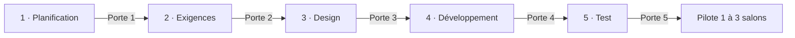
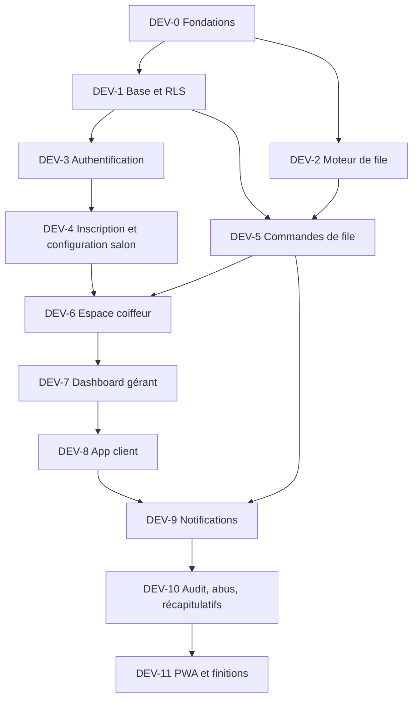

# PLAN D'IMPLÉMENTATION — Zelaté

> version 1.3 · 19/10/2026 · statut : **DEV-0 en cours** (fondations)
> v1.3 : déploiement en deux projets Vercel (`apps/client`, `apps/pro`) conformément à ADR-002 ; abandon du projet multi-services avec Pro sous `/pro` (404 : un service reçoit le chemin d'origine `/pro/…` alors que ses fichiers sont à la racine de sa sortie).
> v1.2 : correction du routage Vercel de `/pro` et `/pro/` vers le fichier d'entrée du service Pro.
> version 1.1 · 19/10/2026 · statut : **DEV-0 en cours** (fondations)
> version 1.0 · 19/10/2026 · statut : **DEV-0 en cours** (fondations)
> v1.0 : Supabase local démarré et vérifié (API, Studio, Mailpit) ; les services publient des ports sur toutes les interfaces réseau, donc usage strictement local et réseau de confiance.
> version 0.9 · 19/10/2026 · statut : **DEV-0 en cours** (fondations)
> v0.9 : démarrage des deux applications vérifié ; Docker Desktop fonctionne, mais le premier démarrage Supabase est bloqué par une limitation temporaire de téléchargement depuis `public.ecr.aws`.
> version 0.8 · 19/10/2026 · statut : **DEV-0 en cours** (fondations)
> v0.8 : monorepo pnpm, configuration partagée, composants UI initiaux, i18n typé et deux applications de démonstration démarrés ; pile Supabase locale initialisée.
> version 0.7 · 19/10/2026 · statut : **phase 2 close** ; prochain lot DEV-0
> v0.7 : questions E32-E39 et K42-K45 closes par leurs propositions (décisions par défaut). Pilote en deux temps : d'abord la boucle de base (rejoindre, appeler, commencer, terminer, recalcul), puis les rendez-vous. Le code démarre sans attendre la fin des maquettes ; règle de travail : un manque se règle par le choix le plus simple, noté dans la PR.
> version 0.6 · 19/10/2026 · statut : phase 2 (Exigences) en attente des réponses d'Ely ; phase 3 commencée en parallèle
> v0.6 : K13 à K27 tranchées ; DES-0 (agent `architect`) et DES-6 (skill `zelate-domain` v0) faits avant la porte 2, DES-1 (Figma) lancé par Koni ; les maquettes des rendez-vous et du consentement et DES-4 attendent les réponses E17 à E31.
> v0.5 : PRD v1.1 (rendez-vous du salon, règles E1 à E16), TRD et schéma v0.3 ; les rendez-vous sont répartis dans les lots existants (moteur, commandes, espace coiffeur, dashboard, app client) ; 9 nouvelles stories (S-17 à S-19, C-11, U-13 à U-17).
> v0.4 : porte 1 franchie le 16/10 ; PLN-3, PLN-4 et PLN-6 poursuivis en parallèle.
> v0.3 : PLN-1 fait le 16/10 (PRD §11) ; DEV-6 devient l'espace coiffeur sur téléphone (tablettes au lot 2, §9) ; fin de journée ajoutée à DEV-5, DEV-7 et DEV-8.
> v0.2 : skills et agents Claude répartis par phase (§2.1) ; dépôt créé dès la phase 2 (REQ-0) ; agent `architect` et première version de `zelate-domain` en phase 3 ; `pwa-release` déplacé en DEV-11 ; ajustement des skills en phase 5 (TST-9).
> Documents liés : [PRD](./PRD.md) · [TRD](./TRD.md) · [APP_FLOW](./APP_FLOW.md) · [DESIGN_SYSTEM](./DESIGN_SYSTEM.md) · [BACKEND_SCHEMA](./BACKEND_SCHEMA.md)

Ce plan dit **dans quel ordre** tout se fait. Il suit cinq phases — **Planification → Exigences → Design → Développement → Test** — fermées chacune par une **porte de validation** : on ne commence pas la phase suivante tant que les critères de la porte ne sont pas remplis. Les durées seront estimées à la fin de la Planification, selon l'équipe disponible.

Correspondance avec la feuille de route de la synthèse : Planification et Exigences = étapes 0 et 1 ; Design = étape 2 ; Développement = étapes 2 (fondations) et 3 ; Test = fin de l'étape 3 et étape 4 (pilote).

---

## 1. Règles de travail pour Claude

1. **Lire avant d'écrire** : au début de chaque lot, relire dans cet ordre le PRD (règles), APP_FLOW (écrans du lot), BACKEND_SCHEMA (tables du lot), TRD (décisions), DESIGN_SYSTEM (composants).
2. **Un lot à la fois**, dans l'ordre de ce plan. Un lot commence quand ses dépendances sont terminées.
3. **Ne rien deviner** : une règle, un écran, une colonne ou une dépendance absents des documents donnent lieu à une question, puis à une mise à jour du document concerné, avant d'être codés.
4. **Documents à jour** : un changement de schéma, de route ou de décision modifie le document dans la même pull request que le code.
5. **Tests d'abord pour le moteur et la base** : le test qui décrit la règle est écrit avant le code qui la satisfait.
6. **Code en anglais**, textes affichés dans le dictionnaire.
7. **Un skill ou un agent arrive juste avant sa première utilisation**, quand son contenu est stable. Un skill renvoie aux sections des documents au lieu de recopier les règles, pour qu'il n'y ait qu'une source.

---

## 2. Vue d'ensemble

| Phase             | Responsable principal             | Livrable de sortie                                                                                     |
| ----------------- | --------------------------------- | ------------------------------------------------------------------------------------------------------ |
| 1 · Planification | Koni, Ely                         | Arbitrages tranchés, comptes ouverts, essais techniques faits                                          |
| 2 · Exigences     | Koni, Ely, Claude                 | Dépôt créé (documents + premier agent), PRD v1.0, user stories Given/When/Then, textes du dictionnaire |
| 3 · Design        | Koni (Figma), Claude              | Design system et maquettes Figma, schéma et ADR figés                                                  |
| 4 · Développement | Claude (agents), Koni (revue)     | MVP complet en préversion                                                                              |
| 5 · Test          | Claude, Koni, Ely, salons pilotes | MVP recetté, prêt pour le pilote                                                                       |

### 2.1 Outillage Claude : skills et agents par phase

Tout vit dans le dépôt, sous `.claude/`. Trois façons de les obtenir :

- **Écrire** (skills propres à Zelaté) : rédigés avec skill-creator, qui vérifie qu'un skill se déclenche sur une demande type et pas sur une demande hors sujet.
- **Configurer** (agents, `CLAUDE.md`, `.claude/settings.json`) : un fichier par agent dans `.claude/agents/`, avec son rôle, ses outils autorisés et son modèle ; permissions et hooks (lint, tests) dans `settings.json`.
- **Importer** (skills publics, en complément) : relus avant ajout, copiés dans le dépôt en version figée, avec un fichier `SOURCE.md` (dépôt d'origine, version, date, règles retenues ou écartées).

| Élément                                                                                                  | Type          | Mode            | Phase et lot | Première utilisation                        |
| -------------------------------------------------------------------------------------------------------- | ------------- | --------------- | ------------ | ------------------------------------------- |
| `CLAUDE.md` (version minimale : règles du §1, liens vers `docs/`)                                        | Configuration | Configurer      | 2 · REQ-0    | REQ-2                                       |
| `product-analyst`                                                                                        | Agent         | Configurer      | 2 · REQ-0    | REQ-2 (user stories)                        |
| `architect`                                                                                              | Agent         | Configurer      | 3 · DES-0    | DES-4 (schéma et ADR)                       |
| `zelate-domain` v0                                                                                       | Skill         | Écrire          | 3 · DES-6    | DES-4, puis tout le développement           |
| `zelate-domain` v1                                                                                       | Skill         | Écrire          | 4 · DEV-0    | DEV-2                                       |
| `feature-workflow`                                                                                       | Skill         | Écrire          | 4 · DEV-0    | Chaque lot à partir de DEV-1                |
| `db-migration-rls`                                                                                       | Skill         | Écrire          | 4 · DEV-0    | DEV-1                                       |
| `supabase-postgres-best-practices` (dépôt `supabase/agent-skills`)                                       | Skill         | Importer        | 4 · DEV-0    | DEV-1, en complément de `db-migration-rls`  |
| `react-best-practices` (dépôt `vercel-labs/agent-skills`), règles côté client seulement : pas de Next.js | Skill         | Importer        | 4 · DEV-0    | DEV-0 (`packages/ui`)                       |
| `frontend-design` (Anthropic)                                                                            | Skill         | Déjà disponible | —            | DEV-0 et écrans                             |
| `queue-engine`                                                                                           | Agent         | Configurer      | 4 · DEV-0    | DEV-2                                       |
| `code-reviewer`                                                                                          | Agent         | Configurer      | 4 · DEV-0    | Chaque pull request                         |
| `security-reviewer` (lecture seule)                                                                      | Agent         | Configurer      | 4 · DEV-0    | DEV-1, DEV-3, puis TST-3                    |
| `qa-e2e`                                                                                                 | Agent         | Configurer      | 4 · DEV-0    | DEV-4, puis TST-1                           |
| `a11y-ecodesign`                                                                                         | Agent         | Configurer      | 4 · DEV-0    | DEV-0 (`packages/ui`), puis DEV-11 et TST-4 |
| `CLAUDE.md` complet, `.claude/settings.json` (permissions, hooks)                                        | Configuration | Configurer      | 4 · DEV-0    | DEV-1                                       |
| `pwa-release`                                                                                            | Skill         | Écrire          | 4 · DEV-11   | Préversion finale de DEV-11, puis TST-8     |
| Tous                                                                                                     | —             | Ajuster         | 5 · TST-9    | Pilote et V1                                |

---

## 3. Phase 1 · Planification

| ID    | Tâche                                                                                                                                                                                                         | Qui                      | Dépend de     | Sortie                                                                   |
| ----- | ------------------------------------------------------------------------------------------------------------------------------------------------------------------------------------------------------------- | ------------------------ | ------------- | ------------------------------------------------------------------------ |
| PLN-1 | Atelier d'arbitrage avec Ely (2 h) : H8, arbitrages 10 à 12, les 10 questions ouvertes du PRD §9                                                                                                              | Koni, Ely                | —             | **Fait le 16/10** : décisions consignées dans le PRD v1.0 (§11)          |
| PLN-2 | Réserver zelate.com et zelate.fr (libres le 16/10) ; vérifier la marque « Zelaté » à l'INPI                                                                                                                   | Koni                     | PLN-1         | Domaines réservés, sous-domaines `zelate.*` et `pro.zelate.*` définis    |
| PLN-3 | Essais techniques du [TRD §14](./TRD.md#14-essais-techniques-à-mener-lot-pln-3) : push iOS/Android, charge temps réel, SMS chez deux fournisseurs, tuiles de carte, Recherche d'entreprises, verrou par salon | Claude, Koni (appareils) | —             | Rapport d'essai par sujet ; statuts 🔬 du TRD remplacés par une décision |
| PLN-4 | Ouvrir les comptes : GitHub (dépôt), Supabase (deux projets UE : staging, production), Vercel, Sentry UE, fournisseur SMS, Brevo                                                                              | Koni                     | PLN-3 (SMS)   | Accès partagés, secrets dans les coffres des services                    |
| PLN-5 | Fixer le budget SMS du pilote (pris en charge par Zelaté, décision du 16/10)                                                                                                                                  | Koni                     | PLN-3         | Plafond de dépense du pilote                                             |
| PLN-6 | Identifier 1 à 3 salons pilotes et leur faire valider le parcours walk-in (sur papier)                                                                                                                        | Koni, Ely                | —             | Salons engagés, dates indicatives                                        |
| PLN-7 | Estimer les durées des phases 2 à 5                                                                                                                                                                           | Koni, Claude             | PLN-1 à PLN-6 | Planning daté                                                            |

**Porte 1 — franchie le 16/10/2026** (décision de Koni) : les règles H1 à H9 sont validées. Trois tâches restent ouvertes et se poursuivent en parallèle de la phase 2 :

- PLN-4 (comptes, dont GitHub) : avant REQ-0 ;
- PLN-3 (essais techniques) : avant DES-4 pour les 🔬 du TRD, et au plus tard avant DEV-5 ;
- PLN-6 (salon pilote) : avant DES-3, qui teste les maquettes avec des gérants et des coiffeurs.

---

## 4. Phase 2 · Exigences

| ID     | Tâche                                                                                                                                                                                 | Qui                              | Dépend de              | Sortie                                                                                                                          |
| ------ | ------------------------------------------------------------------------------------------------------------------------------------------------------------------------------------- | -------------------------------- | ---------------------- | ------------------------------------------------------------------------------------------------------------------------------- |
| REQ-0  | Créer le dépôt GitHub avec seulement `docs/` (les six documents), un `CLAUDE.md` minimal (règles du §1, liens vers les documents) et l'agent `product-analyst` dans `.claude/agents/` | Claude, Koni (accès GitHub)      | PLN-4                  | Dépôt créé ; l'agent produit une story d'essai conforme                                                                         |
| REQ-1  | PRD v1.0 : décisions de l'atelier intégrées, cibles des métriques validées                                                                                                            | Claude, relu par Koni et Ely     | PLN-1                  | **Fait le 16/10** ; relecture par Ely à prévoir                                                                                 |
| REQ-1b | PRD v1.1 : rendez-vous du salon (H10, R1 à R7), questions E1 à E16 et K1 à K12 tranchées ; TRD, schéma et parcours alignés                                                            | Claude, réponses d'Ely et Koni   | REQ-2 (première passe) | **Fait le 18/10**                                                                                                               |
| REQ-2  | User stories au format Given / When / Then, une par ID du PRD §5.3 (S, C, U, P), avec cas d'erreur                                                                                    | Agent `product-analyst`          | REQ-0, REQ-1, REQ-1b   | `docs/stories/*.md`, une par story (50 au total après la v1.1)                                                                  |
| REQ-3  | Textes du dictionnaire en français : écrans, SMS (≤ 160 caractères), push, e-mails, erreurs                                                                                           | Claude, relu par Ely             | REQ-2                  | `packages/i18n/src/fr/*.json` en brouillon — **brouillon fait le 18/10** (860 textes), relecture dans `packages/i18n/REVIEW.md` |
| REQ-4  | Textes juridiques : CGU, politique de confidentialité, mentions légales                                                                                                               | Koni (avec un conseil juridique) | REQ-1                  | `legal.json`                                                                                                                    |
| REQ-5  | Registre des traitements et contrats de sous-traitance (Supabase, SMS, e-mail, Sentry)                                                                                                | Koni                             | PLN-4                  | Registre à jour                                                                                                                 |

**Porte 2** : chaque story « I » a ses critères Given / When / Then ; les SMS tiennent en 160 caractères ; Ely a validé les textes des notifications.

---

## 5. Phase 3 · Design

| ID    | Tâche                                                                                                                                                                                          | Qui                         | Dépend de    | Sortie                                                                                                                          |
| ----- | ---------------------------------------------------------------------------------------------------------------------------------------------------------------------------------------------- | --------------------------- | ------------ | ------------------------------------------------------------------------------------------------------------------------------- |
| DES-0 | Configurer l'agent `architect` (lecture des documents, écriture limitée à `docs/` et `docs/adr/`)                                                                                              | Claude                      | Porte 2      | `.claude/agents/architect.md` — **fait le 19/10**, avancé avant la porte 2 avec l'accord de Koni                                |
| DES-1 | Reprendre le [DESIGN_SYSTEM](./DESIGN_SYSTEM.md) dans Figma : variables, styles de texte, composants ; valider ou corriger les valeurs 🟡                                                      | Koni                        | Porte 2      | Bibliothèque Figma ; DESIGN_SYSTEM mis à jour                                                                                   |
| DES-2 | Maquettes des écrans du MVP, un cadre par route et par état important d'[APP_FLOW](./APP_FLOW.md) (en commençant par les écrans absents du prototype)                                          | Koni, Claude (propositions) | DES-1        | Maquettes Figma                                                                                                                 |
| DES-3 | Test des maquettes avec 2 gérants, 2 coiffeurs et 5 clients (parcours walk-in, appel, rejoindre la file, rendez-vous saisi puis client qui se signale)                                         | Koni, Ely                   | DES-2        | Corrections intégrées                                                                                                           |
| DES-4 | Figer le [BACKEND_SCHEMA](./BACKEND_SCHEMA.md) et les ADR du TRD (fichiers `docs/adr/`) ; revue par l'agent `architect`                                                                        | Claude                      | DES-0, DES-6 | Schéma v1.0, ADR en statut « accepté »                                                                                          |
| DES-5 | Logo, icônes des deux apps, illustrations des états vides                                                                                                                                      | Koni                        | DES-1        | Fichiers SVG et PNG                                                                                                             |
| DES-6 | Écrire la v0 du skill `zelate-domain` : glossaire, cycle de vie du ticket, règles H1 à H10 validées, rendez-vous, décisions d'Ely, sous forme de renvois aux sections du PRD (§5.1, §5.2, §11) | Claude, relu par Koni       | Porte 2      | `.claude/skills/zelate-domain/SKILL.md` v0 — **écrit le 19/10**, à relire par Koni, à mettre à jour avec les réponses E17 à E31 |

**Porte 3** : chaque route d'APP_FLOW a sa maquette ; le schéma est en v1.0 ; aucune valeur 🟡 ne reste dans le design system pour les composants du MVP ; `zelate-domain` v0 est relu et ne contredit aucun document.

---

## 6. Phase 4 · Développement

L'ordre suit la boucle métier : **sans salon configuré, pas de coiffeur ; sans coiffeur disponible, pas de file côté client.** Le moteur de file est construit tôt et seul, car tout en dépend.

### DEV-0 · Fondations

**Dépend de** : Porte 3.

- Monorepo pnpm selon [TRD §4](./TRD.md#4-structure-du-dépôt) ; import du prototype Figma Make dans une branche de référence (lecture seule).
- `packages/config` (TypeScript strict, ESLint avec `i18next/no-literal-string` et `jsx-a11y`, Prettier), Husky, lint-staged, commitlint.
- `packages/ui` : `theme.css` du design system, polices auto-hébergées, composants de base (Button, IconButton, TextField, Dialog, Banner, Toast, Skeleton) avec tests.
- `packages/i18n` : configuration i18next, types des clés, dictionnaire de REQ-3.
- Deux apps vides (`client`, `pro`) avec routeur, TanStack Query, `lang="fr"`, page d'accueil de démonstration.
- Supabase local (`supabase init`), CI GitHub Actions complète ([TRD §10.3](./TRD.md#103-intégration-continue)), préversions Vercel, Sentry.
- Outillage Claude (voir §2.1) :
  - `CLAUDE.md` complet : structure du dépôt, commandes (`pnpm dev`, `pnpm test`, `supabase test db`), conventions, ordre de lecture des documents ;
  - `.claude/settings.json` : permissions, hooks qui lancent lint et tests avant de rendre la main ;
  - skills à écrire : `zelate-domain` v1, `feature-workflow`, `db-migration-rls` ;
  - skills à importer, relus et figés avec leur `SOURCE.md` : `supabase-postgres-best-practices`, `react-best-practices` (règles côté client seulement) ;
  - agents à configurer : `queue-engine`, `code-reviewer`, `security-reviewer` (lecture seule), `qa-e2e`, `a11y-ecodesign`.
- Fichiers `docs/adr/001` à `019`.

**Fini quand** : la CI passe au vert sur une pull request d'exemple, avec une préversion déployée des deux apps ; chaque skill écrit se déclenche sur une demande type et pas sur une demande hors sujet (test skill-creator) ; `code-reviewer` a relu la pull request d'exemple.

### DEV-1 · Base de données et RLS

**Dépend de** : DEV-0.

- Migrations dans l'ordre du [BACKEND_SCHEMA §12](./BACKEND_SCHEMA.md#12-ordre-des-migrations-lot-dev-1).
- Tests pgTAP : contraintes, journal en ajout seul, **isolation entre salons** pour chaque table, vues publiques sans colonnes sensibles.
- `seed.sql` ; génération des types (`packages/db-types`).

**Fini quand** : `supabase test db` passe ; un test prouve qu'un gérant du salon A ne lit rien du salon B.

### DEV-2 · Moteur de file (`packages/queue-engine`)

**Dépend de** : DEV-0 (peut avancer en parallèle de DEV-1). **Agent** : `queue-engine`.

- Types d'état (salon, coiffeurs, présences, tickets) et de commande, indépendants de la base.
- Fonctions pures : `computeSchedule` (heures de passage, H2, rendez-vous à heure fixe et trous, H10), `pickNextTicket` et `estimateStylist` (règles de distribution 1 à 8 du PRD §5.2), `findNextFreeSlots` (prochain créneau libre par prestation, marge en paramètre), `applyCommand` (transitions et règles H4, H5, H8), `detectTimeTriggers` (T-30, T-10, rappel à 5 min, libération à `release_due_at`, retard sur rendez-vous, fin des demandes de réaffectation, fenêtre de fin de journée, fermeture, annulation 15 min après), `diffNotifications` (quelles notifications produire).
- Tests : chaque règle du PRD §5.2, chaque transition du cycle de vie, cas limites (pause, débordement de prestation, coiffeur absent, gérant qui coiffe, changement d'heure), tests par propriétés des invariants (un client ne recule jamais par réaffectation ; une seule alerte de fin de journée par ticket ; jamais plus de 2 places de recul ; un seul ticket appelé par coiffeur ; aucun rendez-vous retardé par un client de dernière minute ; un créneau libre annoncé tient toujours la durée de la prestation).

**Fini quand** : couverture ≥ 95 % ; chaque règle H1 à H10 a au moins un test nommé d'après elle.

### DEV-3 · Authentification

**Dépend de** : DEV-1.

- Client : code SMS (Supabase Auth + Edge Function `auth-send-sms`), plafonds par numéro et par IP, composants `PhoneField` et `OtpField`, route `/signin`, création du profil invité.
- Gérant : e-mail + mot de passe et lien magique, route `/signin` de l'app Pro.
- Admin : table `platform_admins`, MFA, garde de route `/admin`.
- Stories : U-03, une partie de P-03.

**Fini quand** : test de bout en bout « un client reçoit un code (fournisseur en mode test) et se connecte » ; tests de plafond.

### DEV-4 · Inscription et configuration du salon

**Dépend de** : DEV-3.

- `/signup` (F-M1) avec brouillon, `AddressField` (Géoplateforme), `verify-siret`, `salon-signup`.
- Admin : `/admin/salons` et `admin-decide-salon` (F-A1).
- `/dashboard/setup` (F-M2) : horaires, fermetures, prestations, équipe (`invite-member`), QR et PDF (`regenerate-qr`).
- Activation coiffeur `/invite/:token` (F-S1) : `activate-invitation`, compte personnel et lien magique.
- Stories : S-01 à S-06, C-01, P-01.

**Fini quand** : un gérant inscrit son salon, l'admin le valide, le gérant le configure et invite un coiffeur qui active son compte — en un seul test Playwright.

### DEV-5 · Commandes de file côté serveur

**Dépend de** : DEV-1, DEV-2.

- Edge Function `queue-command` : validation zod, résolution du contexte (client, jeton, gérant, appareil + session), verrou par salon, idempotence, appel du moteur, écritures, événements, outbox, diffusion Broadcast.
- Commandes des rendez-vous : `create_appointment`, `update_appointment`, `cancel_appointment`, `check_in_appointment`, `confirm_appointment` ; réaffectation avec demande au client (`respond_reassignment`).
- Edge Function `queue-tick` et tâche pg_cron : T-30, T-10, rappel à 5 min, libération à `release_due_at`, alertes de retard sur rendez-vous, fin des demandes de réaffectation, alertes de fin de journée, annulation 15 min après la fermeture, `next_free_slots`.
- Distribution au moment de l'appel (ADR-015) : coiffeur pressenti pour l'estimation, attribution à l'appel.
- RPC de lecture `get_stylist_queue`, `get_salon_board` (gérant seulement), `my_active_ticket`, `preview_presence_change`.
- Canaux temps réel publics `salon-public` et `ticket-token` (ADR-018) ; lien court `/t/:shortCode`.
- Fournisseur de notifications « journal » en local (les notifications sont écrites, pas envoyées).

**Fini quand** : chaque commande du [TRD §6.2](./TRD.md#62-commandes-de-queue-command) a un test ; deux `call_ticket` simultanés donnent un succès et un `invalid_transition` ; rejouer un `command_id` renvoie la même réponse.

### DEV-6 · Espace coiffeur (téléphone)

**Dépend de** : DEV-4, DEV-5.

- Connexion du coiffeur par lien magique (F-S2), session de 30 jours, déconnexion à distance (`revoke-member-sessions`, F-M4).
- Statut (F-S3), ma file (F-S4), appel avec compteur de 10 min et arrivée par le code du ticket (F-S5, `CodeField`), commencer (F-S6), prestation en cours avec +5 / +15 / +30 / +45 (F-S7), client en retard (F-S8), bilan (F-S9), mes rendez-vous (F-S10).
- Gabarit téléphone d'abord, barre d'action en bas ; `ConnectionBanner` et blocage des actions hors ligne ; repli de lecture toutes les 10 s.
- Aucune donnée client sur l'appareil : cache en mémoire seulement, pas de persistance locale, réponses d'API exclues du service worker.
- Stories : C-01 à C-09, C-11, S-16 (avec `deactivate-member`).

**Fini quand** : test multi-rôles « le gérant crée un ticket test, le coiffeur l'appelle depuis un téléphone, saisit le code, commence, ajuste, termine » ; un test vérifie qu'après déconnexion aucune donnée client ne reste dans le stockage du navigateur ; S-07 (test et publication) fonctionne.

### DEV-7 · Dashboard gérant

**Dépend de** : DEV-6.

- Ouvrir / pause / fermer (F-M5), vue temps réel avec interrupteur « Je coiffe » (F-M6), walk-in (F-M7), absence et retard d'un coiffeur avec aperçu de l'impact (F-M8), retrait (F-M9), réaffectation (F-M10), pages de configuration (F-M11), publication (F-M3), fin de journée (F-M12), rendez-vous du jour (F-M13).
- Stories : S-02, S-07 à S-13, S-15, S-18, S-19.

**Fini quand** : un walk-in inscrit en moins de 10 s (mesuré par le test) apparaît dans l'espace coiffeur en moins de 2 s.

### DEV-8 · App client

**Dépend de** : DEV-7.

- Accueil liste + carte (F-C1, `search_salons`, MapLibre chargé à la demande), fiche salon (F-C2), rejoindre la file (F-C3), entrée QR (F-C4), suivi (F-C5), réponse T-30 (F-C6), arrivée (F-C7), annulation (F-C8), lien SMS `/t/:shortCode` (F-C10), compte (F-C11), se signaler pour un rendez-vous (F-C12), rendez-vous saisi par le salon (F-C13), alerte de fin de journée, choix de coiffeur et réaffectation (bandeaux de F-C5), prochain créneau libre (F-C1, F-C2).
- Stories : U-01, U-02, U-04 à U-08, U-10 à U-17.

**Fini quand** : test multi-rôles complet « client rejoint par l'app → le coiffeur appelle → le client voit "C'est votre tour" → arrivée → prestation → fin », et la même chose par QR sans compte préalable ; un rendez-vous saisi par le gérant n'est jamais retardé par un client de dernière minute placé avant lui.

### DEV-9 · Notifications

**Dépend de** : DEV-5, DEV-8.

- Service worker des deux apps (push, clic sur notification, actions T-30).
- `push-subscribe`, clés VAPID, `/install` et guide iPhone (F-C9).
- `send-notifications` : push, SMS par le fournisseur retenu, e-mails Brevo ; plafond de 3 SMS ; nouvel essai ; suppression des abonnements expirés.
- Tests des modèles : 160 caractères, variables présentes.
- Stories : U-09, politique de notifications du PRD §5.4.

**Fini quand** : sur appareils réels (iPhone avec PWA installée, Android), « votre tour » arrive en moins de 5 s ; sans push, le SMS part ; le 4e SMS d'un ticket est `skipped`.

### DEV-10 · Audit, abus et récapitulatifs

**Dépend de** : DEV-9.

- `/dashboard/audit` et `/admin/audit` (`get_audit_log`), journalisation des lectures admin.
- Plafonds de P-03 : avertissement à la 5e absence en 30 jours (`private.no_show_records`), limites de création de tickets.
- Récapitulatif de fin de journée (S-14, `salon-daily-summary`) et bilan coiffeur (C-10).
- Tâche `daily-maintenance`.
- Stories : P-02, P-03, S-14, S-17, C-10.

### DEV-11 · PWA et finitions

**Dépend de** : DEV-10.

- Manifestes et icônes des deux apps, invite d'installation, mise à jour de version (toast).
- Budgets de poids (RGESN), images optimisées, chargement paresseux par route.
- Mesure d'audience sans cookie.
- Passe d'accessibilité complète par l'agent `a11y-ecodesign`.
- Écrire le skill `pwa-release` à partir de ce qui a été construit en DEV-9 et DEV-11 : manifestes, service worker, icônes, Lighthouse, notifications, variables d'environnement, migration de la base, vérifications après déploiement.

**Fini quand** : Lighthouse PWA et performance ≥ 90 sur l'accueil client, la fiche salon et l'espace coiffeur ; aucune violation axe sérieuse ou critique ; la préversion finale a été déployée en suivant `pwa-release`.

**Porte 4** : toutes les stories « I » sont terminées selon la Definition of Done (§8) et déployées en préversion.

---

## 7. Phase 5 · Test

| ID    | Tâche                                                                                                                                                                                               | Qui                          | Sortie                               |
| ----- | --------------------------------------------------------------------------------------------------------------------------------------------------------------------------------------------------- | ---------------------------- | ------------------------------------ |
| TST-1 | Suite de bout en bout multi-rôles complète sur la préversion (chaque story « I »)                                                                                                                   | Agent `qa-e2e`               | Rapport Playwright vert              |
| TST-2 | Test de charge : 3 salons × 5 coiffeurs × 100 tickets, 50 clients connectés                                                                                                                         | Claude                       | p95 < 2 s, aucune incohérence        |
| TST-3 | Revue de sécurité : OWASP ASVS niveau 2, tentatives d'accès entre salons, jetons, plafonds SMS, en-têtes                                                                                            | Agent `security-reviewer`    | Aucun point critique ou élevé ouvert |
| TST-4 | Audit d'accessibilité manuel RGAA (lecteur d'écran VoiceOver et NVDA, clavier, zoom 200 %)                                                                                                          | Agent `a11y-ecodesign`, Koni | Aucune non-conformité bloquante      |
| TST-5 | Matrice d'appareils : iPhone (Safari, PWA) et Android (Chrome, PWA) pour les clients et les coiffeurs, dont les téléphones réels des coiffeurs pilotes ; ordinateur (Chrome, Edge, Safari, Firefox) | Koni                         | Grille remplie                       |
| TST-6 | Recette fonctionnelle avec Ely, story par story                                                                                                                                                     | Ely, Koni                    | Procès-verbal de recette             |
| TST-7 | Répétition générale dans un salon pilote, hors heures d'ouverture (téléphones des coiffeurs et des clients)                                                                                         | Koni, Ely, salon             | Corrections listées et faites        |
| TST-8 | Préparation du pilote : production déployée en suivant `pwa-release`, comptes des salons pilotes, QR imprimés, tableau de suivi des métriques du PRD §8                                             | Koni, Claude                 | Check-list de lancement              |
| TST-9 | Ajuster les skills et les agents à partir des erreurs constatées en phases 4 et 5 (règle mal appliquée, vérification oubliée, faux positifs de revue)                                               | Claude, relu par Koni        | Skills et agents mis à jour          |

**Porte 5** : TST-1 à TST-7 sans point bloquant ; la mesure de l'indicateur principal fonctionne en production. Le pilote peut démarrer.

---

## 8. Definition of Done

Une story ou une tâche est terminée quand :

- [ ] Elle est liée à son ID (S, C, U, P) et à la section des cahiers qu'elle couvre.
- [ ] Ses critères Given / When / Then passent en test automatisé (unitaire, pgTAP ou Playwright selon le cas).
- [ ] Le moteur et la base ont leurs tests ; toute nouvelle table a ses politiques RLS et leurs tests.
- [ ] Revue de code indépendante (`code-reviewer`) ; revue sécurité si elle touche l'authentification, les données personnelles ou les jetons.
- [ ] Aucun texte en dur ; clés du dictionnaire ajoutées ; SMS ≤ 160 caractères.
- [ ] Aucune violation axe sérieuse ; cibles ≥ 44 px ; clavier complet.
- [ ] Déployée en préversion et vérifiée sur smartphone et ordinateur.
- [ ] Événements de mesure en place si elle porte une métrique du PRD.
- [ ] Documents mis à jour si un schéma, une route ou une décision a changé.

---

## 9. Après le pilote

**Lot 2 · tablettes partagées** : location de petites tablettes (financement Innov'Up), appairage par le gérant et déverrouillage par PIN, selon l'annexe A du TRD et du schéma. Le moteur et les commandes ne changent pas.

Bilan à 4 semaines sur les métriques du PRD §8, calibrage des durées de prestation à partir des durées réelles, puis cadrage de la V1 (créneau payant 2 € avec confirmation par le gérant, heures creuses manuelles, avis, import CSV) selon le même cycle Planification → Exigences → Design → Développement → Test.
